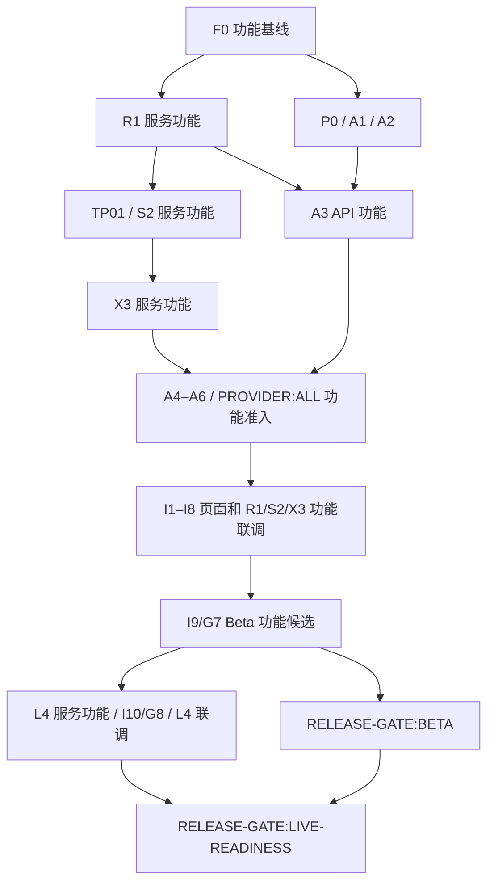

> 当前确认收口（G0 / PROVIDER:ALL，2026-10-20）：项目用户确认迁移后完整稿，1652工程输入与冻结4fdc67b4一致；G0_LEGACY_SCOPE_LOCAL与ALL_LEGACY_REVIEW_LOCAL DEVELOPMENT READY。8实际入口exit0，176项确认/门禁/计划直接回归PASS；不重跑原16组/134 API或全闭包，原执行原件/失败/拒绝记录保持。仅功能阶段准入，formalAccepted=false、runtime DENIED，完整联调/发布NOT_RUN。见[报告](./audit/G0-PROVIDER-ALL-confirmation-closure-2026-10-20.md)和[本会话确认](./audit/evidence/g0-legacy-confirmation-20261020/user-confirmation.json)。下一可执行FE:UI-103 / I1当前功能复核。

> 历史工程结果（G0确认收口与legacy迁移，2026-10-20）：原G0在f7141e4b按e4434952原稿确认收口READY；迁移冻结4fdc67b4，1652输入、16组/8入口，Node323、consumer177/3 skipped、Web/mockOIDC11例。四类生产backend/旧构造器移除，L10-2 IMPLEMENTED_ENGINEERING；当前G0/ALL工程PASS，BLOCKED只剩新功能输入确认，原批准不改绑。完整联调/发布NOT_RUN、runtime DENIED。见[报告](./audit/G0-legacy-backend-review-2026-10-20.md)与[迁移后完整稿](./audit/evidence/g0-legacy-local-20261020/confirmation-draft.md)。

> 当前工程结果（G0与8项台账，2026-10-20）：冻结e4434952，1601输入、16组/8入口，Node346、consumer117、Web/mockOIDC11例及单次构建通过；8项IMPLEMENTED_ENGINEERING，其他11项保持。G0工程PASS/BLOCKED待新稿确认；ALL工程PASS/BLOCKED另含L10-2 legacy移除未完成。原ALL确认只绑定a045f15c/fce29312，不自批G0；原API证据不重跑不改绑。完整联调/发布NOT_RUN、runtime DENIED。见[报告](./audit/G0-current-functional-review-2026-10-20.md)和[完整稿](./audit/evidence/g0-local-20261020/confirmation-draft.md)。

> 当前工程结果（FE:BFF-FE-002/A6，2026-10-20）：冻结116d076e，1247输入、16组/5入口PASS；Rust47、Node249、consumer/契约46，两C02 API/42条当前HTTP及基本Chromium，34限定控制点。四源受权读取、null/陈旧/缺失、排序截断与最早期限、只读权限和有界流恢复完成。54,468原audit/gate保持，三轮FAIL、第四轮替代与预检失败保留。仅BFF002_SCOPE_LOCAL DEVELOPMENT READY，新稿PENDING；完整UI/联调/发布NOT_RUN、runtime DENIED。见[报告](./audit/BFF-FE-002-functional-review-2026-10-20.md)与[完整稿](./audit/evidence/bff-fe-002-local-20261020/confirmation-draft.md)。下一可执行FE:BFF-FE-011/A6。

> 用户确认（PROVIDER:A5，2026-10-20）：原稿CONFIRMED，仅5fb5b6aa/8a0ce81b原1169输入。共享输入变更后独立当前Gate NOT_ASSESSED，原稿与回执保持。见[记录](./audit/evidence/provider-a5-confirmation-20261020/summary.md)。

> 历史工程结果（PROVIDER:A5，2026-10-20）：冻结5fb5b6aa，1169输入、17组/8入口PASS；Rust84、Node218、consumer/契约49，58API/637条当前HTTP与三个基本Chromium，26限定控制点。旧凭据不随observer续期及共享quarantine跨域拒绝通过。54,386份原audit/gate保持，沙箱FAIL/预检失败保留；仅A5_SCOPE_LOCAL DEVELOPMENT READY，四前置只引用原确认，新汇总稿PENDING，完整联调/发布NOT_RUN、runtime DENIED。见[报告](./audit/PROVIDER-A5-functional-review-2026-10-20.md)与[完整稿](./audit/evidence/provider-a5-local-20261020/confirmation-draft.md)。下一可执行FE:BFF-FE-002/A6。

> 用户确认（FE:BFF-FE-010，2026-10-20）：原完整稿CONFIRMED，仅3152db47/4ed64603原1146输入。共享输入变化后独立当前Gate NOT_ASSESSED；原稿/回执保持。见[记录](./audit/evidence/bff-fe-010-confirmation-20261020/summary.md)。

> 历史前端API结果（FE:BFF-FE-010/A5，2026-10-20）：冻结3152db47，1146输入、18组/7入口PASS，43项C11/C16 API；仅BFF010_SCOPE_LOCAL DEVELOPMENT READY，七前置referenceOnly，完整联调/发布NOT_RUN、runtime DENIED、新稿PENDING。见[报告](./audit/BFF-FE-010-functional-review-2026-10-20.md)。

> 当前前端API结果（FE:BFF-FE-008/A5，2026-10-20）：冻结b20efc30，1109输入、15组/6入口PASS，八项C14 API；仅BFF008_SCOPE_LOCAL DEVELOPMENT READY，五前置referenceOnly，完整联调/发布NOT_RUN、runtime DENIED、新稿PENDING。见[报告](./audit/BFF-FE-008-functional-review-2026-10-20.md)。

> 当前前端API结果（FE:BFF-FE-009/A5，2026-10-20）：冻结007040fd，1082输入、15组/5入口通过，七项C15 API；仅BFF009_SCOPE_LOCAL DEVELOPMENT READY。五前置referenceOnly，A4原确认只限原范围；完整联调/发布NOT_RUN、runtime DENIED、新稿PENDING。见[报告](./audit/BFF-FE-009-functional-review-2026-10-20.md)。

> 当前前端provider结果（PROVIDER:A4，2026-10-20）：冻结1297bc3b，1053输入、16组与7入口通过，32项API；仅A4_SCOPE_LOCAL DEVELOPMENT READY。三个原确认限原源码/稿/回执，独立当前Gate不重授；完整联调/发布NOT_RUN，runtime DENIED，用户确认PENDING。见[报告](./audit/PROVIDER-A4-functional-review-2026-10-20.md)。

> 工作流调整（2026-10-18）：11个非main本地分支已完整快进整合并安全删除，后续直接在main开发，见根目录AGENTS.md。合并后代码树与12a11c72完全一致；AGENTS.md属于A5输入，当前PROVIDER:A5阶段门禁撤回NOT_ASSESSED，原范围确认CONFIRMED及原技术证据保持不变，不改绑到新提交。本次只验证Git整合及文档/计划一致性，不重跑无关业务闭包。见[整合记录](./audit/evidence/main-consolidation-20261018/README.md)。

> 用户确认（PROVIDER:A5，2026-10-18）：项目用户已确认完整稿，确认门禁CONFIRMED；仅绑定原DEVELOPMENT功能汇总源码a036f73baaae984386e43b5eec0294fdfe44c031与原回执提交e41e65fda773c85d4e9734e0111eff9eb6188d8e。本阶段评审ACCEPTED，formalAccepted=false、runtimeAdmission=DENIED，完整联调/发布仍NOT_RUN；原稿及技术回执保持原字节。见[原始确认](./audit/evidence/provider-a5-confirmation-20261018/user-confirmation.json)与[确认门禁](./audit/evidence/provider-a5-confirmation-20261018/gate.json)。本次未启动A6。

> 历史工程结果（PROVIDER:A5，2026-10-18）：冻结a036f73b，1087输入/17组当前汇总与直接影响、8实际入口PASS；Rust72、Node196、consumer/契约47，58操作/584条当前HTTP和三个基本Chromium通过，24限定控制PASS。同一Shadow provider验证账本/冻结报表、独立告警来源、三域同键并发与丢回复恢复/唯一F05根、撤权和过期拒绝。仅A5_SCOPE_LOCAL DEVELOPMENT READY；009/008/010及A4原确认CONFIRMED并保持原SHA，四前置不重授READY，BFF010独立当前撤回。53,577原audit/gate文件保持；完整联调/发布NOT_RUN、runtimeAdmission=DENIED，本汇总原范围确认CONFIRMED。见[报告](./audit/PROVIDER-A5-functional-review-2026-10-18.md)与[完整稿](./audit/evidence/provider-a5-local-20261018/confirmation-draft.md)。下一可执行FE:BFF-FE-002/A6。

> 历史工程结果（FE:BFF-FE-010/A5，2026-10-18）：冻结5d41b7fb，1058输入/18组当前功能与直接影响、6实际入口PASS；Rust48、Node172、consumer/契约44，43个C11/C16操作/287条HTTP与基本Chromium通过，24限定控制PASS。真实X06/F09、五类治理、签名Engine能力准入、incident职责分离、ack/unack、幂等F05/游标/SSE完成。仅BFF010_SCOPE_LOCAL DEVELOPMENT READY；BFF008原稿本次CONFIRMED，A4/BFF009原确认保持原SHA，七前置不重授READY，BFF008独立当前撤回。53,439原audit/gate文件保持；完整联调/发布NOT_RUN、runtimeAdmission=DENIED，本任务确认PENDING。见[报告](./audit/BFF-FE-010-functional-review-2026-10-18.md)与[完整稿](./audit/evidence/bff-fe-010-local-20261018/confirmation-draft.md)。下一可执行PROVIDER:A5当前功能汇总。

> 历史工程结果（FE:BFF-FE-008/A5，2026-10-18）：冻结d926c246，1015输入/15组当前功能与直接影响、5实际入口PASS；Rust52、Node159、consumer/契约44，八C14操作/146条HTTP与基本Chromium通过，24限定控制点PASS。X01/C15版本绑定、provisional、immutable报告/原键恢复/过期下载拒绝完成。仅BFF008_SCOPE_LOCAL DEVELOPMENT READY；A4与BFF009原确认保留原SHA，五前置不重授READY，BFF009独立当前撤回。53,344原audit/gate文件保持；完整联调/发布NOT_RUN、runtimeAdmission=DENIED，本任务确认PENDING。见[报告](./audit/BFF-FE-008-functional-review-2026-10-18.md)与[完整稿](./audit/evidence/bff-fe-008-local-20261018/confirmation-draft.md)。下一可执行FE:BFF-FE-010 / A5。

> 历史工程结果（FE:BFF-FE-009/A5，2026-10-18）：冻结15d1fd65，989输入/15组当前功能与直接影响、5个实际入口PASS；Rust61、Node145、consumer/契约44，C15七操作/147条当前HTTP和基本Chromium通过，24控制点PASS。只读账本/真实X05闭环事实、受控幂等重跑、day绑定/关闭证明及撤权恢复完成。仅BFF009_SCOPE_LOCAL DEVELOPMENT READY；A4原确认CONFIRMED且保留c9deac5b/5bab5659范围，五前置不重授READY。53,247历史文件保持，探索失败保留；完整联调/发布NOT_RUN、runtimeAdmission=DENIED，本任务用户确认PENDING。见[报告](./audit/BFF-FE-009-functional-review-2026-10-18.md)与[完整稿](./audit/evidence/bff-fe-009-local-20261018/confirmation-draft.md)。下一可执行FE:BFF-FE-008 / A5。

> 历史工程结果（PROVIDER:A4，2026-10-18）：冻结c9deac5b，953输入/16组当前汇总与直接影响、7个实际入口PASS；Rust69、Node180、consumer/契约53，32操作/2153条当前HTTP和两个基本Chromium通过。修复公共审批隔离/最小权限与撤权游标，24控制点PASS。仅A4_SCOPE_LOCAL DEVELOPMENT READY；FE006/FE004/A3原确认CONFIRMED但独立当前Gate不重授。53,148个原audit/gate文件保持，失败/中断保留；完整联调/发布NOT_RUN、runtimeAdmission=DENIED，本汇总用户确认PENDING。见[报告](./audit/PROVIDER-A4-functional-review-2026-10-18.md)与[完整稿](./audit/evidence/provider-a4-local-20261018/confirmation-draft.md)。下一可执行FE:BFF-FE-009 / A5。

> 历史工程结果（PROVIDER:A3，2026-10-18）：冻结4580bac1，837输入/18组当前汇总与直接边界、7个激活入口PASS；Node265、Rust74、consumer/契约68，16操作/93条实际HTTP和基本Chromium通过。仅A3_SCOPE_LOCAL DEVELOPMENT READY，24控制点PASS，三原确认CONFIRMED且保持原SHA；BFF005独立READY因共享变化撤回，三直接前置不重授。52830个原audit/gate文件未改，完整联调/发布NOT_RUN、runtimeAdmission=DENIED，本汇总用户确认PENDING。见[报告](./audit/PROVIDER-A3-functional-review-2026-10-18.md)。下一可执行FE:BFF-FE-006 / A4。
> 历史工程结果（FE:BFF-FE-005/A3，2026-10-18）：冻结e171fb7c，814输入/18组当前功能与直接边界、5个激活入口PASS；Node229、Rust52、consumer/契约57，7操作/50条实际HTTP及基本Chromium通过。仅BFF005_SCOPE_LOCAL DEVELOPMENT READY，24项限定控制点PASS；BFF003原稿确认CONFIRMED/独立Gate因共享变化撤回，A2原确认保持原SHA。52,760个历史文件未改；五前置不重授READY，完整联调/发布NOT_RUN、runtimeAdmission=DENIED，本轮用户确认PENDING。见[报告](./audit/BFF-FE-005-functional-review-2026-10-18.md)。下一可执行PROVIDER:A3当前功能汇总。
> 历史工程结果（FE:BFF-FE-003/A3，2026-10-18）：冻结aeab72a5，911输入/19组当前功能与直接边界、4项激活入口PASS；Node237、Rust63、consumer/契约60，9操作/43条真实HTTP（逐项401/403）及26项限定控制点PASS。仅BFF003_SCOPE_LOCAL任务DEVELOPMENT READY；A2原确认CONFIRMED并保持3f0c9bd5/013c20e8范围，本任务确认PENDING。52,654个历史文件未改；九前置不重授READY，完整联调/发布NOT_RUN、runtimeAdmission=DENIED。见[当前报告](./audit/BFF-FE-003-functional-review-2026-10-18.md)。下一可执行FE:BFF-FE-005 / A3当前功能复核。

> 历史工程结果（PROVIDER:A2，2026-10-18）：冻结3f0c9bd5，781输入/16组当前功能与直接边界、5项激活入口PASS；Node223、Rust35、consumer/契约82，26操作/55条真实HTTP及26项限定控制点PASS。仅A2_SCOPE_LOCAL汇总DEVELOPMENT READY；BFF-FE-001/007原用户确认CONFIRMED且保持各自源码/范围，本汇总确认PENDING。52,575个历史文件未改，两轮失败保留；各API/F05/A1独立Gate不重授READY，完整联调/发布NOT_RUN、runtimeAdmission=DENIED。见[当前报告](./audit/PROVIDER-A2-functional-review-2026-10-18.md)。下一可执行FE:BFF-FE-003 / A3当前功能复核。

> 历史工程结果（FE:BFF-FE-007/A2，2026-10-18）：冻结7d0fc366，760输入/17组当前功能与直接边界、4项激活入口PASS；Node172、Rust35、消费者/契约42、6操作/34条真实HTTP（12项401/403）、8类真实变异及28项限定控制点PASS。仅A2_AUDIT_LOCAL任务DEVELOPMENT READY；原BFF-FE-001用户确认CONFIRMED且仍绑定85530021/4f261e67，本任务确认PENDING。52,482个历史文件未改，首轮工具FAIL保留；F05/A1/身份独立Gate不重授READY，完整联调/发布NOT_RUN、runtimeAdmission=DENIED。见[当前报告](./audit/BFF-FE-007-functional-review-2026-10-18.md)。下一可执行PROVIDER:A2当前功能汇总复核。

> 历史范围（2026-10-18）：FE:BFF-FE-007/A2 Audit与导出API当前功能复核，仅C10六操作与F05/A1/身份直接边界。BFF-FE-001原85530021/4f261e67完整确认稿已获项目用户确认并通过门禁，见[原始确认](./audit/evidence/bff-fe-001-confirmation-20261018/user-confirmation.json)；确认不放行新HEAD/完整联调/发布。共享C10输入变化后BFF-FE-001独立READY撤回，原范围证据和确认保留。见[当前规程](./operations/bff-fe-007-functional-admission.md)。

> 历史工程结果（FE:BFF-FE-001 / A2，2026-10-18）：冻结85530021，727个功能输入、14组当前功能/直接边界及3项激活入口PASS；Node167、Rust34、消费者/契约128、9类真实源码变异拒绝，20操作/21条HTTP与24项限定控制点PASS。仅A2_IDENTITY_LOCAL任务DEVELOPMENT READY，A1/F06/PROVIDER:A2/G1/FEP-1不重授READY；完整联调/发布NOT_RUN、用户确认PENDING、runtimeAdmission=DENIED。保留首轮工具FAIL与52,392个历史文件。见[当前报告](./audit/BFF-FE-001-functional-review-2026-10-18.md)。下一可执行FE:BFF-FE-007当前功能复核。

> 当前前端功能复核（2026-10-18）：FE:BFF-FE-001/A2仅消费CORE:F06身份/会话直接边界及A1契约输入，不递归重验F06及上游；功能/完整联调/发布独立。A1共享输入变化后独立READY撤回，变更前回执保留参考；见[规程](./operations/bff-fe-001-functional-admission.md)。

> 历史工程结果（A1，共享A2输入变更后独立READY撤回，2026-10-18）：冻结b80835df，1136个功能输入、27组当前功能/直接边界及7项激活入口收口通过；Node278、client/contract110（含7项真实loopback SSE）、Rust26、38条reference HTTP、Chromium11通过。API1.7.0的70published/38planned/62schemas、六类生成产物与G0/FEP-0工程冻结范围一致。仅FE:BFF-FE-000与PROVIDER:A1限定DEVELOPMENT READY；G0当前范围确认PENDING、G0/FEP-0独立准入NOT_GRANTED，完整联调/发布NOT_RUN、runtimeAdmission=DENIED。P0旧独立READY因共享输入变化撤回，原538afeef证据保留。首轮中断与第二轮CLI失败均保留，不拼接。见[当前报告](./audit/A1-functional-admission-2026-10-18.md)及[待确认文稿](./audit/evidence/a1-local-20261018/confirmation-draft.md)。下一可执行FE:BFF-FE-001/A2当前功能复核。

> 本轮范围（2026-10-18）：FE:BFF-FE-000 / A1 当前功能复核；仅直接前置边界、契约/生成client-schema-MSW与G0/FEP-0工程冻结范围，完整联调/发布独立。共享功能输入变化后P0独立READY撤回，538afeef原范围及证据保留；本轮不递归重验或重授P0/F03/F05/F06/F0/六PRE。

> 历史工程结果（PREPARATION:P0，2026-10-18）：冻结538afeef，1054个功能输入、24组当前功能/直接影响检查PASS；Node263项、配置26/UI19/契约28、关键策略198 PASS/3显式跳过，六策略四维覆盖100%；Chromium Terminal/OIDC11与官网8 PASS。干净Web workspace以既有pnpm store离线frozen安装、双Web构建、配置/UI测试及双路由PoC用时27.98秒。仅P0_LOCAL DEVELOPMENT READY / A1_ONLY，六PRE独立Gate不重授READY；完整联调/发布NOT_RUN、正式确认PENDING、runtimeAdmission=DENIED。旧正式P0/F06及52,098个历史审计/门禁文件保留。见[本轮报告](./audit/PREPARATION-P0-functional-admission-2026-10-18.md)与[待确认文稿](./audit/evidence/p0-local-20261018/confirmation-draft.md)。下一可执行FE:BFF-FE-000/A1当前功能复核，不直接进入页面或发布。

> 本轮范围（2026-10-18）：PREPARATION:P0 按最新 AGENTS.md 复核 PRE-01–PRE-06 与 A1 前置；使用 P0_LOCAL 功能入口，不递归重验无关上游、不拼接历史READY。功能准入、联调、发布及正式确认独立记录。共享门禁输入变化后，X3-SERVICE 独立READY撤回为NOT_ASSESSED，原2026-10-18证据保留原范围。见[规程](./operations/p0-functional-admission.md)。

> 当前执行（CORE:X05，2026-10-17）：源码4f527da8的15组当前功能/直接影响检查全部PASS；四域对账、20类定位、无venue submit边界、CAS/复验关闭与journal恢复通过。仅X05_LOCAL功能DEVELOPMENT READY；真实10交易日/28组目标/完整联调与发布NOT_RUN、正式确认PENDING。未做无关全闭包，见[本轮报告](./audit/X05-local-admission-2026-10-17.md)。

> 历史执行（S02，2026-10-15；S03共享输入变化后独立READY撤回）：冻结5efa0be0完整34节点/111组PASS，108组必要依赖先于自身3组；三次可复现构建及make lint/test PASS，Rust406/9 ignored、Python1845、Web233/3 skipped。S02_LOCAL限定DEVELOPMENT READY，全图1 READY/158 NOT_ASSESSED/0 BLOCKED；637文件和4个目录原有存在性已恢复。首轮中断/溢出失败已保留，第二轮全部重跑。22组共享目标及4类继承发布义务NOT_RUN，formalAccepted=false、databaseExecution=false、externalPublished=false。见[验收报告](./audit/S02-local-admission-2026-10-15.md)。

> 历史执行（TP06，2026-10-15）：冻结0ade6441完整32节点/104组PASS，三次跨语言可复现构建与make lint/test PASS；Rust401 PASS/9 ignored、Python1845 PASS、Web233 PASS/3 skipped。TP06专用功能210 PASS、回执/准入33+62 PASS，真实Python→Rust回测消费/100静态失败及100伪造输入拒绝。637文件canonical恢复；TP06_LOCAL限定DEVELOPMENT READY，全图1 READY/158 NOT_ASSESSED/0 BLOCKED。22组共享目标与4类TP06发布义务NOT_RUN；formalAccepted=false、databaseExecution=false、externalPublished=false。S01旧独立准入撤回且历史保留；首轮中断后第二轮全部重跑，未拼接旧结果。见[本轮报告](./audit/TP06-local-admission-2026-10-15.md)。

> 历史工程快照（S01，2026-10-15；TP06共享源码变更后独立准入撤回）：冻结d021ac20联合32节点/103组本地检查全部PASS，三次跨语言可复现构建PASS；S01_LOCAL限定DEVELOPMENT READY。50组各4线程竞争无静默覆盖，S01 Rust19 PASS/1性能ignored、门禁62 PASS、迁移静态3 PASS；make test：Rust399 PASS/9 ignored、Python1635 PASS、Web233 PASS/3 skipped。637文件canonical恢复。仅登记S01，上游内部LOCAL_READY不传播独立Gate；全图1 READY/158 NOT_ASSESSED/0 BLOCKED。22组共享目标及11项发布义务NOT_RUN，formalAccepted=false、databaseExecution=false、externalPublished=false。见[本轮报告](./audit/S01-local-admission-2026-10-15.md)。

> 历史工程快照（2026-10-15，S01前）：SERVICE:TP01在冻结fedee914完整31节点/99组本地检查PASS，三次跨语言可复现构建PASS；SERVICE-TP01_LOCAL限定DEVELOPMENT READY。132项专用功能案例（100安全负向、20workflow、取消<2秒、Artifact去重和禁用/回滚）、33+64项专用回执/准入测试PASS；make test：Rust396 PASS/8 ignored、Python1635 PASS、Web233 PASS/3 skipped。仅SERVICE消费者内部A–G/R1-SERVICE LOCAL_READY，旧G独立READY撤回且历史原件保留；637文件canonical恢复。全图1 READY / 158 NOT_ASSESSED / 0 BLOCKED；22组共享目标和8项汇总发布义务NOT_RUN，formalAccepted=false、externalPublished=false、upstreamAccepted=false。见[本轮报告](./audit/SERVICE-TP01-local-admission-2026-10-15.md)。

> 历史工程快照（2026-10-15，SERVICE汇总实现前）：冻结f21318b7完整30节点/96组本地检查PASS，三次跨语言可复现构建PASS；TP01-G_LOCAL限定DEVELOPMENT READY。198项真实UDS模块替换/协议检查、4项上游离线patch回归、40+57项G回执/准入测试PASS。上游DRAFT_NOT_SUBMITTED，externalPublished=false、upstreamAccepted=false、formalAccepted=false；22组共享目标与E/F/G发布义务NOT_RUN。E/F独立旧READY保持撤回，本轮仅作为G消费者内部依赖。全图1 READY / 158 NOT_ASSESSED / 0 BLOCKED。见[本轮报告](./audit/TP01-G-local-admission-2026-10-15.md)。

> 历史工程快照（2026-10-14）：冻结5e555802完整29节点/92组本地检查PASS，三次跨语言可复现构建PASS；TP01-F_LOCAL限定DEVELOPMENT READY，E从同轮实际执行派生28节点新回执并恢复READY，全图2 READY / 157 NOT_ASSESSED / 0 BLOCKED。47项Python/19条实际UDS演练、94项F专用回执/准入负向及15项模拟回归PASS。22组共享目标检查和6项F发布义务NOT_RUN，formalAccepted=false；首轮79/13失败原件保留。见[本轮报告](./audit/TP01-F-local-admission-2026-10-14.md)。

> 历史工程快照（2026-10-14，TP01-F源码变更前）：冻结9b7bb8e5完整复验TP01-E_LOCAL必要28节点/88组本地检查PASS，104项专用测试与16项完整回执负向PASS；仅TP01-E限定DEVELOPMENT READY，全图1 READY / 158 NOT_ASSESSED / 0 BLOCKED。22组Supabase/外部/性能义务移交测试及RELEASE，formalAccepted=false、syncApproved=false；历史失败与中断原件保留。见[本轮报告](./audit/TP01-E-local-admission-2026-10-14.md)。

> TP01-E 前次独立复验（2026-10-14，F源码变更前）：de6d39fc 已提交独立复验报告，12/12检查、187/187测试PASS；原9b7bb8e5的28节点/88组冻结闭包证据重新校验有效，本次未重跑或改绑完整闭包。开发实现完成待正式验收，限定DEVELOPMENT READY；RELEASE预期拒绝，22组目标/外部/性能义务仍NOT_RUN。未push或外部发布。见[执行复验](./audit/TP01-E-execution-recheck-2026-10-14.md)。

> 上轮工程快照（2026-10-14，TP01-E_LOCAL前）：冻结5e14e3a4完成X03缓存重放安全重验/请求人及意图绑定、TTL/P95拆分；27节点/85组已登记本地前置与12项收尾全部通过。完整X03闭包42节点仍缺15节点专用映射，未授予准入；公共输入变化后旧六项READY已撤回，全图0 READY / 159 NOT_ASSESSED / 0 BLOCKED。外部/性能留测试及RELEASE，formalAccepted=false。见[本轮报告](./audit/X03-replay-fix-2026-10-14.md)。

> 上轮工程快照（2026-10-14，X03修复前）：冻结5fa0fb04完整42节点/141组共同本地执行PASS；R1-SERVICE/A2/BFF003/BFF005/A3五项限定DEVELOPMENT READY已恢复，TP02_LOCAL以同源13节点/44组证明重新READY。全图6 READY / 153 NOT_ASSESSED / 0 BLOCKED；Supabase、外部/性能与正式验收独立待办，formalAccepted=false。见[本轮报告](./audit/PROVIDER-A3-readmission-2026-10-14.md)。

> 上轮工程快照：2026-10-13 TP02_LOCAL DEVELOPMENT READY；冻结135c7bd5完整13节点/44组本地检查PASS，全图1 READY / 158 NOT_ASSESSED / 0 BLOCKED，仅TP02放行。上轮A3相关五项READY因公共输入变化撤回，历史证据保留；外部/性能归测试及RELEASE，formalAccepted=false。见[本轮报告](./audit/TP02-local-admission-2026-10-13.md)。

> 上轮工程快照：2026-10-13 PROVIDER:A3 聚合开发验收完成；冻结 1ee328c7 的 42 节点 / 140 组全部 PASS，A2/R1-SERVICE/BFF003/BFF005/A3 五份限定 DEVELOPMENT READY；全图 5 READY / 154 NOT_ASSESSED / 0 BLOCKED。外部环境及性能移交 RELEASE，formalAccepted=false。见[本轮报告](./audit/PROVIDER-A3-development-2026-10-13.md)。

> 历史基础设施修复：2026-10-13 修复 main 自动签名/目标执行与正式验收 HEAD 循环；签名/目标检查改为手动冻结候选，正式入口显式选 SHA。公共工作流/校验器功能输入变化后，旧四消费者 READY 撤回为 NOT_ASSESSED，原回执保留。仅文档/证据后续提交不改变已选候选，不自动接受新 HEAD。见[修复报告](./audit/Frozen-candidate-workflow-2026-10-13.md)。

> 历史工程快照（BFF-FE-005，本次基础设施修复前）：2026-10-13 BFF-FE-005 本地 DEVELOPMENT READY；冻结 ac4a8dc4 完整 42 节点 / 139 组 PASS，A2/R1-SERVICE/BFF003/BFF005 四消费者回执均同源复评 READY。PROVIDER:A3 未授予 READY；外部/性能 RELEASE NOT_RUN，formalAccepted=false。见[本轮报告](./audit/BFF-FE-005-development-2026-10-13.md)。

> 历史 A3 前置回执复评（2026-10-12）：A2 与 R1-SERVICE 均 NOT_ASSESSED；TP01-D 旧 READY 因当前功能输入漂移撤回。当前全图 0 READY / 158 NOT_ASSESSED / 1 BLOCKED（BFF-FE-003）；外部环境/性能为 RELEASE NOT_RUN，未自行批准。见[复评与前端发布移交](./audit/A3-prerequisites-and-frontend-release-handoffs-2026-10-12.md)。

> TP01-D_LOCAL 历史复验（2026-10-12）：冻结4fe846ef完整执行16节点/54组必要本地检查全部PASS；仅TP01-D限定DEVELOPMENT READY，全图1 READY/158 NOT_ASSESSED/0 BLOCKED。旧TP01-C本地READY因公共输入变化撤回，历史回执和失败保留。14组目标/远程检查及外部环境/性能移交RELEASE-GATE:BETA，formalAccepted=false。见[完成报告](./audit/TP01-D-local-admission-2026-10-12.md)及[本地规程](./operations/tp01-d-local-admission.md)。

> 历史 TP01-C_LOCAL 复验（2026-10-12）：冻结bacc3b60完成13节点/45组必要本地检查及递归内容验证，全部PASS；仅TP01-C限定DEVELOPMENT READY，全图1 READY/158 NOT_ASSESSED/0 BLOCKED。原5个限定本地READY因公共输入变化撤回，历史证据保留。12组目标/远程治理检查及外部环境/性能由测试和RELEASE-GATE:BETA验收，formalAccepted=false。见[完成报告](./audit/TP01-C-local-admission-2026-10-12.md)及[本地规程](./operations/tp01-c-local-admission.md)。

> 历史本地复验（2026-10-12）：冻结54aeff32完成17节点/56组本地必要前置、R03七组和R04四组全部PASS；F0/TP03/TP04/R03/R04限定本地READY，全图5 READY/154 NOT_ASSESSED/0 BLOCKED。Supabase、外部环境、性能与正式发布仍待测试/RELEASE-GATE:BETA；formalAccepted=false。见[完成报告](./audit/R04-development-2026-10-12.md)。

> 历史本地复验（2026-10-12）：冻结76789443完成17节点/56组本地必要前置及R03七组PASS；F0/TP03/TP04/R03本地READY，R04实施admission READY、完成NOT_ASSESSED。全图4 READY/155 NOT_ASSESSED/0 BLOCKED；13组Supabase目标与后续22任务/16检查点外部环境和性能移交测试/最终发布，formalAccepted=false。见[当前报告](./audit/local-development-gates-and-handoffs-2026-10-12.md)。

> 历史严格复评（F06/F07/F09目标诊断，2026-10-12）：冻结e4c45a7c完成14节点/56组实际复验，46 PASS、10 FAIL（本地45/45、目标1/11）。F09收尾/超时缺陷已修复，F06/F07/F09只读前置明确拒绝；平台Auth服务与真实调度写入仍未恢复验收。严格F0/TP03/TP04为BLOCKED；全图0 READY、156 NOT_ASSESSED、3 BLOCKED，formalAccepted=false。见[本轮报告](./audit/F0-target-failures-remediation-2026-10-12.md)。

> 历史预检（R04，2026-10-12）：冻结2c6e1fb4完成接口/fixture预检；Python 1366项、Runtime 100条Proposal/过期拒绝/重放/订单工具拒绝、两组100条schema及49项回执负向PASS。TP03/TP04/F0当前仍NOT_ASSESSED，旧回执存在内容漂移；TP04完整套件计数校验待修复。R03_LOCAL继续READY，本轮未授予R04 Gate。见[预检报告](./audit/R04-interface-fixture-preflight-2026-10-12.md)。

> 历史工程快照（R03本地开发Gate，2026-10-11）：冻结b2511e1d完成15节点/49组本地前置与R03七组实际复验，R03 DEVELOPMENT READY（R03_LOCAL）；全图1 READY、158 NOT_ASSESSED、0 BLOCKED。13组Supabase前置及R03真实生命周期移交RELEASE-GATE:BETA，NOT RUN。原只读/失败/退役pending=0历史保留；用户工程确认、同SHA CI及发布独立。见[本轮报告](./audit/R03-local-gate-policy-2026-10-11.md)。

> 历史工程快照（R03，2026-10-11）：冻结0819addc的研究编排与持久Artifact限定工程验证PASS，取消230/621ms、独立进程恢复通过；旧功能输入变化后撤销失效开发Gate，R03 BLOCKED。R02历史来源授权到期，合成目标证据不能替代真实来源准入；正式/CI/发布独立。见[本轮报告](./audit/R03-development-2026-10-11.md)。

> 上轮工程快照（TP09，2026-10-11）：冻结fbb5775e完成TP09/TP03/F08/F05/F0必要14节点、56组实际功能复评与严格内容校验；14 DEVELOPMENT READY、145 NOT_ASSESSED、0 BLOCKED。正式用户确认、同SHA hosted CI、发布独立。见[本轮报告](./audit/TP09-development-2026-10-11.md)。

> 先行准入快照（TP03，2026-10-11）：冻结13c4096f完成TP03/F08/F05/F0必要13节点、原53组52PASS/1连接重置FAIL，同源完整补测PASS，53有效组与严格内容校验；13 DEVELOPMENT READY、146 NOT_ASSESSED、0 BLOCKED。正式用户确认、同SHA hosted CI、发布独立。见[本轮报告](./audit/TP03-readmission-2026-10-11.md)。

> 上轮工程快照（TP11，2026-10-11）：先行TP05已刷新；冻结05d3b78f完成TP11/TP05/F0必要14节点、原56组55PASS/1超时FAIL及同源完整补测PASS，并通过严格组合递归内容校验；14 DEVELOPMENT READY、145 NOT_ASSESSED、0 BLOCKED。限定reference_only，无真实数据或上游运行时准入；正式/hosted CI/部署/发布独立。见[TP11报告](./audit/TP11-development-2026-10-11.md)。

> 先行准入快照（TP05，2026-10-11）：冻结ddae9d52完成TP05/F08/F0必要13节点、53组实测与严格内容准入；13 READY、146 NOT_ASSESSED、0 BLOCKED，正式/hosted CI/生产发布独立。见[TP05刷新报告](./audit/TP05-readmission-2026-10-11.md)。

> 上轮工程快照（TP10，2026-10-11）：冻结8fbedfe8完成TP10/F08/F0必要13节点、53组实际功能复评，严格DEVELOPMENT READY；当前13 READY、146 NOT_ASSESSED、0 BLOCKED。限定IA评估，无上游源码/运行时；正式、UI实现与发布独立。见[TP10报告](./audit/TP10-development-2026-10-11.md)。

> 上轮工程快照（2026-10-10）：冻结4875b140完成TP05/F05/F08/F0必要13节点、53组实际功能复评与严格内容校验；13 DEVELOPMENT READY、146 NOT_ASSESSED、0 BLOCKED。TP02/TP03/TP04等旧Gate本轮未重授，正式/hosted CI/发布独立。见[本轮报告](./audit/TP05-development-2026-10-10.md)。

> 上轮工程快照（TP03，2026-10-10）：冻结3ab1df6完成TP03/F08/F05/F0必要13节点、53组实际功能复评及严格内容校验；13 DEVELOPMENT READY、146 NOT_ASSESSED、0 BLOCKED。TP02/TP01-C/D/R01/R02旧Gate本轮未重授，正式/hosted CI/发布独立。见[本轮报告](./audit/TP03-development-2026-10-10.md)。

> 上轮工程快照（2026-10-09）：冻结c3f86f5完成TP02与F08/F0必要13节点、53组实际功能检查及严格内容校验，13 DEVELOPMENT READY、146 NOT_ASSESSED、0 BLOCKED。旧TP01-C/D、R01/R02未在本轮重新准入；正式确认、hosted CI和发布独立，见[本轮报告](./audit/TP02-development-2026-10-09.md)。

> 上轮工程快照（2026-10-09，TP01-C源码变更前）：冻结7f18b8b完整R02必要闭包57/57实际执行及严格内容校验PASS；14节点DEVELOPMENT READY、145 NOT_ASSESSED。C01当前依赖与R02自身准入闭合，开发27/27，原完整范围26/28；C25性能/C26部署与候选同SHA CI留Beta，项目用户已确认当前DEVELOPMENT范围，确认/内容门禁PASS；发布及新SHA正式验收仍待办。见[当前报告](./audit/R02-current-development-admission-2026-10-09.md)。8408122的TP01-E远程六场景/23回归及8/8 push仍为历史事实；自然schedule与候选采用继续待验。

> 迁移时历史快照：2026-10-07 执行文档目录整理：25 份 BFF/PRE/Desktop 准备产物保留并迁入 `docs/execution/`；读取脚本及输入策略已同步。原 26 READY 和 `52fee5f6e499` 确认为迁移前历史记录，当前受影响功能准入均为 NOT_ASSESSED，需独立内容复评。见[整理报告](./audit/Execution-document-organization-2026-10-07.md)。

> 迁移前历史快照：2026-10-07 CI `47cb743` 的 F02/F05 Storage fixture 缺列已修复；冻结源码 `d00041e` 的87个命令组有效结果、A2子门禁及聚合、G0/FEP-0工程均通过。当前 26 READY、0 BLOCKED；项目用户已确认当前 G0 范围 `52fee5f6e499`，G0/FEP-0 严格 READY。 新候选 hosted CI 待推送验证，原失败保留。见[整改报告](./audit/CI-47cb743-remediation-2026-10-07.md)。

> 历史快照（47cb743 CI 修复前）：2026-10-07 PROVIDER:A2 整改复验完成：原 4 项问题全部关闭，24/24 控制点 PASS；F0/A1 87/87、G0 16/16、FEP-0 2/2 工程通过，A2 聚合门禁严格 READY。当前 26 READY、0 BLOCKED；当前 G0 范围 b2fd984536e0 已由项目用户确认，G0/FEP-0 严格 READY。原问题、失败尝试及旧确认完整保留，hosted CI/RELEASE 独立验收。见[当前报告](./audit/PROVIDER-A2-comprehensive-review-2026-10-07.md)。

> 历史快照（本轮整改前）：2026-10-07 旧 READY 复评完成：F0/A1 87/87、G0 16/16、FEP-0 2/2 工程检查通过；项目用户已确认当前 G0 文稿，确认后 FEP-0 2/2 实际重评通过；当前 25 READY、0 BLOCKED。历史正式/hosted CI 不迁移。见[复评报告](./audit/Core-plan-READY-reassessment-2026-10-07.md)。

> 2026-10-07 格式重构前工程快照：BFF-FE-007 持久审计/导出整改完成，F0/A1 基础前置已实际刷新 READY，含 Supabase 执行；当时 25 READY、0 BLOCKED（G0 当前范围已确认，FEP-0 严格 READY）。旧批准和 hosted CI 不迁移到本轮源码。见[整改结论](./audit/BFF-FE-007-comprehensive-review-2026-10-06.md)。

# SumAlpha QuantOS 可执行开发计划

> 2026-10-07 格式重构前范围确认：项目用户已确认 G0 DEVELOPMENT 文稿（`900e809c60dd`），G0/FEP-0 当时严格 READY；25 READY、0 BLOCKED。见[当前确认验收报告](./audit/G0-FEP0-user-confirmed-acceptance-2026-10-07.md)。

> 2026-10-06 历史范围确认：项目用户确认 G0 文稿（范围 `09bcaf7f28d9`），G0 严格 READY；实际重评 FEP-0 2/2 PASS、八依赖 READY。当时 24 READY、0 BLOCKED；`3799c4c` 的 9/9 CI 属历史结果，后续提交不继承其 hosted CI。见[确认验收报告](./audit/G0-FEP0-user-confirmed-acceptance-2026-10-06.md)。


> 版本：3.79
> 更新时间：2026-10-14
> 状态：X03缓存修复限定本地复验PASS；完整X03及聚合准入未授予，阶段Gate均NOT_ASSESSED。
> 本轮变更：BFF-FE-005 市场 API、四消费者当前源码本地复评及发布验收移交。
> 依据：[架构](./SumAlpha-QuantOS-Architecture.md)、[技术方案](./SumAlpha-QuantOS-Technical-Solution.md)、[Terminal 前端设计规格](./SumAlpha-QuantOS-Terminal-Frontend-Design-Spec.md)  
> 目标：从空仓库交付可复现、可审计、可对账的单主租户 Paper + Shadow Beta；M5 仅完成 Assisted Live 上线评审准备，不默认开启实盘。

## 版本变更说明

- `3.79`：2026-10-14从5fa0fb04完整复验42节点/141组，共源恢复R1/A2/BFF003/BFF005/A3并重新绑定TP02；保留旧失败与canonical归档，外部/性能/正式接受仍独立。见[复验报告](./audit/PROVIDER-A3-readmission-2026-10-14.md)。

- `3.78`：建立 A3_LOCAL 聚合回执和五回执事务发布；复评当前源码完整闭包，绑定直接消费者回执同 SHA、哈希与严格内容证明。见[本地验收规程](./operations/provider-a3-local-admission.md)。

- `3.77`：组件 CI 与手动候选签名/目标检查分离；正式校验显式选择冻结 SHA，文档/证据记录不追逐 HEAD；旧功能回执保留并撤回受影响 READY。

- `3.76`：完成 BFF-FE-005 C12 七操作与当前源全闭包；42 节点 / 139 组 PASS，四消费者本地 READY；PROVIDER:A3、正式/目标/性能独立。见[本轮报告](./audit/BFF-FE-005-development-2026-10-13.md)。

- `3.74`：建立并实际执行 A2/R1/BFF003 当前源码完整本地功能闭包；135 组全部 PASS，只发布三个消费者限定 READY；外部环境/性能发布移交、正式确认和 UI 集成独立。见[本轮报告](./audit/A3-local-admission-2026-10-12.md)。

- `3.73`：修复R04公共校验器7类输入缺口，实现R03引用消费与专用本地完成Gate；目标环境和性能仍由Beta验收。

- `3.72`：实现TP03/TP04/F0独立本地开发Gate与R04实施准入，后续22任务外部环境/性能移交测试和发布；保留原严格失败证据。

- `3.71`：定位Supabase Auth数据库500和只读状态，新增写入前置拒绝、错误白名单及F09有界收尾回归；冻结新源码完整复验TP03/TP04/F0。见[本轮报告](./audit/F0-target-failures-remediation-2026-10-12.md)。

- `3.70`：修复TP04完整Python计数校验，保留失败/旧组件证据；从冻结源码复评TP03/TP04/F0必要前置，源码漂移撤销R03旧READY。见[本轮记录](./audit/TP04-python-receipt-readmission-2026-10-12.md)。

- `3.69`：R04接口/fixture预检与TP03/TP04/F0当前准入核对；修正TP03说明中的历史READY歧义，保留旧回执及未准入状态。见[预检报告](./audit/R04-interface-fixture-preflight-2026-10-12.md)。
- `3.68`：R03限定本地功能准入与Supabase最终发布验收分离；功能/取消/恢复/权限/质量要求保留，LOCAL_READY不授予上游数据库READY；历史失败与32事实限时用途保留。见[范围调整](./audit/R03-local-gate-policy-2026-10-11.md)。

- `3.67`：开发Supabase平台超限/磁盘压力确认；精确退役本轮100任务和1工具，独立读回pending=0、32事实hash不变；普通新连接写入25006，待平台容量恢复后完整复验。R03 Gate仍BLOCKED。见[恢复报告](./audit/R03-supabase-recovery-2026-10-11.md)。

- `3.66`：R02保留32事实限时用途独立确认；当前前置53 PASS/5 FAIL/2 NOT RUN，开发Supabase只读使F07和fixture收尾阻塞；R03新工程目标PASS、admission实际拒绝，Gate BLOCKED。见[当前报告](./audit/R03-prerequisite-readmission-2026-10-11.md)。

- `3.65`：R03原子研究调度、持久Artifact/重放与取消验证；旧Gate因功能输入变化撤销，当前R03 BLOCKED，R02来源授权到期待用户决策。见[本轮报告](./audit/R03-development-2026-10-11.md)。

- `3.64`：TP09当前必要闭包刷新，14节点/56实际命令组PASS，严格DEVELOPMENT READY；工程和正式/发布验收独立。见[本轮报告](./audit/TP09-development-2026-10-11.md)。
- `3.63`：TP03当前必要闭包刷新，13节点/53实际命令组PASS，严格DEVELOPMENT READY；工程和正式/发布验收独立。见[本轮报告](./audit/TP03-readmission-2026-10-11.md)。
- `3.62`：TP11 OpenStock限定评估、两份自有DataSnapshot映射及独立widget拒绝、真实字节血缘/质量/F05 Gate与生产排除；必要14节点/56有效组（原55PASS/1超时FAIL、同源完整补测PASS）并严格DEVELOPMENT READY。真实数据/运行时、正式和发布独立。见[TP11报告](./audit/TP11-development-2026-10-11.md)。

- `3.61`：先行刷新TP05当前开发准入；修复旧Python总数等值检查，完整13节点/53组实测与严格内容校验PASS，正式与生产独立。见[TP05刷新报告](./audit/TP05-readmission-2026-10-11.md)。

- `3.60`：TP10 ValueCell限定信息架构评估刷新，12项来源分级与可验设计锚点、5项设计后续、10项ADR差异、源码/运行时排除；功能输入变化后原回执全部转NOT_ASSESSED，必要F0/TP10闭包13节点/53组实际PASS，严格DEVELOPMENT READY；12项补充UI源结构只读审阅单独绑定。正式/页面/发布独立。见 [TP10报告](./audit/TP10-development-2026-10-11.md)。

- `3.59`：TP08 固定来源重验、三项可执行离线映射与许可证/隔离边界刷新；原回执因功能输入变化全部转 NOT_ASSESSED，必要 F05/F0 闭包 13 节点/53 组实测通过，严格 DEVELOPMENT READY；正式 ACCEPTED/运行时/发布仍未授予。详见 [TP08 报告](./audit/TP08-development-2026-10-10.md)。

- `3.58`：冻结4875b140完成TP05受控数据provider、许可证与生产制品排除Gate，必要13节点/53组实际复评PASS；13 DEVELOPMENT READY、146 NOT_ASSESSED、0 BLOCKED。见[本轮报告](./audit/TP05-development-2026-10-10.md)。
- `3.57`：冻结e27d5dab完成TP04/TP03/F08/F0必要14节点、56组实际功能复评及严格内容校验；14 DEVELOPMENT READY、145 NOT_ASSESSED、0 BLOCKED，正式/hosted CI/发布独立。见[本轮报告](./audit/TP04-development-2026-10-10.md)。

- `3.56`：冻结3ab1df6完成TP03/F08/F05/F0必要13节点、53组实际功能复评及严格内容校验；13 DEVELOPMENT READY、146 NOT_ASSESSED、0 BLOCKED。TP02/TP01-C/D/R01/R02旧Gate本轮未重授，正式/hosted CI/发布独立。见[本轮报告](./audit/TP03-development-2026-10-10.md)。

- `3.55`：TP03受控Signal adapter、100条实际schema/双RPC重放、scoped Artifact/取消/deadline、独立wheel和Research UI响应桥接完成；13旧Gate撤销，必要13节点/53组实际复评待执行。见[本轮报告](./audit/TP03-development-2026-10-10.md)。

- `3.54`：冻结c3f86f5完成TP02及F08/F0必要13节点、53组实际功能复评与严格准入；131项契约/开发、Python433、Manager/Runtime各2、实际隔离wheel服务、已配置开发Supabase及9项最终回执破坏探针通过。13 READY/146 NOT_ASSESSED；其他旧Gate、正式、hosted CI及发布未继承。见[本轮报告](./audit/TP02-development-2026-10-09.md)。

- `3.53`：补齐TP02研究/实验Engine的递归边界、scoped取消/Artifact、deadline/幂等与wheel安装验证，组件131/全Python433等通过；源码变化后撤销16旧Gate，等待TP02必要13节点/53组实际复评。历史正式摘要和失败记录保留。见[本轮报告](./audit/TP02-development-2026-10-09.md)。

- `3.52`：冻结6a393eb完成TP01-D及全部必要前置16节点/62组实际功能复评，严格READY16/NOT_ASSESSED143；20双RPC回放、畸形合约前置拒绝、两项queue与禁止vibe导入的真实Runtime研究/取消通过，F08/F0/TP01-C及R01/R02重新准入。仅开发功能；原前置F07失败及同源补测、组件脚本拒绝与正式签署完整保留，发布/性能/长稳及候选hostedCI未继承。见[本轮报告](./audit/TP01-D-selective-absorption-2026-10-09.md)。

- `3.51`：TP01-D实现、20回放/坏合约与实际Runtime移除验证、两项最小queue及严格门禁已纳入源码；受影响15旧回执撤销，新16节点内容准入待完整复评。原失败、前置回执和正式历史保留。

- `3.50`：TP01-D前置15节点开发闭包当前复评：原59组58 PASS/1 F07连接FAIL，同源完整补测PASS；标准严格组合准入15 READY/144 NOT_ASSESSED，原失败与历史正式回执保留。下一步执行TP01-D并对改变源码重新评估。

- `3.49`：冻结b1603bf实际完成TP01-C必要13节点/52组检查，含三轮独立构建、配置Supabase数据库/Storage/RLS、100任务恢复、F08分支覆盖与wheel服务链、263项Python/55项Manager及TP01-C证据负向。严格源码/日志/依赖摘要通过，13 DEVELOPMENT READY/146 NOT_ASSESSED/0 BLOCKED；原BLOCKED回执归档，R01/R02不在本轮闭包。F07调度P95诊断1337.73ms未满足200ms目标，性能、部署、持久Artifact、候选同SHA CI和正式验收保持独立待办。见[报告](./audit/TP01-C-development-admission-2026-10-09.md)。

- `3.48`：实现TP01-C严格输入边界、mock Artifact读回/哈希/租户隔离、取消提交互斥、deadline与幂等冲突、受控错误及安全UDS启动；Python263/Rust Manager55回归通过。原14节点内容输入失效，归档后转NOT_ASSESSED；TP01-C工程完成但阶段BLOCKED。当前0 READY/158 NOT_ASSESSED/1 BLOCKED，发布、持久服务与正式ACCEPTED保持待验。见[报告](./audit/TP01-C-skeleton-2026-10-09.md)。

- `3.47`：再次逐项复核R02原13项发现，阻塞1/高危5/中危6/低危1全部CLOSED；重构[活跃报告](./audit/R02-comprehensive-review-2026-10-07.md)，原件及关闭依据独立归档。功能Gate/六类行为变异、回执与用户确认校验通过；27/27开发控制、26/28原完整范围、14 READY/145 NOT_ASSESSED保持。补充独立操作说明勘误；本轮无新数据库执行、无功能输入变化，不扩大授权或迁移发布/远程CI结论。

- `3.46`：项目用户明确确认CORE:R02当前DEVELOPMENT文稿及边界；原答复、记录时间、不可变文稿与范围摘要单独保存，人工确认和57/57工程证据严格核验PASS。当前14 DEVELOPMENT READY/145 NOT_ASSESSED不扩展，开发27/27、原完整26/28保持；发布C25/C26、新SHA远程CI、R01 B01/FA-H01及用途许可待办。原manifest正式字段与历史文稿不重写。见[确认验收报告](./audit/R02-user-confirmed-development-acceptance-2026-10-09.md)。

- `3.45`：冻结7f18b8b重新执行R02必要14节点/57组并严格验收，恢复DEVELOPMENT READY14/NOT_ASSESSED145；修复F06/F02/R02连接生命周期、F09/Engine进程监督与当前失败回执，保留全部历史轮次FAIL/提前退出及实际收尾。R02开发27/27、原完整26/28，正式确认/发布/新hosted CI分别待验。见[当前报告](./audit/R02-current-development-admission-2026-10-09.md)。

- `3.44`：归档8408122的TP01-E远程工程验证：六场景与23回归通过，严格候选阻断后摘要/原件实际上传并下载；主线8/8 push成功，F04未触发不计PASS。自然schedule及上游候选采用保持待验，不授予阶段或正式验收。见[报告](./audit/TP01-E-remote-verification-2026-10-08.md)。

- `3.43`：修复TP01-E定时任务混淆监测完成与候选同步阻断的问题，保留严格人工同步Gate；补齐失败摘要/原报告/决策上传、异常输入及严重性保留。真实上游候选仍BLOCKED；新SHA远程workflow待验证，159节点NOT_ASSESSED不变。见[整改报告](./audit/TP01-E-scheduled-remediation-2026-10-08.md)。

- `3.42`：记录41a3b27同SHA主线CI修复验收9/9 PASS及F02/F05/正式下载原始回执；全部运行10成功/1定时TP01同步阻断，不隐藏待人工决策与失败时上传缺口。本机补充payload下载超时记NOT_RUN；当前159节点NOT_ASSESSED，未授予阶段/正式/发布准入。见[验收报告](./audit/CI-41a3b27-acceptance-2026-10-08.md)。

- `3.41`：修复c6e55f6 CI同集群双库重建的共享角色重复创建，并补齐R02 API schema事务回放映射；历史迁移字节与checksum不变，权限/漂移/签名Gate保留。聚焦静态及已配置Supabase角色验证分别记账；当前159节点NOT_ASSESSED，不恢复旧准入或扩大范围。见[CI续修报告](./audit/CI-c6e55f6-remediation-2026-10-08.md)。

- `3.40`：修复c7a4d65远程CI的R02破坏测试Cargo缓存污染与PRE-03版本检查遗漏；原14份开发回执因当前输入漂移不再有效，转NOT_ASSESSED并保留全部原件。没有降低Gate或重建数据库；功能完成状态、发布移交及历史正式确认不变。见[整改报告](./audit/CI-c7a4d65-remediation-2026-10-08.md)。

- `3.39`：R02当前开发准入闭合，完整57/57实际复评通过，14节点DEVELOPMENT READY、145节点NOT_ASSESSED。R02调整后开发27/27、原完整范围26/28；C25代表性性能/C26部署与候选同SHA CI留Beta，R01 B01/FA-H01继续OPEN/PARTIAL。仅当前功能工程回执，不补写正式ACCEPTED、不迁移G0或旧hosted CI；失败历史和原批准完整保留。见[本轮报告](./audit/R02-development-admission-2026-10-08.md)。

- `3.38`：完成执行文档用途核对，25 份全部保留迁入 `docs/execution/`；同步当前计划、ADR、读取脚本、受控输入路径和字段字典生成器。历史审计/回执/确认原件不改字节，旧路径由[目录索引](./execution/README.md)定位。路径/门禁输入变化后，旧 26 READY 明确归档并清为 NOT_ASSESSED，G0 新输入确认恢复 PENDING；本次只验收迁移及相关本地回归，不冒充 Supabase 重跑、新 hosted CI 或正式验收。见[整理报告](./audit/Execution-document-organization-2026-10-07.md)。

- `3.37`：修复共享Storage fixture缺列；87组有效结果PASS，原86PASS/1协议I/O失败与同源完整补测分开保留，21基础回执重新发布。两BFF语义/变异及127门禁负向通过，A2严格READY；当前 26 READY、0 BLOCKED。项目用户已确认当前 G0 范围 `52fee5f6e499`，G0/FEP-0 严格 READY。 新hosted CI未执行，历史正式字段不迁移。

- `3.36`：完成 PROVIDER:A2 四项整改；逐 API 成功状态和不可变执行提交/源码校验、26 API 专用聚合 policy/manifest、递归依赖、31 项负向及强制 CI 入口生效。全依赖 87/87 实际复评通过；身份/Audit 新语义与 8/5 项变异拒绝通过，127 项门禁负向及 11 项真实原件异常探针通过。两子任务目标字节未变，复用原 51/83 次 Supabase 目标及 7/13 项内容溯源；未把原目标改记为本轮执行。当前 26 READY、0 BLOCKED；当前 G0 范围 b2fd984536e0 已由项目用户确认，G0/FEP-0 严格 READY。当前检查报告重构，初审与旧报告保留原件。

- `3.35`：实际复评格式重构影响的原 25 READY；冻结 `963a2c3` 完整 F0/A1 87/87 通过并刷新 21 节点，身份/审计 BFF 本地语义与 8/5 个变异拒绝通过，自身未变的 7/13 项目标源码摘要核对一致，保留原 Supabase 目标执行时间与提交。G0 16/16、FEP-0 2/2 工程通过；项目用户本会话明确答复“确认 G0 DEVELOPMENT 文稿”，`1d2bce97fcfb` 当前范围已核验；确认后 FEP-0 两项实际重评通过，当前 25 READY、0 BLOCKED。初次 G0 发布因旧 FEP-0 READY 不允许依赖 BLOCKED 被拒绝，已撤销旧准入并实际重评；历史原件、性能诊断和正式/hosted CI 边界均保留。见[复评报告](./audit/Core-plan-READY-reassessment-2026-10-07.md)。

- `3.34`：以现行前端任务卡为标准，统一 47 个核心任务的字段顺序、workflow 和“当前工程复核”摘要；新增与既有窗口一致的 iteration、核心前置子集及空 closes_core。原指定模型复审模块、状态范围、问题与修复追踪完整归档，业务要求、任务 ID/顺序、依赖、开发状态、阶段记录和检查点保持原事实。同步更新结构与旧格式读取门禁；脚本属于内容绑定输入，旧 25 READY 为重构前已登记结果，当前严格内容有效性须独立复评，不以本轮静态验证继承。

- `3.33`：项目用户明确答复“确认 G0 DEVELOPMENT 文稿”，当前范围 `900e809c60dd` 与功能输入一致；保存原答复/文稿/范围摘要，G0 核验原 16/16 工程执行后严格 READY。确认后 FEP-0 两项实际重评 PASS、八依赖及 23 节点闭包 READY；加上身份与 Audit 两项 A2 当前共 25 READY、0 BLOCKED。原 PENDING 及历史确认保留，hosted CI/RELEASE 独立。见[当前确认验收报告](./audit/G0-FEP0-user-confirmed-acceptance-2026-10-07.md)。

- `3.32`：BFF-FE-007 原 9 项问题关闭、31/31 控制点通过；F0/A1 当前 87 个独立命令组实际通过，21 个基础节点 READY，身份/审计 A2 严格内容回执刷新。完整 F05 八项独立重跑与原执行超时记录均保留；G0/FEP-0 工程通过，新增范围用户确认待办，当前 23 READY、2 BLOCKED。历史批准与新 hosted CI/RELEASE 边界独立。见[整改复验报告](./audit/BFF-FE-007-comprehensive-review-2026-10-06.md)。

- `3.31`：项目用户明确确认当前 G0 文稿，原答复/文稿/范围摘要保存并核验；原 PENDING 工程回执保留，G0 严格 READY。确认后实际重评 FEP-0 两项 PASS，八依赖及其 23 节点闭包 READY，连同 A2 当前共 24 READY、0 BLOCKED。完整 87/16 项实际工程回执仍绑定原冻结源码，formal/RELEASE 独立。见[确认验收报告](./audit/G0-FEP0-user-confirmed-acceptance-2026-10-06.md)。

- `3.30`：核验已推送 `3799c4c` 的 9/9 hosted CI 全部成功，原失败步骤、Python 129 PASS / 91.20% 覆盖、A2 离线语义与构建下载验签实际通过，CI 整改技术验收闭环。既有完整 87/87 工程回执按当前内容核验有效；22 READY、2 BLOCKED（G0 当前范围确认），formal/RELEASE 独立。见[验收报告](./audit/CI-3799c4c-acceptance-2026-10-06.md)。

- `3.29`：修复 5da474e 的上游 Python lint 扫描和 A2 离线 Rust 缺少依赖预取，补齐失败日志归档及 pytest 归属边界；完整 87/87、G0 16/16、FEP-0 2/2 工程 PASS，A2 当前内容 READY。22 READY、2 BLOCKED（当前 G0 用户确认待办），历史原件保留，未推送、新 hosted CI 待验证。见[整改报告](./audit/CI-5da474e-remediation-2026-10-06.md)。

- `3.28`：修复 e0e9cbc 的子模块未检出及 RLS DO/FOREACH 静态识别错误，并升级 source-map-js 1.2.2 修复本轮新发现的 SCA 漏洞；固定 pin、迁移 SQL 与权限不变。冻结 `14bf36c` 完整 F0/A1 87/87、G0 16/16、FEP-0 2/2 工程 PASS；A2 本地及内容门禁 READY，已有正常目标七项摘要一致。当前 22 READY，G0/FEP-0 新范围用户确认仍 BLOCKED；历史原件保留，未推送、最新 hosted CI NOT_RUN、formal/RELEASE 不迁移。见[整改报告](./audit/CI-e0e9cbc-remediation-2026-10-06.md)。

- `3.27`：修复 f764bc6 的五类 CI 故障；冻结源码 `02f26c0` 完整执行 F0/A1 86/86 PASS、21 READY，G0 16/16 和 FEP-0 2/2 工程 PASS。A2 新 Supabase 正常目标 51 次调用覆盖 20 API、14 强断言且恢复通过，目标七项源码摘要与当前一致；本地正负/mutation 回归及严格内容门禁 READY。当前共 22 READY，G0/FEP-0 新范围确认待办为 BLOCKED；历史用户批准、原失败和旧目标回执保留，hosted CI 未推送执行，formal/RELEASE 不迁移。见[CI 整改报告](./audit/CI-f764bc6-remediation-2026-10-05.md)。

- `3.26`：项目用户完成当前 G0 功能范围确认，严格 G0/FEP-0 内容校验 READY；FEP-0 八依赖和 23 节点完整闭包 READY。F0/A1 原 86/86 实际证据绑定 `04229ce`，确认后里程碑聚合在 `a805b50` 重新执行；仅文档/确认记录变化，规范功能输入一致，历史正式与 RELEASE 不自动迁移。见[最终整改复验报告](./audit/FEP-0-remediation-2026-10-05.md)。

- `3.25`：FEP-0 整改完成当前 F0/A1 闭包的 86/86 实际检查，CORE-GATE:F0 及 11 个直接前置 READY；三次独立构建、现有 Supabase、F07 100-task 恢复、F08 实际 wheel/UDS 与四生态 SCA 均有内容绑定证据。F07 诊断 P95/管理员 Storage 不作正式批准，未重建共享库；G0/FEP-0 工程通过、当前范围用户确认待办。历史正式 ACCEPTED/source 不迁移。见[整改复验报告](./audit/FEP-0-remediation-2026-10-05.md)。

- `3.24`：FEP-0 整改新增 F02/F07/F08/F09/TP01-A/B 当前 DEVELOPMENT 功能证据及 CORE-GATE:F0 内容聚合。仅使用已配置 Supabase；F02 catalog/RLS 破坏在事务内回滚，不重建共享库。F07 保留诊断状态与临时管理员 Storage 身份，按功能范围核验，不接收其 P95/部署批准。证据输入变更后独立复评，历史正式回执保留。见[整改报告](./audit/FEP-0-remediation-2026-10-05.md)。

- `3.23`：用户确认 G0 DEVELOPMENT 当前文稿后，在 `92dddbd` 重新完整执行 65/65 上游检查；F01/F03/F04/F05/F06 等 14 个节点的阶段回执已刷新为 READY，实际使用已配置 Supabase。G0 随后 16/16 PASS / READY，见[当前验收报告](./audit/FRONTEND-GATE-G0-user-confirmed-acceptance-2026-10-05.md)。历史 formal/source/evidence 不迁移，新页面需 PROVIDER:ALL，发布验收独立完成。

- `3.22`：所有原六方/多角色项目验收改为 Codex 拟稿、项目用户单人确认；各阶段技术证据和业务权限要求不变，历史签署保留。按[统一确认流程](./gate-records/user-acceptance-confirmation-workflow.md)推进；本次策略输入变化的旧功能回执待复评。

- `3.21`：为 PROVIDER:A1 前置准入补齐 F01/F03/F04/F05/F06 内容绑定功能回执；三轮构建、覆盖率及既有 Supabase 数据/Storage/RLS/F06 通过，五项核心 DEVELOPMENT stage_gate READY。原完整轮与聚焦复验分开记账；未重建/migrate 目标，历史正式记录及 RELEASE 范围保持原事实。详见 [PROVIDER:A1 整改报告](./audit/PROVIDER-A1-remediation-2026-10-05.md)。

- `3.20`：统一功能开发、功能联调、发布前验收三阶段；新增独立 `stage_gate` 功能准入记录，将性能、长稳运行、部署与正式发布回执交给独立 Release Gate。保留 47 个核心任务、原业务要求、量化目标、依赖 ID、开发状态及历史复审证据；不自动将任何记录标为 READY/ACCEPTED，不扩大 provider 或数据库授权。

以下版本条目是历史决策记录；当前阶段归属以 3.36、第 2.9 节及各任务“阶段执行”为准。

- `3.19`：按前端顺序审查协调方案拆分服务准入与完整业务 Gate；保留全量 API 前置和全部原验收标准。新增结构化 depends_on、服务子范围与检查点，将含页面任务的完整验收后置到对应 FEP 闭环；校验两份计划联合图、阶段窗口及末尾关闭位置。未据此新增任何功能或目标验收 PASS。

- `3.18`：按依赖与验收顺序重排全部任务，将第三方任务穿插到所属阶段、阶段 Gate 移至各阶段末尾；区分 TP 评估、最小适配与完整验收，澄清 TP01-D/R02 及 TP07/TP12 的跨阶段关系。保留既有开发状态、复审记录、验收标准和证据；本次仅调整计划，不新增功能验收结论。

- `3.17`：修复 F05 共享库测试串扰及 F03 手动基线，PR #6 正常合入 main `91e222f`；14/14 主线工作流、8/8 必需检查、正式签名与独立下载通过。随后经授权完成实际 Supabase 完整重建及独立远程参考库 drift，F0 为 7/7 PASS，关闭本阶段总 Gate。

- `3.16`：执行 F0 总 Gate，保留 BLOCKED；补齐候选分项回执，发现 F05 共享库用例隔离缺陷，远程重建和最终主线签名仍待闭环。

- `3.15`：F09 修复版 `81cb5ae` 完成同 SHA 开发期验收，B04 关闭；原 14 项中 9 项关闭、5 项运行期剩余问题继续追踪，F0 总 Gate 保持关闭。

- `3.14`：F06 已关闭问题及修复追踪移至审计归档，计划保留当前结论和验收边界；F06 Gate 改为校验归档中的完整关闭记录，同 SHA 回执要求不变。

- `3.13`：F07 再次核验 12/12 原问题保持关闭；主报告重构为当前开发验收结论，原初审与关闭追踪分别归档，开发计划活动问题清空。18/18、3/3 的既有验收范围和 L04 上线前移交边界保持有效。

- `3.12`：按当前开发阶段范围，F07 以本地启动的真实服务、隔离 Supabase 功能验证、同源码 SHA 的 CI/Nightly 和 F06 依赖回执完成开发验收。部署后的 HTTPS 入口与仅限 `quantos-artifacts` 的 Runtime Storage 凭据改列 L04 上线前 Gate；临时管理员 Storage key 仅允许隔离环境诊断，不构成发布授权。历史初审及旧范围诊断结论不改写。详见 [F07 开发验收与上线前移交](./audit/F07-development-acceptance-2026-09-25.md)。
- `3.11`：F07 补齐 HTTP、worker、重试、权限隔离和 Artifact 测试；隔离 Supabase 诊断覆盖率 line/region/branch 为 93.27%/88.15%/89.13%，通过既有门槛。目标服务诊断完成真实 Auth、BFF/Runtime、私有 Storage 往返和跨租户拒绝；actor 唯一约束与 Bucket 缺失以前向迁移修复。正式同 SHA Nightly、受限 Storage 凭据及部署入口仍待验收，F07 保持 `FIX_VALIDATION`。详见 [F07 覆盖率与目标服务复验](./audit/F07-coverage-target-service-2026-09-25.md)。
- `3.10`：F07 Nightly 在 `1e14310` 上执行，调度 P95 326.65ms 超过 200ms，正式恢复与覆盖率未开始；已改为原子单语句调度并在隔离 Supabase 验证迁移和限额回滚。待新提交同 SHA Nightly 复验，F07 仍为 `FIX_VALIDATION`。详见 [Nightly 调度整改](./audit/F07-nightly-schedule-remediation-2026-09-24.md)。
- `3.9`：F07 全面复审发现 12 项问题并进入本地修复验证；新增 Runtime 服务入口、持久租约 fencing、权限/限额、前向 migration 和隔离库 Gate。F07 量化验收仍为 `0/3` 同 SHA 目标回执，F06 依赖未验收，故保持 `FIX_VALIDATION`。详见 [F07 复审](./audit/F07-comprehensive-review-2026-09-24.md)及[整改记录](./audit/F07-remediation-2026-09-24.md)。
- `3.8`：F06 续修补齐服务端会话签发前的成员映射检查、Supabase 验证后 JWT `aal`/到期绑定、BFF SessionContext 必填字段、应用登录的独占角色及可验证 TLS 要求；隔离库新增前向 migration 和负向测试。`developer_remote` 100 次鉴权 P95 仍为 651ms（门槛 <500ms），live 服务连接所需证书/角色/OIDC 回执仍缺，复审保持 `FIX_VALIDATION`。详见 [F06 续修记录](./audit/F06-continuation-2026-09-24.md)。
- `3.7`：F06 全面复审进入修复验证；开发状态与复审验收状态分开记录。隔离目标的远程鉴权 P95 曾超过 500ms，同区域 100ms 和正式 OIDC/BFF 服务会话尚无同 SHA 回执，F06 不作为已验收依赖。详见 [F06 复审](./audit/F06-comprehensive-review-2026-09-24.md)。

- `3.6`：再次核验 F01 全部整改已解决；主报告改为当前验收视图，已关闭问题和修复跟踪移至历史记录，活动清单清空。保留 20/20、3/3 的验收结论及适用边界，F0 总体 Gate 不变。

- `3.5`：完成 F01 全部 10 项整改；20/20 检查点、3/3 量化验收通过。已取得绑定修复源码提交的新环境时限与三次构建真实回执；F01 更新为 `COMPLETED / ACCEPTED`，F0 总体 Gate 保持原状态。详见 [F01 修复与验收记录](./audit/F01-remediation-2026-09-17.md)。

- `3.4`：完成 F01 初审；当时的问题与证据见 [历史初审归档](./audit/F01-initial-review-2026-09-17.md)，当前结论以任务记录及全面复审报告为准。

- `3.3`：第一期范围收敛为官网与 Web Terminal；移除 Desktop 开发、原生测试、双端回归与 Desktop Gate 要求，统一迁入 [Desktop 第二期开发执行计划](./SumAlpha-QuantOS-Desktop-Development-Execution-Plan.md)。
- `3.2`：完成 CORE:R02 当前仓库交付复核与加固；确定性不可变 hash、时间窗、schema、来源、许可证、血缘、对象存储 hash 校验、租户绑定质量 Gate、300 个拒绝 fixture、PostgreSQL/RLS migration 与数据库更新拒绝触发器均纳入可破坏 Gate。真实 PostgreSQL 查询 P95、目标 RLS 与 Supabase Storage 仍需独立凭据和目标环境验收。
- `3.1`：完成 CORE:R01 当前仓库交付复核与加固；批准 provider、严格 symbol 归一化、精度/时间/来源/质量契约、10 万条 replay、乱序/重复去重、五秒异常发出与 `MarketEvent` append-only ledger 写入均纳入可破坏 Gate。真实 provider、消息基础设施和目标环境吞吐仍需独立验收。
- `3.0`：为 GPT-6 Astra 对全量已开发核心功能重新复审重构文档，移除历史核查、复验结论与过程记录；保留业务需求、功能定义、量化标准、依赖和已开发状态标记。
- 每项核心功能及 TP01 子任务均配置独立复审入口；v3.0 初始化为 `NOT_STARTED`，后续按实际复审结果更新各任务记录。
- 格式约定：`quantos-plan-review/v1`；v3.0 仅重构计划，v3.6 的 F01 当前复核结论见对应记录。

## 1. 执行范围与不可变约束

### 1.1 当前交付范围

| 范围 | 本计划交付 | 不在本计划交付 |
|---|---|---|
| 产品 | 单主租户、单主工作区、单优先 venue、有限现货/永续订单意图 | 多租户产品体验、多工作区切换、多 venue 智能路由 |
| 模式 | Research、Paper、Shadow；M5 完成 Assisted Live 的 testnet/上线评审准备 | 无审批自动实盘、Guarded Live 生产上线 |
| 客户端 | 官网与 `app.sumalpha.ai` Web Terminal；BFF | Desktop、移动交易 App、浏览器内量化回测 |
| 交易边界 | `TradeProposal → RiskDecision → Approval（如需）→ TradeCommand → Execution Gateway` | Agent、Engine、前端或插件绕过该链路直连 venue |

### 1.2 开发不变量

1. Rust 负责核心领域、事件、权限、策略、风控、命令与执行边界；Python 仅作为受控 Engine，通过版本化 Engine Protocol 接入。
2. `TradeProposal` 永远不可执行；`TradeCommand` 必须已批准、短时有效、可审计且幂等。
3. 每个研究、策略、风险、命令和订单事实必须带 `tenant_id`、`actor`、`correlation_id`；一期只创建一个主租户和主工作区。
4. 研究 Engine 和 Web 客户端不持有 venue 密钥；秘密只在执行边界以引用或短期租约使用。
5. M3/M4 的 `StrategyRelease` 仅可部署至 Paper/Shadow；只有 M5 Gate 与单独批准后才可出现 Assisted Live 目标。
6. 第一期 UI 只以 Web Terminal 为交付和验收载体；Desktop 的共享业务产物、平台适配与发布边界由第二期计划管理，不纳入本计划 Gate。

## 2. 任务编写与自动验收规范

### 2.1 任务状态与依赖

任务按 `F`（Foundation）、`R`（Research）、`S`（Strategy）、`X`（Execution）、`U`（User interface）、`L`（Live-readiness）、`TP`（Third-party）编号。结构化 `depends_on` 消费前置单位的 `stage_gate` 准入范围；先实现并验证功能，再完成跨模块联调，最后统一执行发布前验收。依赖的功能准入满足后即可推进，不等待其性能、长稳或部署签字全部完成；本阶段的正确性、权限、数据完整性等问题仍然阻塞。阶段准入不等于正式复审 ACCEPTED，具体边界见第 2.9 节；任何破坏性协议或风险边界变更必须新增 ADR、迁移和回放用例。

### 2.2 分阶段最低完成条件

2026-10-17 起，按 [AGENTS.md](../AGENTS.md) 和[分阶段测试规程](./operations/phased-testing.md)，当前 X03 收尾及后续任务优先完成完整业务功能。DEVELOPMENT 默认仅当前功能、必要编译/静态检查和按实际变更影响选取的直接回归；新提交、文档/证据更新或测试工具修复不自动触发全仓、三轮构建或全部上游复验。扩大测试须记录受影响路径和理由。INTEGRATION 再集中验证完整业务链与全仓；RELEASE 冻结候选后执行适用完整矩阵及真实目标证据。三阶段状态分别记录，未完成的联调/发布不阻塞无关功能，已确认的当前功能/权限/数据/风险缺陷必须当期修复。

每项任务的原“量化验收标准/集成验收标准”保留为全量目标，验证时机以本节和任务中的“阶段执行”为准，不能把全量目标再次当成开发准入清单。开发、联调均记录耗时/规模基线；吞吐无法支撑最小功能、无界排队、超时后仍执行危险动作等必须当期修复，不能作为普通性能优化后置。

| 维度 | 功能开发 DEVELOPMENT | 功能联调 INTEGRATION | 发布前验收 RELEASE |
|---|---|---|---|
| 功能完整性 | 输入、成功、拒绝、恢复路径自动化；契约、确定性重放、幂等、超时/取消、审计与质量拒绝 | 真实模块组合与代表性 Web 业务链；消费者补偿、跨角色拒绝、证据可追溯 | 候选版本全部业务链和已移交风险关闭；不得以性能通过掩盖功能缺陷 |
| 代码质量 | 受影响模块 fmt/Clippy（无 warning）、Ruff/Pyright、lint/typecheck 与单元/契约测试 | 依赖范围的集成/回归测试；基础库或契约变更扩大到受影响消费者 | Rust `cargo test --workspace --locked`（含 doctest）、Python、TypeScript 全量流水线与候选版本一致；遵守 [F01 测试执行器 ADR](./adr/20260917-f01-rust-test-runner.md) |
| 覆盖率 | 新增 Rust 核心领域/风险/执行行覆盖率 ≥90%；稳定 Rust/LLVM region ≥85%；Python Engine 适配 ≥85%；TypeScript 领域组件/状态 ≥80%；逐项说明无法覆盖代码 | 补足跨模块、拒绝与恢复分支，不能仅复测正常路径 | nightly 分支覆盖率 ≥85% 与全量回归回执；不以发布阶段安排为由取消新增代码覆盖率 |
| 性能 | 记录基线、规模、环境和瓶颈；异步任务在 deadline 内返回受理或确定性错误；取消/异常提交时限按协议做受控测试 | 采样真实组合的延迟、吞吐和队列趋势；发现功能不可用立即阻塞 | 纯领域计算 P95 <50ms、命令校验 P95 <200ms；F06 首次同区域部署 P95 <100ms；任务专属性能目标全部归档。跨区域 F06 仅诊断，不能冒充同区域验收 |
| 兼容性 | Buf breaking check、三语言生成 SDK 编译及受影响浏览器功能用例 | 主流程与依赖消费者兼容，不以 mock 替代真实集成 | Chromium/Firefox/Safari 当前稳定版完整回归及视觉/可访问性发布矩阵 |
| 安全与审计 | 授权/RLS 默认拒绝、actor/tenant/correlation/causation、secret scan、高危依赖处置；错误/日志/导出无秘密 | 跨租户与高风险业务 E2E、取消后无副作用、持久审计 | 发布制品完整供应链、签名与同 SHA 远程 CI；适用环境/用途批准 |
| 可运维性 | 健康检查、结构化日志、trace、指标、失败/恢复语义与 Runbook | 连通真实服务，验证断连补偿、监测缺口和功能恢复 | 授权环境的容量、持续运行、进程/主机死亡通知、部署/回滚与实际通知回执 |

2026-10-22 F05/F07 专项策略：取消日常全量覆盖率与数据库 campaign 强制执行；数据库正确性、恢复和权限例行检查由人工维护。push/PR/schedule 不调用完整入口，保留离线功能/静态检查；完整测量仅 `QUANTOS_MANUAL_F05_F07=1` 手工运行。发布候选的适用矩阵另行组织，未执行保留 `NOT_RUN`，不改写历史结论。见[维护规程](./operations/f05-f07-manual-maintenance.md)。

### 2.3 测试资产规则

- `quantos-testkit` 提供固定 clock、ID、market replay、策略/订单 fixture 和 mock Engine；确定性功能测试不得依赖真实账户、实时公共数据或未固定的模型输出。真实服务联调、provider 与发布验证另列证据，必须在对应授权范围内执行。
- 每个 Engine/插件必须使用同一套 `Metadata / Health / Execute / StreamExecute / Cancel` contract harness。
- 每个事件消费者必须通过“重复投递、乱序投递、进程重启、死信重放”四类测试。
- 每个高风险命令必须有 allow、deny、approval-required、过期、重复、数据陈旧、kill switch 七类端到端用例。

### 2.4 Supabase 数据库实施基线

1. 一期主数据库采用 Supabase 平台的 PostgreSQL；事务数据、策略元数据、审批、任务状态、审计索引、outbox/inbox 与读模型均以版本化 SQL migration 管理。
2. 用户身份以 Supabase `auth.users` 为唯一主锚点；QuantOS 的 actor、成员关系、workspace/account 授权等业务表必须显式映射 `auth.users.id`，不得额外建立平行密码账户体系。
3. 凡是用户可见且承载 tenant/workspace/account 数据的业务表，默认启用 RLS 且默认拒绝；服务端只可通过受控 backend role/service role 执行跨租户维护、重放和运维任务。
4. 所有业务表主键与跨表引用统一使用 UUID，数据库默认值采用 `gen_random_uuid()`；`created_at`、`updated_at`、`occurred_at`、`expires_at` 等时间字段统一使用 `timestamptz`。
5. 每个数据库任务都必须提供 migration、RLS policy、索引、回滚说明和自动化验证；开发/联调中，受影响的 SQL、事务、RLS 与权限负向用例必须在已配置 Supabase PostgreSQL 实测。候选版本 CI 另覆盖受控远程重建、schema drift 与完整 RLS 回归，日常文档或无关代码变更不触发整库重建。本机不得建立 PostgreSQL/Supabase 服务或容器；静态检查与实际目标执行结果分别记录，重建等破坏性操作须取得对应授权。
6. `outbox_event`、`inbox_receipt`、`dead_letter_event` 与 `projection_checkpoint` 是可靠事件闭环的受控表；生产消费者必须以 PostgreSQL 轮询、租约和 `FOR UPDATE SKIP LOCKED` 领取事件，`inbox_receipt` 的幂等唯一约束、指数退避、死信和 checkpoint 均须持久化。
7. Supabase Realtime 仅用于消费者唤醒与已授权 UI 实时投影，不得充当可靠队列、事件事实来源或唯一 worker 调度器；断连、漏通知或订阅恢复后，消费者必须以数据库扫描补偿并最终处理全部已提交 outbox 事件。
8. PostgreSQL advisory lock 只用于短时互斥协调；不得把其或 Realtime 作为通用缓存。可重建读模型、任务状态和命令事实均以 PostgreSQL 为真相源，缓存失效不得改变交易或风控结论。
9. Supabase Vault 与平台托管 secrets 仅保存静态加密秘密/引用；解密访问仅授予 Execution Gateway 的受控数据库角色并经 allowlist 数据库函数，UI、Engine、普通 BFF 与用户角色必须无法读取解密视图。短时授权由执行边界的服务会话、命令过期时间与轮换状态表达，而非将 Vault 误作动态租约系统。
10. 在未完成 ADR 和容量评审前，不得预置 Supabase 生态外的独立事件、缓存、时序或秘密基础设施；仅当达到第 F09/L04 定义的阈值，方可比较 Supabase 原生索引/分区/聚合/批处理/Realtime Broadcast/可选 Queues 与外部方案。

<a id="plan-review-schema"></a>
### 2.5 统一任务格式与工程复核

以[前端执行计划的 BFF-FE-000 任务卡](./SumAlpha-QuantOS-Frontend-Development-Execution-Plan.md#task-bff-fe-000)为标准：稳定任务锚点、任务标题、固定字段、业务要求和一条“当前工程复核”摘要。核心任务使用 `quantos-core-task/v1`，与前端任务采用相同字段顺序；标题层级按所属章节调整。项目联合校验入口继续使用 `quantos-plan-review/v1`，它是仓库约定，不代表平台实际加载或模型复审。

| 字段 | 含义与格式 |
|---|---|
| `task_id` | 唯一任务 ID；使用 `task-<小写 ID>` 稳定锚点，每个任务仅定义一次。 |
| `task_type` | 核心为 `CORE`；前端使用 `PREPARATION`、`PAGE_API`、`FRONTEND`、`WEBSITE`、`MILESTONE`。 |
| `iteration` | 所属执行窗口；核心沿用 F0、R1-SERVICE、TP01-SERVICE、S2-SERVICE、X3-SERVICE、R1/S2/X3、L4-SERVICE/L4；不转换为前端 Sprint。 |
| `stage_gate` | 独立阶段准入 JSON：`stage/status/input_digest/evidence`，规则见第 2.9 节。 |
| `depends_on` | JSON 字符串数组；空依赖为 `[]`。原“依赖/阶段依赖”保留业务背景，实际执行前置以本字段为准。命名空间见第 2.8 节。 |
| `core_prerequisites` | `depends_on` 中 CORE、CORE-GATE、SERVICE 命名空间的原样子集，用于快速读取核心前置，不创建新依赖。 |
| `closes_core` | 前端页面闭环后需复审的核心总任务映射；核心任务本身为 `[]`，总 Gate 依赖仍由检查点声明。 |
| `development_status` | `COMPLETED`、`IMPLEMENTED_PENDING_ACCEPTANCE`、`PARTIAL`、`UNSPECIFIED`；只表示实现进度，不推定验收结果。 |
| `workflow` | 固定为 `DEVELOPMENT → REVIEW_READY → IN_REVIEW → CHANGES_REQUESTED → FIX_VALIDATION → RE_REVIEW → ACCEPTED`；表示流转路径，不是当前状态。 |
| `acceptance_window` | 核心排期扩展字段，与 `iteration` 一致；保留既有调度 policy 和检查点接口。 |
| 当前工程复核 | 单行中文摘要及报告/证据链接，位于业务要求之后；记录检查范围、结论、活动问题、修复验证、阶段准入和剩余验收边界。 |

任务卡不再内嵌 `review_entry/review_model/review_status/review_conclusion/issues/fix_tracking` 或指定模型复审子章节。复审从任务需求、技术要求、交付物、验收标准和依赖进入；检查矩阵、问题清单与修复追踪写在各任务审计报告，任务卡仅引用当前结论。摘要保留“历史正式复审：`ACCEPTED`/`FIX_VALIDATION`”时，只陈述原报告状态，不能作为当前 SHA 的批准。未开始的正式复审明确说明尚无结论，不把空记录解释为通过。

复核摘要应先链接当前报告，再说明已关闭与活动问题、整改/复验结果及证据，最后说明阶段和正式验收边界。OPEN/PARTIAL、DEFERRED_TO_FINAL_REVIEW、NOT_RUN 等原事实按适用范围保留；关闭记录移入审计归档，不在任务卡重复展开。正式接受仍要求非空结论、适用问题全部 CLOSED、最后修复验证 PASS，以及相应源码/环境回执；不得由格式迁移自动批准。

[格式重构前复审记录](./audit/archive/core-development-plan-review-records-before-refactor-2026-10-07.md)完整保留 47 个任务的原字段与原结论。F06/R01 的既有门禁改读任务卡复核摘要，继续验证其原有问题关闭和同 SHA 证据要求；检查点 fenced JSON 的 `review_status/source_commit/evidence` 保持原接口和事实。

仓库根目录运行 `node scripts/check-development-plans.mjs` 与 `node --test scripts/development-plan-order-negative.mjs`，检查任务结构、链接、阶段和联合依赖；`--json` 输出任务清单，`--fresh-review` 仅作无旧内嵌复审字段的结构检查，不清空审计报告。本地结构 PASS 不等于实际 Gate、数据库、hosted CI 或正式验收 PASS。

### 2.6 通用第三方接入流程（每个 TP 任务均强制执行）

1. 固定上游 repository URL、tag/commit、LICENSE、NOTICE、依赖锁和许可证结论；生成 SBOM/CVE 报告。
2. 在隔离环境做 capability inventory：输入、输出、副作用、网络、秘密、存储、资源和测试覆盖。
3. 只定义 QuantOS 自有契约；禁止公开上游 class、数据库 ID、配置格式或交易密钥。
4. 实现 adapter/Engine manifest 或仅形成 ADR；执行 contract、负向权限、重放和升级/回滚测试。
5. 将上游差异、补丁、升级策略、许可证义务写入 `UPSTREAM.md` 和 `THIRD_PARTY_NOTICES.md`。

### 2.7 Vibe-Trading 同步借鉴与演进执行规则

TP01 除遵循通用流程外，还必须执行以下专属规则：

1. 统一采用“受控 Fork + `vibe_adapter` 适配层吸收”策略，`third_party/vibe-trading` 仅作只读参考，生产制品只能来自 `engines/vibe-adapter`。
2. 上游更新按 S0–S3 分级处理：S0 安全响应、S1 兼容性响应、S2 计划同步、S3 研究借鉴；不同级别必须有独立 decision record、时限与阻断策略。
3. 每次同步必须固定 upstream commit/tag，并记录 LICENSE/NOTICE hash、依赖锁 hash、diff 摘要、patch queue、制品 digest 与回滚指针；禁止直接跟踪 `main`。
4. 只允许三种吸收方式：最小 cherry-pick 到 fork、在 adapter 重写等价逻辑、仅提取设计/测试思路；不得把上游 session/memory 主数据、订单工具或内部类型带入 QuantOS 核心协议。
5. 开发时必须实现并受控验证 canary、能力禁用及回滚机制；生产候选同步还必须完成连续 canary 和目标环境回滚。未完成发布质量 Gate 的变更只能留在开发/隔离 candidate registry 或标记“仅借鉴”，不得进入生产默认 capability registry。

Vibe-Trading 同步必须满足以下质量 Gate；契约/安全在开发验证，Web Research 在联调验证，可复现构建早期验证且发布重验，连续 canary 与目标环境 ≤5 分钟回滚在 `RELEASE-GATE:BETA` 验收，后续正式同步同样执行：

| 维度 | 最低标准 |
|---|---|
| 可复现性 | 连续 3 次独立构建得到相同 `uv.lock`、制品 digest 与 SBOM；`UPSTREAM.md` 能反向追溯 `upstream SHA → fork patch set → adapter image digest → release manifest`。 |
| 契约与功能 | `GetMetadata/Health/Execute/StreamExecute/Cancel` 100% contract 通过；20 个代表性 workflow fixture 可回放；取消 ≤2 秒确认；重启无重复 Artifact。 |
| 安全负向 | 至少 100 个 fixture 覆盖 secret、venue、shell、文件、未授权网络、跨 tenant 数据；全部必须被拒绝并写审计。 |
| 兼容与 UX | Web Research E2E 全绿；上游故障只允许暴露受控错误，不泄露内部堆栈、路径或凭证。 |
| 发布与回滚 | canary 观察期内无未解释 P1；能力禁用或回滚在 ≤5 分钟完成，且 in-flight 请求有确定性取消或重试语义。 |

TP08–TP12 为仅参考工程的独立评估任务，不作为 Day-1 生产依赖。每个任务的完成标准是形成可验证的“采用/不采用”结论和可移植设计输入；未通过 Gate 时不得被引入运行时、客户端或核心领域编译图。

### 2.8 跨计划验收单位与证据规则

- `CORE:<ID>`、`FE:<ID>` 标识任务；前端本地 ID 等价于 FE 前缀。依赖读取 `stage_gate` 所属阶段的就绪范围，正式复审状态在任务审计报告和检查点 JSON 中单独保留。
- `SERVICE:TP01/S04/X06/L03/L04` 是服务子范围；`CORE-GATE:<阶段>-SERVICE` 为服务功能准入；原 `CORE-GATE:R1/S2/X3/L4` 关闭业务功能联调。保留原 ID、稳定锚点与量化要求，延期项交给指定发布检查点。
- `FRONTEND-GATE:G0–G8`、`PROVIDER:A1–A6/ALL`、`PREPARATION:P0`、`EVALUATION:TP07/TP12` 按各自窗口声明 DEVELOPMENT 或 INTEGRATION；`RELEASE-GATE:BETA`、`RELEASE-GATE:LIVE-READINESS` 只用于最终发布前验收。
- 检查点 fenced JSON 包含原 checkpoint_id、acceptance_window、depends_on、required_scope、review_status、source_commit、evidence，加上独立 `stage_gate`。原正式 ACCEPTED 仍需完整源码 SHA 与证据；F0 的历史回执保持原始边界，不能转移到新 HEAD。
- 保留“全量页面 API 先行”：12 个 API 和 `PROVIDER:ALL` 功能准入后，才能启动新页面及既有页面真实联调。开发 mock 可用于契约/界面实现；标记 Integrated 必须有获准工程环境中真实 BFF/领域服务证据，mock 不能代替真实服务，工程环境也不能冒充正式 staging。
- `closes_core` 是页面闭环后要复审的核心总任务映射，不是页面启动依赖，避免把 U01/S04/X06 总项作为其消费页面的前置。
- 固定窗口与必要依赖由 `scripts/development-plan-order-policy.json` 管理；变更后运行 `pnpm check:development-plans`、`pnpm test:development-plans`。校验阶段一致性、依赖图与发布门槛无反向阻塞；结构 PASS 不执行 Gate，不验证证据内容或把 NOT_ASSESSED 变成 READY。

### 2.9 三阶段准入契约与验收移交

以下 `quantos-plan-stages/v1` 对象与前端计划保持一致，由联合校验器检查。阶段是验证目的，窗口是排期：后续 L4 功能开发可以依赖前面已完成的业务联调，但任何功能开发/联调节点不得依赖 RELEASE 节点。

```json
{
  "schema": "quantos-plan-stages/v1",
  "dependency_basis": "stage_gate",
  "early_required": [
    "contracts",
    "data-integrity",
    "authorization",
    "idempotency-recovery",
    "deadline-semantics"
  ],
  "release_required": [
    "performance",
    "soak",
    "deployment",
    "same-sha-ci",
    "release-authorization",
    "r03-supabase-target-acceptance",
    "supabase-target-acceptance",
    "external-environment-acceptance"
  ],
  "release_checkpoints": [
    "RELEASE-GATE:BETA",
    "RELEASE-GATE:LIVE-READINESS"
  ],
  "local_dependency_receipts": {
    "CORE:R03": {
      "profile": "R03_LOCAL",
      "schema": "quantos-r03-development/v2",
      "manifest": "audit/evidence/r03-20261011/manifest.json",
      "prerequisites": [
        "CORE:F07",
        "CORE:F08",
        "CORE:R02",
        "CORE:TP02",
        "CORE-GATE:F0"
      ],
      "release_checkpoint": "RELEASE-GATE:BETA"
    },
    "CORE-GATE:F0": {
      "profile": "R04_LOCAL",
      "schema": "quantos-local-development/v1",
      "manifest": "audit/evidence/local-development-20261012/core-gate-f0.json",
      "prerequisites": [
        "CORE:F01",
        "CORE:F02",
        "CORE:F03",
        "CORE:F04",
        "CORE:F05",
        "CORE:F06",
        "CORE:F07",
        "CORE:F08",
        "CORE:F09",
        "CORE:TP01-A",
        "CORE:TP01-B"
      ],
      "release_checkpoint": "RELEASE-GATE:BETA"
    },
    "CORE:TP03": {
      "profile": "R04_LOCAL",
      "schema": "quantos-local-development/v1",
      "manifest": "audit/evidence/local-development-20261012/core-tp03.json",
      "prerequisites": [
        "CORE:F08",
        "CORE:F05",
        "CORE-GATE:F0"
      ],
      "release_checkpoint": "RELEASE-GATE:BETA"
    },
    "CORE:TP04": {
      "profile": "R04_LOCAL",
      "schema": "quantos-local-development/v1",
      "manifest": "audit/evidence/local-development-20261012/core-tp04.json",
      "prerequisites": [
        "CORE:F08",
        "CORE:TP03",
        "CORE-GATE:F0"
      ],
      "release_checkpoint": "RELEASE-GATE:BETA"
    },
    "CORE:TP01-C": {
      "profile": "TP01-C_LOCAL",
      "schema": "quantos-tp01-c-local-development/v1",
      "manifest": "audit/evidence/tp01-c-local-20261012/manifest.json",
      "prerequisites": [
        "CORE:TP01-B",
        "CORE:F08",
        "CORE-GATE:F0"
      ],
      "release_checkpoint": "RELEASE-GATE:BETA"
    },
    "CORE:TP01-D": {
      "profile": "TP01-D_LOCAL",
      "schema": "quantos-tp01-d-local-development/v1",
      "manifest": "audit/evidence/tp01-d-local-20261012/manifest.json",
      "prerequisites": [
        "CORE:TP01-C",
        "CORE:R02",
        "CORE-GATE:F0"
      ],
      "release_checkpoint": "RELEASE-GATE:BETA"
    },
    "PROVIDER:A2": {
      "profile": "A2_SCOPE_LOCAL",
      "schema": "quantos-a2-aggregate-functional-development/v1",
      "manifest": "audit/evidence/provider-a2-local-20261018/manifest.json",
      "prerequisites": [
        "FE:BFF-FE-001",
        "FE:BFF-FE-007",
        "PROVIDER:A1"
      ],
      "release_checkpoint": "RELEASE-GATE:BETA"
    },
    "CORE-GATE:R1-SERVICE": {
      "profile": "R1_LOCAL",
      "schema": "quantos-research-local-admission/v1",
      "manifest": "audit/evidence/provider-a3-local-20261013/r1-local.json",
      "prerequisites": [
        "CORE:R01",
        "CORE:R02",
        "CORE:TP01-C",
        "CORE:TP01-D",
        "CORE:TP02",
        "CORE:TP03",
        "CORE:TP04",
        "CORE:TP05",
        "CORE:TP08",
        "CORE:TP09",
        "CORE:TP10",
        "CORE:TP11",
        "CORE:R03",
        "CORE:R04"
      ],
      "release_checkpoint": "RELEASE-GATE:BETA"
    },
    "FE:BFF-FE-003": {
      "profile": "BFF003_SCOPE_LOCAL",
      "schema": "quantos-bff003-scoped-functional-development/v1",
      "manifest": "audit/evidence/bff-fe-003-local-20261018/manifest.json",
      "prerequisites": [
        "FE:BFF-FE-001",
        "FE:BFF-FE-007",
        "CORE:F07",
        "CORE:F08",
        "CORE:R02",
        "CORE:R03",
        "CORE:R04",
        "CORE-GATE:R1-SERVICE",
        "PROVIDER:A2"
      ],
      "release_checkpoint": "RELEASE-GATE:BETA"
    },
    "FE:BFF-FE-005": {
      "profile": "BFF005_SCOPE_LOCAL",
      "schema": "quantos-bff005-scoped-functional-development/v1",
      "manifest": "audit/evidence/bff-fe-005-local-20261018/manifest.json",
      "prerequisites": [
        "FE:BFF-FE-001",
        "CORE:R01",
        "CORE:R02",
        "CORE-GATE:R1-SERVICE",
        "PROVIDER:A2"
      ],
      "release_checkpoint": "RELEASE-GATE:BETA"
    },
    "PROVIDER:A3": {
      "profile": "A3_SCOPE_LOCAL",
      "schema": "quantos-a3-aggregate-functional-development/v1",
      "manifest": "audit/evidence/provider-a3-local-20261018/manifest.json",
      "prerequisites": [
        "FE:BFF-FE-003",
        "FE:BFF-FE-005",
        "PROVIDER:A2"
      ],
      "release_checkpoint": "RELEASE-GATE:BETA"
    },
    "CORE:TP02": {
      "profile": "TP02_LOCAL",
      "schema": "quantos-tp02-local-development/v1",
      "manifest": "audit/evidence/tp02-local-20261013/manifest.json",
      "prerequisites": [
        "CORE:F08",
        "CORE-GATE:F0"
      ],
      "release_checkpoint": "RELEASE-GATE:BETA"
    },
    "CORE:TP01-E": {
      "profile": "TP01-E_LOCAL",
      "schema": "quantos-tp01-e-local-development/v1",
      "manifest": "audit/evidence/tp01-e-readmission-20261014/manifest.json",
      "prerequisites": [
        "CORE:TP01-D",
        "CORE:F02",
        "CORE-GATE:R1-SERVICE"
      ],
      "release_checkpoint": "RELEASE-GATE:BETA"
    },
    "CORE:TP01-F": {
      "profile": "TP01-F_LOCAL",
      "schema": "quantos-tp01-f-local-development/v1",
      "manifest": "audit/evidence/tp01-f-local-20261014/manifest.json",
      "prerequisites": [
        "CORE:TP01-E",
        "CORE:F09",
        "CORE-GATE:R1-SERVICE"
      ],
      "release_checkpoint": "RELEASE-GATE:BETA"
    },
    "CORE:TP01-G": {
      "profile": "TP01-G_LOCAL",
      "schema": "quantos-tp01-g-local-development/v1",
      "manifest": "audit/evidence/tp01-g-local-20261015/manifest.json",
      "prerequisites": [
        "CORE:TP01-F",
        "CORE:R03",
        "CORE-GATE:R1-SERVICE"
      ],
      "release_checkpoint": "RELEASE-GATE:BETA"
    },
    "SERVICE:TP01": {
      "profile": "SERVICE-TP01_LOCAL",
      "schema": "quantos-service-tp01-local-development/v1",
      "manifest": "audit/evidence/service-tp01-local-20261015/manifest.json",
      "prerequisites": [
        "CORE:TP01-A",
        "CORE:TP01-B",
        "CORE:TP01-C",
        "CORE:TP01-D",
        "CORE:TP01-E",
        "CORE:TP01-F",
        "CORE:TP01-G",
        "CORE-GATE:R1-SERVICE"
      ],
      "release_checkpoint": "RELEASE-GATE:BETA"
    },
    "CORE:S01": {
      "profile": "S01_LOCAL",
      "schema": "quantos-s01-local-development/v1",
      "manifest": "audit/evidence/s01-local-20261015/manifest.json",
      "prerequisites": [
        "CORE:R02",
        "CORE:R03",
        "CORE-GATE:R1-SERVICE"
      ],
      "release_checkpoint": "RELEASE-GATE:BETA"
    },
    "CORE:TP06": {
      "profile": "TP06_LOCAL",
      "schema": "quantos-tp06-local-development/v1",
      "manifest": "audit/evidence/tp06-local-20261015/manifest.json",
      "prerequisites": [
        "CORE:F08",
        "SERVICE:TP01",
        "CORE-GATE:R1-SERVICE"
      ],
      "release_checkpoint": "RELEASE-GATE:BETA"
    },
    "CORE:S02": {
      "profile": "S02_LOCAL",
      "schema": "quantos-s02-local-development/v1",
      "manifest": "audit/evidence/s02-local-20261015/manifest.json",
      "prerequisites": [
        "CORE:S01",
        "CORE:TP06",
        "CORE:TP08",
        "CORE-GATE:R1-SERVICE"
      ],
      "release_checkpoint": "RELEASE-GATE:BETA"
    },
    "CORE:S03": {
      "profile": "S03_LOCAL",
      "schema": "quantos-s03-local-development/v1",
      "manifest": "audit/evidence/s03-local-20261015/manifest.json",
      "prerequisites": [
        "CORE:S02",
        "CORE:F06",
        "CORE-GATE:R1-SERVICE"
      ],
      "release_checkpoint": "RELEASE-GATE:BETA"
    },
    "SERVICE:S04": {
      "profile": "SERVICE-S04_LOCAL",
      "schema": "quantos-service-s04-local-development/v1",
      "manifest": "audit/evidence/service-s04-local-20261016/manifest.json",
      "prerequisites": [
        "CORE:S01",
        "CORE:S02",
        "CORE:S03",
        "CORE:F06",
        "CORE-GATE:R1-SERVICE"
      ],
      "release_checkpoint": "RELEASE-GATE:BETA"
    },
    "EVALUATION:TP07": {
      "profile": "EVAL-TP07_LOCAL",
      "schema": "quantos-eval-tp07-local-development/v1",
      "manifest": "audit/evidence/eval-tp07-local-20261016/manifest.json",
      "prerequisites": [
        "CORE:F03",
        "CORE:F06",
        "CORE:F08"
      ],
      "release_checkpoint": "RELEASE-GATE:BETA"
    },
    "EVALUATION:TP12": {
      "profile": "EVAL-TP12_LOCAL",
      "schema": "quantos-eval-tp12-local-development/v1",
      "manifest": "audit/evidence/eval-tp12-local-20261016/manifest.json",
      "prerequisites": [
        "CORE:F07",
        "EVALUATION:TP07"
      ],
      "release_checkpoint": "RELEASE-GATE:BETA"
    },
    "CORE-GATE:S2-SERVICE": {
      "profile": "S2-SERVICE_LOCAL",
      "schema": "quantos-s2-service-local-development/v1",
      "manifest": "audit/evidence/s2-service-local-20261016/manifest.json",
      "prerequisites": [
        "CORE-GATE:R1-SERVICE",
        "SERVICE:TP01",
        "CORE:S01",
        "CORE:TP06",
        "CORE:S02",
        "CORE:S03",
        "SERVICE:S04",
        "CORE:TP08",
        "CORE:TP09",
        "CORE:TP10",
        "CORE:TP11",
        "EVALUATION:TP07",
        "EVALUATION:TP12"
      ],
      "release_checkpoint": "RELEASE-GATE:BETA"
    },
    "CORE:X01": {
      "profile": "X01_LOCAL",
      "schema": "quantos-x01-local-development/v1",
      "manifest": "audit/evidence/x01-local-20261016/manifest.json",
      "prerequisites": [
        "CORE:F05",
        "CORE:R01",
        "CORE-GATE:S2-SERVICE"
      ],
      "release_checkpoint": "RELEASE-GATE:BETA"
    },
    "CORE:X02": {
      "profile": "X02_LOCAL",
      "schema": "quantos-x02-local-development/v1",
      "manifest": "audit/evidence/x02-local-20261017/manifest.json",
      "prerequisites": [
        "CORE:X01",
        "CORE:S03",
        "CORE:F06",
        "CORE-GATE:S2-SERVICE"
      ],
      "release_checkpoint": "RELEASE-GATE:BETA"
    },
    "CORE:X03": {
      "profile": "X03_LOCAL",
      "schema": "quantos-x03-local-development/v2",
      "manifest": "audit/evidence/x03-local-20261017/manifest.json",
      "prerequisites": [
        "CORE:R04",
        "CORE:X02",
        "CORE-GATE:S2-SERVICE"
      ],
      "release_checkpoint": "RELEASE-GATE:BETA"
    },
    "CORE:TP07": {
      "profile": "TP07_LOCAL",
      "schema": "quantos-tp07-local-development/v1",
      "manifest": "audit/evidence/tp07-local-20261017/manifest.json",
      "prerequisites": [
        "CORE:F03",
        "CORE:F06",
        "CORE:F08",
        "CORE:X03",
        "CORE-GATE:S2-SERVICE"
      ],
      "release_checkpoint": "RELEASE-GATE:BETA"
    },
    "CORE:X04": {
      "profile": "X04_LOCAL",
      "schema": "quantos-x04-local-development/v1",
      "manifest": "audit/evidence/x04-local-20261017/manifest.json",
      "prerequisites": [
        "CORE:X03",
        "CORE:TP07",
        "CORE-GATE:S2-SERVICE"
      ],
      "release_checkpoint": "RELEASE-GATE:BETA"
    },
    "CORE:X05": {
      "profile": "X05_LOCAL",
      "schema": "quantos-x05-local-development/v1",
      "manifest": "audit/evidence/x05-local-20261017/manifest.json",
      "prerequisites": [
        "CORE:X01",
        "CORE:X02",
        "CORE:X03",
        "CORE:X04",
        "CORE-GATE:S2-SERVICE"
      ],
      "release_checkpoint": "RELEASE-GATE:BETA"
    },
    "CORE:TP12": {
      "profile": "TP12_LOCAL",
      "schema": "quantos-tp12-local-development/v1",
      "manifest": "audit/evidence/tp12-local-20261017/manifest.json",
      "prerequisites": [
        "CORE:F07",
        "CORE:TP07",
        "CORE-GATE:S2-SERVICE"
      ],
      "release_checkpoint": "RELEASE-GATE:BETA"
    },
    "SERVICE:X06": {
      "profile": "SERVICE-X06_LOCAL",
      "schema": "quantos-service-x06-local-development/v1",
      "manifest": "audit/evidence/service-x06-local-20261017/manifest.json",
      "prerequisites": [
        "CORE:X01",
        "CORE:X02",
        "CORE:X03",
        "CORE:X04",
        "CORE:X05",
        "CORE:F05",
        "CORE:F06",
        "CORE:F09"
      ],
      "release_checkpoint": "RELEASE-GATE:BETA"
    },
    "CORE-GATE:X3-SERVICE": {
      "profile": "X3-SERVICE_LOCAL",
      "schema": "quantos-x3-service-local-development/v1",
      "manifest": "audit/evidence/x3-service-local-20261018/manifest.json",
      "prerequisites": [
        "CORE-GATE:S2-SERVICE",
        "CORE:X01",
        "CORE:X02",
        "CORE:X03",
        "CORE:TP07",
        "CORE:TP12",
        "CORE:X04",
        "CORE:X05",
        "SERVICE:X06"
      ],
      "release_checkpoint": "RELEASE-GATE:BETA"
    },
    "PREPARATION:P0": {
      "profile": "P0_LOCAL",
      "schema": "quantos-p0-functional-development/v1",
      "manifest": "audit/evidence/p0-local-20261018/manifest.json",
      "prerequisites": [
        "FE:PRE-01",
        "FE:PRE-02",
        "FE:PRE-03",
        "FE:PRE-04",
        "FE:PRE-05",
        "FE:PRE-06"
      ],
      "release_checkpoint": "RELEASE-GATE:BETA"
    },
    "FE:BFF-FE-000": {
      "profile": "A1_SCOPE_LOCAL",
      "schema": "quantos-a1-scoped-development/v1",
      "manifest": "audit/evidence/a1-local-20261018/a1.json",
      "prerequisites": [
        "FE:PRE-04",
        "FE:PRE-06",
        "CORE:F03",
        "CORE:F05",
        "CORE:F06",
        "PREPARATION:P0"
      ],
      "release_checkpoint": "RELEASE-GATE:BETA"
    },
    "PROVIDER:A1": {
      "profile": "A1_SCOPE_LOCAL",
      "schema": "quantos-a1-scoped-development/v1",
      "manifest": "audit/evidence/a1-local-20261018/provider-a1.json",
      "prerequisites": [
        "FE:BFF-FE-000",
        "PREPARATION:P0"
      ],
      "release_checkpoint": "RELEASE-GATE:BETA"
    },
    "FE:BFF-FE-001": {
      "profile": "A2_IDENTITY_LOCAL",
      "schema": "quantos-a2-identity-functional-development/v1",
      "manifest": "audit/evidence/bff-fe-001-local-20261018/manifest.json",
      "prerequisites": [
        "FE:BFF-FE-000",
        "CORE:F06",
        "PROVIDER:A1"
      ],
      "release_checkpoint": "RELEASE-GATE:BETA"
    },
    "FE:BFF-FE-007": {
      "profile": "A2_AUDIT_LOCAL",
      "schema": "quantos-a2-audit-functional-development/v1",
      "manifest": "audit/evidence/bff-fe-007-local-20261018/manifest.json",
      "prerequisites": [
        "FE:BFF-FE-001",
        "CORE:F05",
        "PROVIDER:A1"
      ],
      "release_checkpoint": "RELEASE-GATE:BETA"
    },
    "FE:BFF-FE-006": {
      "profile": "BFF006_SCOPE_LOCAL",
      "schema": "quantos-bff006-scoped-functional-development/v1",
      "manifest": "audit/evidence/bff-fe-006-local-20261019/manifest.json",
      "prerequisites": [
        "FE:BFF-FE-003",
        "FE:BFF-FE-005",
        "FE:BFF-FE-007",
        "CORE:X01",
        "CORE:X02",
        "CORE:X03",
        "CORE:X04",
        "CORE:TP07",
        "CORE-GATE:X3-SERVICE",
        "PROVIDER:A3"
      ],
      "release_checkpoint": "RELEASE-GATE:BETA"
    },
    "FE:BFF-FE-004": {
      "profile": "BFF004_SCOPE_LOCAL",
      "schema": "quantos-bff004-scoped-functional-development/v1",
      "manifest": "audit/evidence/bff-fe-004-local-20261019/manifest.json",
      "prerequisites": [
        "FE:BFF-FE-003",
        "FE:BFF-FE-006",
        "FE:BFF-FE-007",
        "CORE:S01",
        "CORE:S02",
        "CORE:S03",
        "CORE-GATE:X3-SERVICE",
        "SERVICE:S04",
        "PROVIDER:A3"
      ],
      "release_checkpoint": "RELEASE-GATE:BETA"
    },
    "PROVIDER:A4": {
      "profile": "A4_SCOPE_LOCAL",
      "schema": "quantos-a4-aggregate-functional-development/v1",
      "manifest": "audit/evidence/provider-a4-local-20261020/manifest.json",
      "prerequisites": [
        "FE:BFF-FE-006",
        "FE:BFF-FE-004",
        "PROVIDER:A3"
      ],
      "release_checkpoint": "RELEASE-GATE:BETA"
    },
    "FE:BFF-FE-009": {
      "profile": "BFF009_SCOPE_LOCAL",
      "schema": "quantos-bff009-scoped-functional-development/v1",
      "manifest": "audit/evidence/bff-fe-009-local-20261020/manifest.json",
      "prerequisites": [
        "FE:BFF-FE-006",
        "FE:BFF-FE-007",
        "CORE:X05",
        "CORE-GATE:X3-SERVICE",
        "PROVIDER:A4"
      ],
      "release_checkpoint": "RELEASE-GATE:BETA"
    },
    "FE:BFF-FE-008": {
      "profile": "BFF008_SCOPE_LOCAL",
      "schema": "quantos-bff008-scoped-functional-development/v1",
      "manifest": "audit/evidence/bff-fe-008-local-20261020/manifest.json",
      "prerequisites": [
        "FE:BFF-FE-009",
        "CORE:X01",
        "CORE:X05",
        "CORE-GATE:X3-SERVICE",
        "PROVIDER:A4"
      ],
      "release_checkpoint": "RELEASE-GATE:BETA"
    },
    "FE:BFF-FE-010": {
      "profile": "BFF010_SCOPE_LOCAL",
      "schema": "quantos-bff010-scoped-functional-development/v1",
      "manifest": "audit/evidence/bff-fe-010-local-20261020/manifest.json",
      "prerequisites": [
        "FE:BFF-FE-001",
        "FE:BFF-FE-007",
        "FE:BFF-FE-009",
        "CORE:F09",
        "CORE-GATE:X3-SERVICE",
        "SERVICE:X06",
        "PROVIDER:A4"
      ],
      "release_checkpoint": "RELEASE-GATE:BETA"
    },
    "PROVIDER:A5": {
      "profile": "A5_SCOPE_LOCAL",
      "schema": "quantos-a5-aggregate-functional-development/v1",
      "manifest": "audit/evidence/provider-a5-local-20261020/manifest.json",
      "prerequisites": [
        "FE:BFF-FE-009",
        "FE:BFF-FE-008",
        "FE:BFF-FE-010",
        "PROVIDER:A4"
      ],
      "release_checkpoint": "RELEASE-GATE:BETA"
    },
    "FE:BFF-FE-002": {
      "profile": "BFF002_SCOPE_LOCAL",
      "schema": "quantos-bff002-scoped-functional-development/v1",
      "manifest": "audit/evidence/bff-fe-002-local-20261020/manifest.json",
      "prerequisites": [
        "FE:BFF-FE-003",
        "FE:BFF-FE-006",
        "FE:BFF-FE-010",
        "CORE:F09",
        "CORE-GATE:X3-SERVICE",
        "PROVIDER:A5"
      ],
      "release_checkpoint": "RELEASE-GATE:BETA"
    },
    "FE:BFF-FE-011": {
      "profile": "BFF011_SCOPE_LOCAL",
      "schema": "quantos-bff011-scoped-functional-development/v1",
      "manifest": "audit/evidence/bff-fe-011-local-20261020/manifest.json",
      "prerequisites": [
        "FE:BFF-FE-001",
        "FE:BFF-FE-010",
        "CORE-GATE:X3-SERVICE",
        "PROVIDER:A5"
      ],
      "release_checkpoint": "RELEASE-GATE:BETA"
    },
    "PROVIDER:A6": {
      "profile": "A6_SCOPE_LOCAL",
      "schema": "quantos-a6-aggregate-functional-development/v1",
      "manifest": "audit/evidence/provider-a6-local-20261020/manifest.json",
      "prerequisites": [
        "FE:BFF-FE-002",
        "FE:BFF-FE-011",
        "PROVIDER:A5"
      ],
      "release_checkpoint": "RELEASE-GATE:BETA"
    },
    "PROVIDER:ALL": {
      "profile": "ALL_LEGACY_REVIEW_LOCAL",
      "schema": "quantos-g0-legacy-functional-development/v1",
      "manifest": "audit/evidence/g0-legacy-local-20261020/provider-all.json",
      "prerequisites": [
        "PROVIDER:A1",
        "PROVIDER:A2",
        "PROVIDER:A3",
        "PROVIDER:A4",
        "PROVIDER:A5",
        "PROVIDER:A6",
        "FE:BFF-FE-000",
        "FE:BFF-FE-001",
        "FE:BFF-FE-002",
        "FE:BFF-FE-003",
        "FE:BFF-FE-004",
        "FE:BFF-FE-005",
        "FE:BFF-FE-006",
        "FE:BFF-FE-007",
        "FE:BFF-FE-008",
        "FE:BFF-FE-009",
        "FE:BFF-FE-010",
        "FE:BFF-FE-011",
        "FRONTEND-GATE:G0"
      ],
      "release_checkpoint": "RELEASE-GATE:BETA"
    },
    "FRONTEND-GATE:G0": {
      "profile": "G0_LEGACY_SCOPE_LOCAL",
      "schema": "quantos-g0-legacy-functional-development/v1",
      "manifest": "audit/evidence/g0-legacy-local-20261020/g0.json",
      "prerequisites": [
        "PREPARATION:P0",
        "PROVIDER:A1",
        "FE:BFF-FE-000"
      ],
      "release_checkpoint": "RELEASE-GATE:BETA"
    }
  }
}
```

除显式登记的功能开发分阶段回执外，节点登记 READY 前，其 `depends_on` 前置阶段记录必须全部 READY；CORE:X03 的 v2 回执仅证明当前功能及影响回归，直接依赖记 NOT_REVALIDATED/referenceOnly，不递归验收上游，也不授予联调或发布 READY；RELEASE 节点还必须有正式 `review_status: ACCEPTED`、完整源码 SHA 和发布证据，不能只凭开发回执登记发布就绪。结构校验仅验证这些记录一致性，实际证据范围仍需复审。

每个 `stage_gate` 使用 `stage`（DEVELOPMENT/INTEGRATION/RELEASE）、`status`（NOT_ASSESSED/READY/BLOCKED）、`input_digest`、`evidence` 四个字段。NOT_ASSESSED 必须为 null/[]；BLOCKED 可以保留合法摘要与失败证据，不能作为已满足依赖。本轮格式重构保留已登记的阶段记录及开发状态，原复审状态、问题和修复追踪移入归档；不把既有完成标记自动换成新准入结论。脚本输入变更后的严格内容有效性需复评，保留的 READY 回执不能单凭结构通过继续放行。

准入评估只审查该阶段必需功能与实际下游使用范围。READY 必须有 `sha256:<64位小写hex>` 输入清单摘要及可定位证据；清单记录源码/契约/测试/配置版本、涉及的数据库迁移和环境、执行命令、结果、尚存风险与适用消费者。未评估和阻塞都不能作为已满足的依赖；先复用并核对既有证据的相关输入，补测受影响内容，再登记 READY，不要求为了登记而重跑无关长稳任务。文档排期改动不使未变化功能失效，源码/契约/配置或目标环境变化必须重新评估受影响准入；这不放宽正式候选版本同 SHA 回执。

功能准入可与正式复审 FIX_VALIDATION/BLOCKED 并存，但必须逐条说明未关闭问题为何不影响允许的下游功能。数据丢失、重复副作用、越权、错误质量/新鲜度判断、不可控恢复和截止时间语义错误不能后置；真实性能退化到基本功能不可用也不能后置。纯性能/长稳/部署差距保持 OPEN/PARTIAL，带责任任务、目标指标和 release 检查点移交；正式复审的全问题关闭规则不变。开发就绪率、联调完成率、发布验收率分开统计，不把任何一种当成总体正式完成率。

| 范围/责任任务 | 开发或联调必须具备 | 发布前归属与保留目标 |
|---|---|---|
| F01/F02/F05/F07、R02/TP02/S01/X01–X03 | 可运行工具链、锁依赖/安全检查、数据/事务正确性、查询功能、拒绝/幂等/恢复；记录基线 | `RELEASE-GATE:BETA`：30 分钟新环境、完整 CI/签名，事件链 ≤5 秒、调度/签发 <200ms、查询/草稿 <300ms、Engine 接收 <1s、kill switch P95 <1s；第 2.2 节其余 P95 不变 |
| R01/R02 | 10 万 replay、原子游标/去重、来源/许可证与质量拒绝、断线补偿、受控异常提交 ≤5s；消费侧必须诚实展示并拒绝不合格实时数据 | `RELEASE-GATE:BETA`：实际 source-age/readiness、自然告警与采样完整性、授权的持续窗口/部署验证。processing、source-age、异常提交时限分别验收，写入持续或 pending=0 不代表新鲜度通过 |
| TP01-F/TP01 | flag、阈值告警、回滚/禁用的受控功能测试，in-flight 请求有确定性结果；Research 消费联调 | `RELEASE-GATE:BETA`：连续 7 天 canary 无未解释 P1、目标回滚 ≤5 分钟及对应制品回执；依赖许可证在引入时就必须获准 |
| X05/X06 | 固定输入 Paper/Shadow 与 20 类差异注入可定位、无 venue submit、证据链完整、命令重复=0；UI 拒绝/审计链联调 | `RELEASE-GATE:BETA`：连续 10 个交易日 Shadow、日终未解释差异=0、实际告警定位 ≤15 分钟、订单 UI 证据链还原 ≤5 分钟 |
| F07/F09 → L04 | 本地恢复/RLS/Storage契约与拒绝机制；目标Supabase功能归最终发布；监测缺口、阈值/连续窗口的确定性测试 | L04 负责归档；Beta 使用的服务由 `RELEASE-GATE:BETA` 验收部署 HTTPS/受限凭据、真实生产者/持续窗口/通知，同 SHA CI；testnet 执行区新增范围归 `RELEASE-GATE:LIVE-READINESS`，不能以 L04 排期较晚推迟 Beta 实际使用范围的验收 |
| L01–L04 | 协议映射、MFA/审批/额度、默认关闭、秘密隔离、轮换与恢复机制；获准 testnet 的代表性 UI/API 真实联调 | `RELEASE-GATE:LIVE-READINESS`：200 笔目标 testnet、真实 mTLS/受限执行区、轮换 ≤5 分钟、目标负载/四类演练、完整安全与证据包。仍不授权生产实盘 |
| U01/S04/X06/前端 FEP | 可访问性与风险交互、真实主流程、稳定错误/恢复状态 | `RELEASE-GATE:BETA` 及涉及 testnet 的 `RELEASE-GATE:LIVE-READINESS`：完整多浏览器/视觉签字、前端性能预算、部署目标与组织签字 |

R01 经[2026-10-07 原问题复核](./audit/R01-comprehensive-review-2026-10-02.md)确认原十项关闭 9 项，B01 及专项 FA-H01 仍 OPEN/PARTIAL，正式复审保留 FIX_VALIDATION；不能据此声称实时健康或 R1 正式 ACCEPTED。可先评估回放、研究/拒绝陈旧数据所需功能，再推进 R02 及后续研发；要求实时健康的消费者仍受新鲜度风险阻塞。已有 scope 固定 1800 秒、BTCUSDT/ETHUSDT 和原内部用途，不自动续期。24 小时、Linux/systemd/其他部署、扩大标的/用途须新的范围授权；具名 actor、空证据目录、提前失败保留、结束停进程并停用 actor 规则继续有效。不删除或重建现有 Supabase，不以计划变更扩张许可。

### 2.10 执行入口与混合 Gate 的处理

本次已实现 TP03/TP04/F0 的 R04_LOCAL 与 R04 admission；其余任务逐卡定义阶段范围，不宣称所有运行脚本已支持 `--stage`。`make r01-check` 的纯领域 P95、`make r02-live-check` 的查询 P95、前端聚合 baseline 的 bundle 预算仍可能与功能检查混合；不能通过删除断言、忽略失败或将整条失败命令记为 PASS 来“解除阻塞”。先使用已有独立功能子检查，分别记录功能结果和性能诊断；缺少可分离入口时，在对应任务内拆分 runner/报告并加负向测试后再登记阶段 READY。正式发布仍运行完整门槛。A1 已有 development/final-review 入口可按前端计划使用，不推定其覆盖其他 API。

日常按改动影响选择测试；基础契约/领域共享库扩大回归到所有消费者。只有纯计划/文档改动时执行结构、链接、依赖和负向测试，不启动 Supabase、provider 窗口或全套签字/同 SHA 环境验证。正式发布回执仍绑定候选完整 SHA，旧回执仅作为历史事实。

人工验收确认统一按[用户确认流程](./gate-records/user-acceptance-confirmation-workflow.md)：所有原需多个项目角色确认的场景由 Codex 综合审阅维度拟稿，项目用户一人确认；不替代本节的工程/目标环境证据。

### 2.11 R04之后全部任务的开发、测试与发布移交

本次用户授权覆盖 TP03/TP04/F0 本地开发 Gate 和 R04 之后全部 22 个任务。INTEGRATION 是测试阶段；开发阶段以本机真实组件、自有合成输入、受控时钟验证契约、权限、幂等、恢复、期限和数据正确性。Supabase 目标验收统一归最终发布阶段；任何外部服务、testnet、云端权限/网络/证书、部署或代表性性能指标均不能作为 DEVELOPMENT 阻塞条件。真实 testnet 代表性闭环在获准测试阶段 I10，完整目标/容量回执在 LIVE-READINESS；数据用途和生产权限不因移交扩大。

任务卡的“阶段执行/验收边界”定义当前阶段准入范围；原量化/集成验收标准完整保留为最终目标。本节优先于历史“开发须真实数据库”文字。本地测试发现的越权、重复副作用、错误schema、数据丢失或取消/期限语义错误仍阻塞开发；受控时钟或进程的deadline测试是正确性检查，生产负载时延、P95、吞吐、长稳均移交。目标NOT_RUN不能记为PASS或删除义务。

逐任务机器清单为 `scripts/development-gate-handoff-policy.json`，校验入口 `make development-handoff-check`；22行完整覆盖，开发/测试/发布范围与任务卡逐字绑定。所有后续服务检查点的 DEVELOPMENT required_scope 仅消费对应任务本地功能范围；其中持久审计、目标数据库恢复、实际外部调用与性能要求按本节移交最终发布。INTEGRATION 检查点仍验证真实模块组合，不能用组件mock冒充完成。

| 后续任务 | 测试/发布归属 | 保留的目标环境与性能义务 |
|---|---|---|
| CORE:TP01-E | INTEGRATION测试 / `RELEASE-GATE:BETA` | 实际Supabase/外部目标环境、部署安全、负载性能、持续窗口和同SHA CI独立验收；保留原目标：模拟 API 破坏、许可证变更、CVE 和 patch 冲突均生成正确分级与阻断结果；未执行保持NOT_RUN。 |
| CORE:TP01-F | INTEGRATION测试 / `RELEASE-GATE:BETA` | 实际Supabase/外部目标环境、部署安全、负载性能、持续窗口和同SHA CI独立验收；保留原目标：canary 连续运行 7 天无未解释 P1；回滚演练 ≤5 分钟，审计完整；未执行保持NOT_RUN。 |
| CORE:TP01-G | INTEGRATION测试 / `RELEASE-GATE:BETA` | 实际Supabase/外部目标环境、部署安全、负载性能、持续窗口和同SHA CI独立验收；保留原目标：不依赖 fork 内部类型；任一模块可替换且业务协议不变；未执行保持NOT_RUN。 |
| CORE:S01 | INTEGRATION测试 / `RELEASE-GATE:BETA` | 实际Supabase/外部目标环境、部署安全、负载性能、持续窗口和同SHA CI独立验收；保留原目标：50 组并发编辑测试无静默覆盖；未授权/无快照/无 Artifact 的草稿不能发起验证；草稿保存 P95 <300ms；未执行保持NOT_RUN。 |
| CORE:TP06 | INTEGRATION测试 / `RELEASE-GATE:BETA` | 实际Supabase/外部目标环境、部署安全、负载性能、持续窗口和同SHA CI独立验收；保留原目标：生成结果只写 Artifact；100 个恶意/越权提示无订单/secret/network 越权；静态检查失败时 100% 阻断 Release；可完全替换上游实现；未执行保持NOT_RUN。 |
| CORE:S02 | INTEGRATION测试 / `RELEASE-GATE:BETA` | 实际Supabase/外部目标环境、部署安全、负载性能、持续窗口和同SHA CI独立验收；保留原目标：同一 release candidate 重放 10 次产生一致指标；100 个 look-ahead/数据泄漏 fixture 100% 失败；回测结果必须含成本、环境和输入 hash；未执行保持NOT_RUN。 |
| CORE:S03 | INTEGRATION测试 / `RELEASE-GATE:BETA` | 实际Supabase/外部目标环境、部署安全、负载性能、持续窗口和同SHA CI独立验收；保留原目标：未验证/未审批 Release 的部署请求 100% 被拒；目标枚举不含 Assisted Live（M5 前）；同一内容重复发布返回同一 hash 或确定性冲突；未执行保持NOT_RUN。 |
| CORE:X01 | INTEGRATION测试 / `RELEASE-GATE:BETA` | 实际Supabase/外部目标环境、部署安全、负载性能、持续窗口和同SHA CI独立验收；保留原目标：1万条订单/成交 replay 后 Position/P&L 与黄金快照一致；读模型重建 100% 成功；查询 P95 <300ms；未执行保持NOT_RUN。 |
| CORE:X02 | INTEGRATION测试 / `RELEASE-GATE:BETA` | 实际Supabase/外部目标环境、部署安全、负载性能、持续窗口和同SHA CI独立验收；保留原目标：allow/deny/approval-required 各 ≥50 个 fixture；规则分支覆盖 ≥95%；kill switch 到新命令拒绝 P95 <1s；拒绝结果含命中规则/限额/签名；未执行保持NOT_RUN。 |
| CORE:X03 | INTEGRATION测试 / `RELEASE-GATE:BETA` | 实际Supabase/外部目标环境、部署安全、负载性能、持续窗口和同SHA CI独立验收；保留原目标：过期、重复、自批、数据陈旧、kill switch、策略失效七类测试 100% 拒绝；同一 key 1,000 次并发只签发一个命令；签发 P95 <200ms；未执行保持NOT_RUN。 |
| CORE:TP07 | INTEGRATION测试 / `RELEASE-GATE:BETA` | 实际Supabase/外部目标环境、部署安全、负载性能、持续窗口和同SHA CI独立验收；保留原目标：`TradeCommand` 以同一 idempotency key 重放只产生一个下游提交；Order/Fill 事件可映射回自有 schema；精度/限额/过期/kill switch 100% 在边界前拦截；内核不可访问 Agent/用户 session；未执行保持NOT_RUN。 |
| CORE:TP12 | INTEGRATION测试 / `RELEASE-GATE:BETA` | 实际Supabase/外部目标环境、部署安全、负载性能、持续窗口和同SHA CI独立验收；保留原目标：明确列出不少于 5 条禁止耦合规则；验证其方案不改变“Agent 不直连 venue”边界；无运行时依赖；未执行保持NOT_RUN。 |
| CORE:X04 | INTEGRATION测试 / `RELEASE-GATE:BETA` | 实际Supabase/外部目标环境、部署安全、负载性能、持续窗口和同SHA CI独立验收；保留原目标：10万条订单事件 state transition 100% 合法；重复 submit 仅一次下游调用；cancel 延迟/拒绝可审计；所有 Fill 可追溯 Command；未执行保持NOT_RUN。 |
| CORE:X05 | INTEGRATION测试 / `RELEASE-GATE:BETA` | 实际Supabase/外部目标环境、部署安全、负载性能、持续窗口和同SHA CI独立验收；保留原目标：连续 10 个交易日 Shadow；日终未解释差异=0；故意注入 20 类差异均在 ≤15 分钟发现并定位；无 venue submit 调用；未执行保持NOT_RUN。 |
| CORE:U01 | INTEGRATION测试 / `RELEASE-GATE:BETA` | 实际Supabase/外部目标环境、部署安全、负载性能、持续窗口和同SHA CI独立验收；保留原目标：Web Playwright 场景全部通过；Research 创建/流式/取消/证据跳转 100% 可用；业务页 `noindex`；小屏不显示高风险动作；未执行保持NOT_RUN。 |
| CORE:TP01 | INTEGRATION测试 / `RELEASE-GATE:BETA` | 实际Supabase/外部目标环境、部署安全、负载性能、持续窗口和同SHA CI独立验收；保留原目标：adapter 只能读写 QuantOS Artifact API；无 venue 网络/secret capability；上游 20 个代表性 workflow fixture 在固定输入下可重放；模拟 API 破坏、许可证变化、CVE 与 patch 冲突均能被分级并阻断；移除 adapter 后 Runtime 仍可启动；未执行保持NOT_RUN。 |
| CORE:S04 | INTEGRATION测试 / `RELEASE-GATE:BETA` | 实际Supabase/外部目标环境、部署安全、负载性能、持续窗口和同SHA CI独立验收；保留原目标：20 个策略 UI fixture 从研究到 Release 可完成；拒绝/过期/并发审批均有明确状态；Web 视觉与功能回归通过；未执行保持NOT_RUN。 |
| CORE:X06 | INTEGRATION测试 / `RELEASE-GATE:BETA` | 实际Supabase/外部目标环境、部署安全、负载性能、持续窗口和同SHA CI独立验收；保留原目标：从任意订单在 ≤5 分钟经 UI 还原完整证据链；订单/审批/kill switch E2E 通过率 100%；无页面含直接 venue 请求；Web 回归通过；未执行保持NOT_RUN。 |
| CORE:L01 | INTEGRATION测试 / `RELEASE-GATE:LIVE-READINESS` | 实际Supabase/外部目标环境、部署安全、负载性能、持续窗口和同SHA CI独立验收；保留原目标：200 笔 testnet 正常/拒绝/撤单/部分成交场景 100% 映射至自有 schema；网络/认证失败明确分类；无生产 endpoint/secret 出现在测试制品；未执行保持NOT_RUN。 |
| CORE:L02 | INTEGRATION测试 / `RELEASE-GATE:LIVE-READINESS` | 实际Supabase/外部目标环境、部署安全、负载性能、持续窗口和同SHA CI独立验收；保留原目标：secret scan 0 泄露；研究 Engine/UI/普通 BFF 无法解析或调用 Vault 解密路径；证书/secret 轮换后 ≤5 分钟恢复；过期服务会话或命令 100% 拒绝；未允许域名 egress 100% 阻断；未执行保持NOT_RUN。 |
| CORE:L03 | INTEGRATION测试 / `RELEASE-GATE:LIVE-READINESS` | 实际Supabase/外部目标环境、部署安全、负载性能、持续窗口和同SHA CI独立验收；保留原目标：M5 flag 关闭时 UI/API 100% 不可达；开启 testnet flag 后 50 次双人审批均写签名审计；自批/额度超限/过期 100% 拒绝；未执行保持NOT_RUN。 |
| CORE:L04 | INTEGRATION测试 / `RELEASE-GATE:LIVE-READINESS` | 实际Supabase/外部目标环境、部署安全、负载性能、持续窗口和同SHA CI独立验收；保留原目标：目标负载下无重复 Command/订单、审计持久化 100%；四类演练（重放、恢复、Engine 故障、kill switch）全部通过；高危安全缺陷=0；未执行保持NOT_RUN。 |

## 3. 全项目功能开发、联调与发布顺序

### 3.1 准入规则与当前位置

保留“全量页面 API 先行”，按实际依赖推进 F0 → R1 → TP01/S2 → X3 服务功能，前端 P0/A1/A2 可在各自前置满足后并行，A3 依赖 R1、A4–A6 依赖 X3。全量 API 的功能准入后进入 I1–I9 联调，得到 Beta 功能候选；L4/I10 接续实现 testnet 评审功能，不等待 Beta 长稳或性能验收。

候选发布另行进入 Release Gate：Beta 必须关闭性能、长稳、部署与适用授权风险；testnet 上线评审同时满足 Beta 和 Live-readiness Release Gate。生产 Assisted Live 仍需计划外批准。实际无前置功能证据不得宣称依赖已满足，历史全量复审也不自动为当前代码放行。

当前优先核对既有 F0/R01/R02 功能证据与输入变化，补齐必要准入记录，然后沿图实现未完成功能及 API；不把下一步默认设成扩大 R01 运行窗口或反复追求性能 Gate。所有新阶段记录保持 NOT_ASSESSED，本次仅重排计划和校验规则。

### 3.2 执行导航与阶段归属

| 顺序 | 窗口与工作 | 关闭范围 |
|---|---|---|
| 1 | F0；前端 P0 在自身依赖满足后推进 | 工具链/协议/权限等功能基线；F0 历史正式验收保留 |
| 2 | R1 服务、TP01 演进、S2 服务、X3 服务 | 服务功能准入；不等待 canary/10 交易日 Shadow |
| 3 | P0 → A1 → A2 → A3 → A4 → A5 → A6 | 12 个 API、G0、各 PROVIDER 与 ALL 功能准入 |
| 4 | I1/G1 → I2/G2 → I3/G3 → I4/I5 → I6/G5 → I7/G4 → I8/G6 → I9/G7 | U01/TP01/R1、S04/S2、X06/X3 功能联调与 Beta 功能候选 |
| 5 | L4 服务 → I10/G8 → L03/L04/L4 | testnet 功能联调与评审材料实现 |
| 发布支线 | 功能候选具备后，按授权环境执行 `RELEASE-GATE:BETA` | Paper + Shadow Beta 正式发布前验收；不阻塞 L4 功能开发 |
| 发布收口 | `RELEASE-GATE:LIVE-READINESS` | Beta 验收与 testnet/执行区发布证据齐备；不自动开启实盘 |



发布支线可在对应功能候选具备后执行，文末两个 RELEASE 窗口的列举顺序不强制等待无依赖的 L4 实现；以 `depends_on` 为准。完整产品范围仍为 R1 研究、S2 策略、X3 Paper/Shadow、L4 testnet 上线评审准备；原性能与长稳指标继续作为发布条件。

<a id="execution-f0"></a>
## 4. F0：工程、协议与运行时基线

<a id="task-f01"></a>
### F01：初始化 Polyglot Monorepo

- task_id: `F01`
- task_type: `CORE`
- iteration: `F0`
- stage_gate: {"stage":"DEVELOPMENT","status":"NOT_ASSESSED","input_digest":null,"evidence":[]}
- depends_on: []
- core_prerequisites: []
- closes_core: []
- development_status: `COMPLETED`
- workflow: `DEVELOPMENT → REVIEW_READY → IN_REVIEW → CHANGES_REQUESTED → FIX_VALIDATION → RE_REVIEW → ACCEPTED`
- acceptance_window: `F0`
- 需求描述：初始化 Polyglot Monorepo
- 技术要求：建立 Cargo workspace、`proto/`、`crates/`、`services/`、`engines/`、`apps/website`、`apps/terminal`、`packages/*`、`supabase/`；固定 Rust、uv、Node 工具链
- 交付物：目录树、锁文件、Make 任务、本地开发环境基线、`DATABASE_URL` 约定
- 量化验收标准：新环境在 ≤30 分钟内运行 `bootstrap`、`lint`、`test`；所有目录有 README 与明确模块边界；跨语言构建连续 3 次可重复
- 阶段执行：功能开发验证 bootstrap/lint/test 可用、边界 README 和连续 3 次构建可复现；≤30 分钟的新环境时限在开发记录基线，正式新环境回执归 RELEASE-GATE:BETA。
- 依赖：无
- 当前工程复核：[全面复审报告](./audit/F01-comprehensive-review-2026-09-17.md)；历史正式复审：`ACCEPTED`；原 20/20 检查点、3/3 量化标准及问题关闭结论保留；Python 3.12 等后续基线按 F02 记录。 当前开发范围：2026-10-12冻结e4c45a7c随TP03/TP04/F0必要14节点、56组完整复验。本地检查通过，严格必要闭包10项目标只读失败，本节点保持NOT_ASSESSED，未重新授予READY。详见[本轮复评](./audit/F0-target-failures-remediation-2026-10-12.md)；历史正式/CI不迁移。

<a id="task-f02"></a>
### F02：CI、制品与供应链门禁

- task_id: `F02`
- task_type: `CORE`
- iteration: `F0`
- stage_gate: {"stage":"DEVELOPMENT","status":"NOT_ASSESSED","input_digest":null,"evidence":[]}
- depends_on: ["CORE:F01"]
- core_prerequisites: ["CORE:F01"]
- closes_core: []
- development_status: `COMPLETED`
- workflow: `DEVELOPMENT → REVIEW_READY → IN_REVIEW → CHANGES_REQUESTED → FIX_VALIDATION → RE_REVIEW → ACCEPTED`
- acceptance_window: `F0`
- 需求描述：CI、制品与供应链门禁
- 技术要求：PR 管道执行 fmt/lint/typecheck/unit/contract、SBOM、license、SCA、secret scan、制品签名、Supabase migration drift 与 RLS policy check；生成可追溯 build manifest
- 交付物：CI workflow、SBOM、NOTICE 模板、签名脚本、DB check 脚本
- 量化验收标准：任一故意注入 secret、破坏 proto、未锁定依赖、RLS 缺失或 schema drift 均使 CI 失败；主干制品含 commit、依赖 digest、SBOM；高危漏洞=0 或有带到期日的豁免
- 阶段执行：secret/proto/锁依赖/RLS/schema drift 负向机制及新增高危漏洞处置在开发期验证；目标远程 CI、主干制品 digest/SBOM/签名回执归 RELEASE-GATE:BETA。缺失 CI 发布回执不等于可跳过安全检查。
- 执行流程：修复已通过PR #4正常合入main；required checks真实阻断与恢复、新main同SHA的完整检查和正式制品回执均已闭环。保留strict、8项GitHub Actions来源检查及零bypass。详见 [F02主线验收收尾](./audit/F02-A11-main-acceptance-2026-09-26.md)。
- 依赖：F01
- 当前工程复核：[当前复审报告](./audit/F02-comprehensive-review-2026-09-17.md)；历史正式复审：`ACCEPTED`；F02-A11 及原 12/12 问题关闭，24/24 检查点通过；main `bb4ef3c` 的远程检查、正式签名和下载验签属于原基线，见[主线收尾](./audit/F02-A11-main-acceptance-2026-09-26.md)。 当前开发范围：2026-10-12冻结e4c45a7c随TP03/TP04/F0必要14节点、56组完整复验。本地检查通过，严格必要闭包10项目标只读失败，本节点保持NOT_ASSESSED，未重新授予READY。详见[本轮复评](./audit/F0-target-failures-remediation-2026-10-12.md)；历史正式/CI不迁移。

<a id="task-f03"></a>
### F03：领域协议 v1 与 SDK 生成

- task_id: `F03`
- task_type: `CORE`
- iteration: `F0`
- stage_gate: {"stage":"DEVELOPMENT","status":"NOT_ASSESSED","input_digest":null,"evidence":[]}
- depends_on: ["CORE:F01"]
- core_prerequisites: ["CORE:F01"]
- closes_core: []
- development_status: `COMPLETED`
- workflow: `DEVELOPMENT → REVIEW_READY → IN_REVIEW → CHANGES_REQUESTED → FIX_VALIDATION → RE_REVIEW → ACCEPTED`
- acceptance_window: `F0`
- 需求描述：领域协议 v1 与 SDK 生成
- 技术要求：定义 `DataSnapshot`、`ResearchArtifact`、`StrategyRelease`、`Signal`、`TradeProposal`、`RiskDecision`、`TradeCommand`、Order/Fill/Position、Engine/Event API；Buf + OpenAPI 生成
- 交付物：`proto/*/v1`、JSON schema、Rust/Python/TS SDK、兼容性测试
- 量化验收标准：SDK 三语言编译；100% 必填元数据（tenant/actor/correlation 等）测试；Buf breaking check 阻止破坏性变更；序列化往返 1,000 组 fixture 无差异
- 依赖：F01
- 当前工程复核：[全面复审报告](./audit/F03-comprehensive-review-2026-09-20.md)；历史正式复审：`ACCEPTED`；原六项问题及 C12 关闭，20/20 检查点、4/4 量化标准通过；生成物与手动基线修复见[F0 主线验收](./audit/F0-F05-F03-main-acceptance-2026-09-28.md)。 当前开发范围：2026-10-12冻结e4c45a7c随TP03/TP04/F0必要14节点、56组完整复验。本地检查通过，严格必要闭包10项目标只读失败，本节点保持NOT_ASSESSED，未重新授予READY。详见[本轮复评](./audit/F0-target-failures-remediation-2026-10-12.md)；历史正式/CI不迁移。

<a id="task-f04"></a>
### F04：Core、错误、时钟与 ID

- task_id: `F04`
- task_type: `CORE`
- iteration: `F0`
- stage_gate: {"stage":"DEVELOPMENT","status":"NOT_ASSESSED","input_digest":null,"evidence":[]}
- depends_on: ["CORE:F03"]
- core_prerequisites: ["CORE:F03"]
- closes_core: []
- development_status: `COMPLETED`
- workflow: `DEVELOPMENT → REVIEW_READY → IN_REVIEW → CHANGES_REQUESTED → FIX_VALIDATION → RE_REVIEW → ACCEPTED`
- acceptance_window: `F0`
- 需求描述：Core、错误、时钟与 ID
- 技术要求：实现强类型 ID、UTC clock、领域错误码、金额/数量精度、版本与 hash primitives
- 交付物：`quantos-core`、fixture builder
- 量化验收标准：金额/精度边界与时区测试分支覆盖 ≥90%；任意错误可映射为稳定机器码；相同 fixture hash 100% 一致
- 依赖：F03
- 当前工程复核：[远端验收回执](./audit/F04-remote-acceptance-c769897-2026-09-21.md)；历史正式复审：`ACCEPTED`；原九项问题和 23 个检查点通过；`c769897` 的远程工作流、数据库/RLS、打包和验签属于原基线，其他任务后续状态分别维护。 当前开发范围：2026-10-12冻结e4c45a7c随TP03/TP04/F0必要14节点、56组完整复验。本地检查通过，严格必要闭包10项目标只读失败，本节点保持NOT_ASSESSED，未重新授予READY。详见[本轮复评](./audit/F0-target-failures-remediation-2026-10-12.md)；历史正式/CI不迁移。

<a id="task-f05"></a>
### F05：事件、存储与审计账本

- task_id: `F05`
- task_type: `CORE`
- iteration: `F0`
- stage_gate: {"stage":"DEVELOPMENT","status":"NOT_ASSESSED","input_digest":null,"evidence":[]}
- depends_on: ["CORE:F03", "CORE:F04"]
- core_prerequisites: ["CORE:F03", "CORE:F04"]
- closes_core: []
- development_status: `COMPLETED`
- workflow: `DEVELOPMENT → REVIEW_READY → IN_REVIEW → CHANGES_REQUESTED → FIX_VALIDATION → RE_REVIEW → ACCEPTED`
- acceptance_window: `F0`
- 需求描述：事件、存储与审计账本
- 技术要求：Supabase PostgreSQL migration、业务 schema、RLS 基线、Supabase Storage、transactional outbox/inbox、schema registry、append-only audit；建立 `outbox_event`、`inbox_receipt`、`dead_letter_event`、`projection_checkpoint` 与基于租约/`FOR UPDATE SKIP LOCKED` 的轮询消费者。Realtime 只发送唤醒/投影通知，绝不作为事件真相或唯一调度；早期不引入 Supabase 生态外的独立消息、缓存或时序基础设施
- 交付物：`quantos-event`、`quantos-storage`、`supabase/migrations/*`、policy/sql、replay CLI、消费者恢复 Runbook
- 量化验收标准：重复/乱序/重启/死信四类测试全过；隔离 Supabase 线上项目或数据库分支可由 migration 重建 `quantos` schema；所有 tenant 表 RLS 默认拒绝且负向权限测试全过；1 万条测试事件无丢失、消费者最终一致；模拟 Realtime 漏通知、断连和重连后，数据库扫描在测试 deadline 内处理全部已提交事件；1,000 次同事件并发投递只产生一次业务副作用；按 correlation ID 在 ≤5 秒取回完整事件链
- 阶段执行：2026-10-22 起，日常保留离线功能/静态检查；真实数据库正确性、RLS、恢复及权限由人工维护，不强制日常全量覆盖率或 1 万事件/1,000 次并发 campaign。规模用例和覆盖率检查器保留为显式手工工具，未执行记 NOT_RUN。受控重建仅在独立授权内进行，发布矩阵按 RELEASE-GATE:BETA 另行组织。
- 依赖：F03、F04
- 当前工程复核：[全面复审报告](./audit/F05-comprehensive-review-2026-09-21.md)；历史正式复审：`ACCEPTED`；原 11/11 问题关闭、30/30 检查点通过；共享库串扰修复、万条一致性、受控重建/drift/RLS 历史回执见[F0 主线验收](./audit/F0-F05-F03-main-acceptance-2026-09-28.md)。跨区域 ID 链时延不代表完整载荷性能验收。 当前开发范围：2026-10-12冻结e4c45a7c随TP03/TP04/F0必要14节点、56组完整复验。本地检查通过，严格必要闭包10项目标只读失败，本节点保持NOT_ASSESSED，未重新授予READY。详见[本轮复评](./audit/F0-target-failures-remediation-2026-10-12.md)；历史正式/CI不迁移。

<a id="task-f06"></a>
### F06：身份、授权、秘密引用与主上下文

- task_id: `F06`
- task_type: `CORE`
- iteration: `F0`
- stage_gate: {"stage":"DEVELOPMENT","status":"NOT_ASSESSED","input_digest":null,"evidence":[]}
- depends_on: ["CORE:F03", "CORE:F05"]
- core_prerequisites: ["CORE:F03", "CORE:F05"]
- closes_core: []
- development_status: `COMPLETED`
- workflow: `DEVELOPMENT → REVIEW_READY → IN_REVIEW → CHANGES_REQUESTED → FIX_VALIDATION → RE_REVIEW → ACCEPTED`
- acceptance_window: `F0`
- 需求描述：身份、授权、秘密引用与主上下文
- 技术要求：Supabase Auth/OIDC 会话、`auth.users` ↔ actor/member/workspace/account 映射、tenant/actor/account/mode 上下文、RBAC + capability、secret reference、默认拒绝；Vault 仅存静态加密秘密，Execution Gateway 通过受控角色与 allowlist 函数取得所需引用，短时授权由服务会话/命令过期/轮换状态控制
- 交付物：`quantos-auth`、`quantos-policy`、鉴权中间件、身份映射 migration、Vault 访问 policy/函数
- 量化验收标准：缺失 tenant/actor、越权 capability、绕过 RLS、Engine 请求 secret 四类请求 100% 拒绝；UI、Engine、普通 BFF 与用户角色读取 Vault 解密视图/函数 100% 被拒；一期固定 Primary workspace 无切换 API。开发机跨区域鉴权读 P95 仅作诊断，不作为 F06 放行条件。
- 验收边界：F06 在隔离目标验证真实 Auth/OIDC 身份接入、BFF 服务端会话与授权、数据库/RLS、Vault/Execution 角色及拒绝矩阵；服务端 HTTP Origin 拒绝可使用明确标记的合成 HTTPS Origin。开发机本地网络到托管数据库的长尾不作为 F06/A09 Gate；同区域 P95 <100ms 移至首次同区域部署后的性能验证。真实浏览器登录/E2E、MFA 页面交互及全部页面 API 功能联调属于 Web 前端 G1/页面与接口阶段；Terminal 实际部署归 RELEASE-GATE:BETA，不作为 F06 开发准入 Gate。
- 依赖：F03、F05
- 当前工程复核：[当前复审报告](./audit/F06-comprehensive-review-2026-09-24.md)；历史正式复审：`ACCEPTED`；F06-A01–A10 全部关闭，活动问题 0；[已关闭问题与修复追踪](./audit/F06-closed-findings-2026-09-25.md)和[性能范围修订](./audit/F06-A09-remote-latency-gate-withdrawal-2026-09-25.md)保留。历史 ACCEPTED 仅覆盖已确认服务端范围；新候选仍须完整 SHA 的 `refs/notes/f06-acceptance`、问题关闭、干净工作树及 `make f06-acceptance-gate` PASS。 当前开发范围：2026-10-12冻结e4c45a7c随TP03/TP04/F0必要14节点、56组完整复验。本地负向55项及目标build通过；preflight以TARGET_DATABASE_READ_ONLY拒绝，未进入Auth登录，平台Auth服务尚未恢复。本节点NOT_ASSESSED。详见[本轮复评](./audit/F0-target-failures-remediation-2026-10-12.md)；历史正式/CI不迁移。

<a id="task-f07"></a>
### F07：Runtime 最小可恢复工作流

- task_id: `F07`
- task_type: `CORE`
- iteration: `F0`
- stage_gate: {"stage":"DEVELOPMENT","status":"NOT_ASSESSED","input_digest":null,"evidence":[]}
- depends_on: ["CORE:F04", "CORE:F05", "CORE:F06"]
- core_prerequisites: ["CORE:F04", "CORE:F05", "CORE:F06"]
- closes_core: []
- development_status: `COMPLETED`
- workflow: `DEVELOPMENT → REVIEW_READY → IN_REVIEW → CHANGES_REQUESTED → FIX_VALIDATION → RE_REVIEW → ACCEPTED`
- acceptance_window: `F0`
- 需求描述：Runtime 最小可恢复工作流
- 技术要求：session、持久任务、tool registry、deadline、cancel、retry、checkpoint、Artifact API、成本/速率限额
- 交付物：`quantos-runtime`、workflow fixtures
- 量化验收标准：worker 强杀后 100 个任务均从 checkpoint 恢复且不重复创建 Artifact；cancel/timeout 事件均带 audit；任务调度 P95 <200ms
- 阶段执行：2026-10-22 起，日常执行离线功能/静态检查，数据库恢复、checkpoint、Artifact 去重、权限及 cancel/timeout 审计由人工维护；不强制日常全量覆盖率或 100 次持久恢复。完整恢复与覆盖率为分开的显式手工入口，未执行记 NOT_RUN；发布矩阵、调度 P95、拟发布 HTTPS/受限 Storage 按 L04/RELEASE-GATE:BETA 另行归档。
- 依赖：F04–F06
- 阶段验收边界：F07 原开发验收回执的源码/环境范围保留在复审记录；当前日常准入按 2026-10-22 人工维护策略执行；工程 BFF/Runtime、Supabase 真实功能、拒绝与恢复工具保留为手工验证入口。P95、正式同 SHA CI、部署 HTTPS 入口和仅可访问 `quantos-artifacts` 的 Runtime Storage 凭据由 L04 负责归档，并在首次使用这些服务的 RELEASE-GATE:BETA 验收；新增执行区范围归 RELEASE-GATE:LIVE-READINESS，不以开发准入代替发布批准。
- 当前工程复核：[当前全面复审](./audit/F07-comprehensive-review-2026-09-24.md)；历史正式复审：`ACCEPTED`；原 12/12 问题关闭，18/18 开发检查及 3/3 量化标准属于 `f599374` 基线；逐项证据见[关闭复核](./audit/F07-closure-recheck-2026-09-25.md)。部署 HTTPS、受限 Storage 与调度性能继续由 L04/RELEASE 收口。 当前开发范围：2026-10-12冻结e4c45a7c随TP03/TP04/F0必要14节点、56组完整复验。本地检查通过；目标recovery/coverage只读失败，service在Auth创建前明确拒绝，未启动服务，fixtureCleanup PASS。本节点NOT_ASSESSED。详见[本轮复评](./audit/F0-target-failures-remediation-2026-10-12.md)；历史正式/CI不迁移。

<a id="task-f08"></a>
### F08：Engine SDK、Manager 与 Mock Engine

- task_id: `F08`
- task_type: `CORE`
- iteration: `F0`
- stage_gate: {"stage":"DEVELOPMENT","status":"NOT_ASSESSED","input_digest":null,"evidence":[]}
- depends_on: ["CORE:F03", "CORE:F06", "CORE:F07"]
- core_prerequisites: ["CORE:F03", "CORE:F06", "CORE:F07"]
- closes_core: []
- development_status: `COMPLETED`
- workflow: `DEVELOPMENT → REVIEW_READY → IN_REVIEW → CHANGES_REQUESTED → FIX_VALIDATION → RE_REVIEW → ACCEPTED`
- acceptance_window: `F0`
- 需求描述：Engine SDK、Manager 与 Mock Engine
- 技术要求：Engine manifest 审核、UDS gRPC、health/readiness、routing、限流、熔断、退避、资源配额、contract harness
- 交付物：`quantos-engine-manager`、Python common SDK、mock engine
- 量化验收标准：`GetMetadata/Health/Execute/StreamExecute/Cancel` 100% contract 通过；连续 3 次崩溃触发退避且不丢请求；deadline 超时 ≤2 秒返回确定性错误
- 依赖：F03、F06、F07
- 当前工程复核：[当前复审报告](./audit/F08-comprehensive-review-2026-09-25.md)；历史正式复审：`ACCEPTED`；原 11/11 问题关闭、24/24 检查点完成；`830c0c5` 的 9 个主线/补充工作流与目标九项场景通过，见[主线收尾](./audit/main-acceptance-closeout-830c0c5-2026-09-26.md)。CPU/GPU 硬隔离移除及 127 项覆盖率豁免保持既定范围。 当前开发范围：2026-10-12冻结e4c45a7c随TP03/TP04/F0必要14节点、56组完整复验。本地检查通过，严格必要闭包10项目标只读失败，本节点保持NOT_ASSESSED，未重新授予READY。详见[本轮复评](./audit/F0-target-failures-remediation-2026-10-12.md)；历史正式/CI不迁移。

<a id="task-f09"></a>
### F09：本地可观测性、容量阈值与故障注入

- task_id: `F09`
- task_type: `CORE`
- iteration: `F0`
- stage_gate: {"stage":"DEVELOPMENT","status":"NOT_ASSESSED","input_digest":null,"evidence":[]}
- depends_on: ["CORE:F05", "CORE:F06", "CORE:F07", "CORE:F08"]
- core_prerequisites: ["CORE:F05", "CORE:F06", "CORE:F07", "CORE:F08"]
- closes_core: []
- development_status: `COMPLETED`
- workflow: `DEVELOPMENT → REVIEW_READY → IN_REVIEW → CHANGES_REQUESTED → FIX_VALIDATION → RE_REVIEW → ACCEPTED`
- acceptance_window: `F0`
- 需求描述：本地可观测性、容量阈值与故障注入
- 技术要求：trace、metrics、结构化日志、健康检查、test fault proxy；为 outbox 年龄/DLQ、Realtime 投影延迟与配额、读模型查询/MV 新鲜度、Storage 错误与秘密轮换配置可执行告警和 ADR 证据采集
- 交付物：dashboards、alert rules、fault tests、容量 ADR 模板
- 量化验收标准：开发阶段 Gate 验证已交付 F0 写入口的持久 trace/correlation ID、结构化错误与健康检查；用确定性样本、断采和时间前进测试告警阈值、连续窗口及 ADR 输入；在已配置的测试 Supabase PostgreSQL 上验证 migration、真实数据库/消费者组件故障恢复、查询采样和本地 Engine 崩溃恢复。CI、Nightly 与数据库组件回执须绑定同一完整源码 SHA。此 Gate 不要求尚未部署的业务生产者持续上报或发送真实通知。
- 阶段执行：本节原标准及历史同 SHA 回执保留；当前功能准入评估持久 trace、确定性告警/断采与受影响真实 Supabase 功能，持续采样/实际通知和远程 CI/Nightly 归发布检查点。Beta 范围在 RELEASE-GATE:BETA 完成，新增 testnet 执行区范围在 RELEASE-GATE:LIVE-READINESS 完成。
- 上线前量化验收（移交 L04）：在拟上线的隔离部署环境中，逐个已部署 F0 写入口可由 trace 查到同一 correlation ID；注入 DB/事件消费者/Engine 故障时无秘密泄露，恢复后同链事件完整；九类真实指标生产者和每分钟 monitor 持续运行，阈值自动告警、实际通知并生成可信 ADR 输入：outbox 最老事件 >60 秒持续 15 分钟或 DLQ >0.1%，Realtime 投影延迟 >5 秒持续 15 分钟或配额 >70%，风险/组合查询 P95 >300ms 持续 15 分钟，风险 MV >1 分钟或运营聚合 >5 分钟连续 3 次，Storage 错误 >1% 或秘密轮换/读取失败。未交付的业务来源仍须由所属业务任务实现，缺采样不能算健康。
- 依赖：F05–F08
- 当前工程复核：[当前剩余问题](./audit/F09-comprehensive-review-2026-09-27.md)；历史正式复审：`ACCEPTED`；原 14 项中 9 项关闭、5 项部分修复/移交，B01–B03/H05/M03 的运行期范围继续由业务任务/L04 追踪；`81cb5ae` 的 CI/目标/手动路径回执见[最终验收](./audit/F09-final-acceptance-2026-09-28.md)。手动调度不证明实际 cron，缺采样不算健康。 当前开发范围：2026-10-12冻结e4c45a7c随TP03/TP04/F0必要14节点、56组完整复验。有界收尾/只读前置/错误分类回归及必要负向35项通过；目标以TARGET_DATABASE_READ_ONLY拒绝，不再复现原300秒外层超时，真实一分钟tick未通过。本节点NOT_ASSESSED。详见[本轮复评](./audit/F0-target-failures-remediation-2026-10-12.md)；历史正式/CI不迁移。

<a id="task-tp01-a"></a>
### TP01-A：上游只读副本与 Fork 基线

- task_id: `TP01-A`
- task_type: `CORE`
- iteration: `F0`
- stage_gate: {"stage":"DEVELOPMENT","status":"NOT_ASSESSED","input_digest":null,"evidence":[]}
- depends_on: ["CORE:F01", "CORE:F02"]
- core_prerequisites: ["CORE:F01", "CORE:F02"]
- closes_core: []
- development_status: `COMPLETED`
- workflow: `DEVELOPMENT → REVIEW_READY → IN_REVIEW → CHANGES_REQUESTED → FIX_VALIDATION → RE_REVIEW → ACCEPTED`
- acceptance_window: `F0`
- 需求描述：上游只读副本与 Fork 基线
- 路线阶段：V0 建基线
- 开发范围：建立 `third_party/vibe-trading`、`forks/vibe-trading`、remote、分支保护、`UPSTREAM.md` 模板与变更监测
- 交付物：baseline SHA、监测 workflow、初始 SBOM/NOTICE、目录 README
- 验收标准：新 tag/commit 只生成 candidate 记录，不更新生产依赖；baseline 可重建
- 依赖：F01、F02
- 当前工程复核：历史工程摘要：2026-10-09冻结c3f86f5随TP02必要闭包实际复评通过，DEVELOPMENT READY，见[当前manifest](./audit/evidence/provider-a1-remediation-20261004/tp02-admission-20261009/attempt-01/core-tp01-a.json)与[本轮报告](./audit/TP02-development-2026-10-09.md)。历史正式复审、原问题关闭与发布范围按[原复审记录](./audit/archive/core-development-plan-review-records-before-refactor-2026-10-07.md#review-tp01-a)及各任务历史audit保留；当前功能回执不迁移正式ACCEPTED、同SHA hostedCI或性能/长稳结论。 当前开发范围：2026-10-12冻结e4c45a7c随TP03/TP04/F0必要14节点、56组完整复验。本地检查通过，严格必要闭包10项目标只读失败，本节点保持NOT_ASSESSED，未重新授予READY。详见[本轮复评](./audit/F0-target-failures-remediation-2026-10-12.md)；历史正式/CI不迁移。

<a id="task-tp01-b"></a>
### TP01-B：capability inventory 与禁止耦合清单

- task_id: `TP01-B`
- task_type: `CORE`
- iteration: `F0`
- stage_gate: {"stage":"DEVELOPMENT","status":"NOT_ASSESSED","input_digest":null,"evidence":[]}
- depends_on: ["CORE:TP01-A", "CORE:F07"]
- core_prerequisites: ["CORE:TP01-A", "CORE:F07"]
- closes_core: []
- development_status: `COMPLETED`
- workflow: `DEVELOPMENT → REVIEW_READY → IN_REVIEW → CHANGES_REQUESTED → FIX_VALIDATION → RE_REVIEW → ACCEPTED`
- acceptance_window: `F0`
- 需求描述：capability inventory 与禁止耦合清单
- 路线阶段：V0 建基线
- 开发范围：枚举 workflow、skill、MCP、memory、tool、streaming、UX 与副作用，映射 QuantOS 边界
- 交付物：capability matrix、threat model 补充、禁止耦合 ADR
- 验收标准：每项能力都有输入/输出/副作用/权限/替换策略；交易/秘密路径全部标记拒绝
- 依赖：TP01-A、F07
- 当前工程复核：历史工程摘要：2026-10-09冻结c3f86f5随TP02必要闭包实际复评通过，DEVELOPMENT READY，见[当前manifest](./audit/evidence/provider-a1-remediation-20261004/tp02-admission-20261009/attempt-01/core-tp01-b.json)与[本轮报告](./audit/TP02-development-2026-10-09.md)。历史正式复审、原问题关闭与发布范围按[原复审记录](./audit/archive/core-development-plan-review-records-before-refactor-2026-10-07.md#review-tp01-b)及各任务历史audit保留；当前功能回执不迁移正式ACCEPTED、同SHA hostedCI或性能/长稳结论。 当前开发范围：2026-10-12冻结e4c45a7c随TP03/TP04/F0必要14节点、56组完整复验。本地检查通过，严格必要闭包10项目标只读失败，本节点保持NOT_ASSESSED，未重新授予READY。详见[本轮复评](./audit/F0-target-failures-remediation-2026-10-12.md)；历史正式/CI不迁移。

### 4.1 TP01–TP05 初步评估检查点

保留 F0 已有固定版本、许可证与 capability inventory 评估；不等于后续 adapter 整体 ACCEPTED。

<a id="101-f0-gate"></a>
<a id="gate-f0"></a>
### 4.2 F0 完整 Gate：业务闭环末尾验收

- 总验收状态：`ACCEPTED`（2026-09-28），F0 总 Gate 关闭；验收主线 `91e222f744fd350ab9db80ba7554bd1fee9194fa`，7/7 条件 PASS（100%）。F05 共享库串扰、F03 手动基线已修复；14/14 主线工作流、8/8 必需检查、正式签名/独立下载，以及同 SHA F05 Supabase 完整重建目标 Gate 全部通过。实际 34 个迁移重建、独立远程参考库七类目录 drift 与正反向检查、重建后 RLS 通过，临时参考库已删除。详见 [整改与最终主线验收](./audit/F0-F05-F03-main-acceptance-2026-09-28.md)及[证据索引](./audit/evidence/f0-91e222f/index.json)。[首次总验收](./audit/F0-total-gate-acceptance-2026-09-28.md)保留历史失败。后续文档提交不自动继承此源码回执；L04 上线前范围不变。

- [x] F01–F09 开发阶段 Gate 完成；三语言 SDK、Mock Engine、事件重放和默认拒绝鉴权全绿。部署后的 F09 运行期验收归 L04 上线前 Gate。
- [x] 基于 `DATABASE_URL` 的远程 migration 重放、migration drift、`auth.users` 映射与 RLS 默认拒绝测试全绿；UUID 默认值与 `timestamptz` 约束无豁免项。
- [x] outbox/inbox 的轮询租约、幂等去重、退避/死信/checkpoint 和 Realtime 漏通知补偿均通过自动化验证；Realtime 未被用作可靠事件源或唯一 worker 调度。
- [x] Vault 解密路径只对 Execution Gateway 的受控角色/allowlist 函数开放；UI、Engine、普通 BFF 与用户角色的负向访问测试全绿；F09 容量规则与 ADR 模板已纳入开发阶段自动化检查，运行期通知另按 L04 验收。
- [x] 每个服务提供 health、metrics、trace 和结构化错误；供应链报告可追溯。
- [x] TP01–TP05 的固定版本、许可证和 capability inventory 至少完成评估，未获批准者不能进入生产拓扑。
- [x] TP01-A、TP01-B 完成；Vibe-Trading baseline SHA、只读副本、fork、`UPSTREAM.md`、分级规则与禁止耦合清单已归档。

<a id="acceptance-core-gate-f0"></a>
### CORE-GATE:F0：验收检查点

沿用 F0 原 7/7 完整 Gate 与原始回执；其源码边界为历史 main 91e222f，不自动转移到当前 HEAD。 R04_LOCAL本地功能准入独立验证；Supabase目标与原严格失败证据由RELEASE-GATE:BETA最终验收。

```json
{
  "checkpoint_id": "CORE-GATE:F0",
  "acceptance_window": "F0",
  "depends_on": [
    "CORE:F01",
    "CORE:F02",
    "CORE:F03",
    "CORE:F04",
    "CORE:F05",
    "CORE:F06",
    "CORE:F07",
    "CORE:F08",
    "CORE:F09",
    "CORE:TP01-A",
    "CORE:TP01-B"
  ],
  "required_scope": "沿用 F0 原 7/7 完整 Gate 与原始回执；其源码边界为历史 main 91e222f，不自动转移到当前 HEAD。 R04_LOCAL本地功能准入独立验证；Supabase目标与原严格失败证据由RELEASE-GATE:BETA最终验收。",
  "review_status": "ACCEPTED",
  "source_commit": "91e222f744fd350ab9db80ba7554bd1fee9194fa",
  "evidence": [
    "./audit/F0-F05-F03-main-acceptance-2026-09-28.md"
  ],
  "stage_gate": {
    "stage": "DEVELOPMENT",
    "status": "NOT_ASSESSED",
    "input_digest": null,
    "evidence": []
  }
}
```

当前功能入口：`pnpm assess:f0-development <独立证据目录>` 实际执行 F0 与 PROVIDER:A1 的功能闭包；`pnpm check:f0-development` 逐项校验 11 个前置的代码/契约/配置/测试、日志/产物和递归依赖。任何缺测或漂移均拒绝。

历史严格核对（2026-10-12，e4c45a7c）：F0必要12节点/50组实际复验40 PASS、10项目标只读FAIL，严格DEVELOPMENT为BLOCKED。三轮独立构建、lint/test和本地必要检查通过；平台Auth服务与真实调度写入未恢复验收。见[本轮复评](./audit/F0-target-failures-remediation-2026-10-12.md)和[失败manifest](./audit/evidence/f0-target-diagnostics-20261012/gates/core-gate-f0.json)。R03_LOCAL投影仅供R03消费。

上方 `required_scope/review_status/source_commit/evidence` 保留 F0 原始 7/7 历史验收事实；当前 `stage_gate` 的 DEVELOPMENT 范围为 F01–F09/TP01-A/B 的工程、契约、安全、数据与恢复功能基线，按第 2.9 节核对相关输入和受影响功能。无需因本文排期调整重跑完整同 SHA 签名、远程重建或长稳；正式候选仍由 RELEASE 检查点取得自身回执。

<a id="execution-r1"></a>
## 5. R1：数据与研究服务功能开发

<a id="task-r01"></a>
### R01：Market ingestion 与标准化行情契约

- task_id: `R01`
- task_type: `CORE`
- iteration: `R1-SERVICE`
- stage_gate: {"stage":"DEVELOPMENT","status":"NOT_ASSESSED","input_digest":null,"evidence":[]}
- depends_on: ["CORE:F03", "CORE:F05", "CORE-GATE:F0"]
- core_prerequisites: ["CORE:F03", "CORE:F05", "CORE-GATE:F0"]
- closes_core: []
- development_status: `COMPLETED`
- workflow: `DEVELOPMENT → REVIEW_READY → IN_REVIEW → CHANGES_REQUESTED → FIX_VALIDATION → RE_REVIEW → ACCEPTED`
- acceptance_window: `R1-SERVICE`
- 需求描述：Market ingestion 与标准化行情契约
- 技术要求：归一化 symbol、时间、精度、来源、质量；只允许已批准 provider；写 `MarketEvent`
- 交付物：`quantos-market`、ingestor、replay dataset
- 量化验收标准：10万条 replay 事件解析成功率 100%；乱序/重复数据正确去重；新鲜度/质量异常在 ≤5s 内发出事件
- 阶段执行：开发验证 10 万 replay、归一化/去重、原子游标、重试/补偿与受控异常提交 ≤5s；source-age、processing、自然告警精确 ACK 与采样缺口分别报告。真实持续运行的新鲜度/readiness 和部署 SLO 归 RELEASE-GATE:BETA；不能以 pending=0 或持续写入冒充健康，已知不健康数据必须明确标识并由策略/交易消费者拒绝。FA-H01/B01 保持 OPEN/PARTIAL，功能准入仅针对有证据支撑的允许用途。
- 依赖：F03、F05
- 当前工程复核：当前因TP02输入变化为NOT_ASSESSED，本轮不重授；下述为冻结6a393eb历史复核：原十项9/10关闭，B01/FA-H01仍OPEN/PARTIAL；当前冻结6a393eb的回放/归一化/原子去重/游标/受控异常及配置Supabase目标、覆盖均通过，DEVELOPMENT READY，见[本轮报告](./audit/TP01-D-selective-absorption-2026-10-09.md)及[当前manifest](./audit/evidence/provider-a1-remediation-20261004/tp01-d-admission-20261009/attempt-01/core-r01.json)。旧来源Degraded仅原1800秒/两标的内部Research用途及2026-10-10T00:00:00Z到期范围，不是新真实provider、持续健康或发布验收；Linux/systemd、父启动器/主机死亡通知、长期运行与候选CI继续留Beta，历史FIX_VALIDATION及原确认保留。 当前开发范围：2026-10-11冻结fbb5775e随TP09必要闭包复评PASS，DEVELOPMENT READY，见[当前manifest](./audit/evidence/provider-a1-remediation-20261004/tp09-admission-20261011/attempt-01/core-gate-f0.json)及[本轮报告](./audit/TP09-development-2026-10-11.md)。历史正式/CI不迁移，性能、部署和生产范围待验。

<a id="task-r02"></a>
### R02：DataSnapshot、血缘与质量 Gate

- task_id: `R02`
- task_type: `CORE`
- iteration: `R1-SERVICE`
- stage_gate: {"stage":"DEVELOPMENT","status":"NOT_ASSESSED","input_digest":null,"evidence":[]}
- depends_on: ["CORE:R01", "CORE:F06", "CORE-GATE:F0"]
- core_prerequisites: ["CORE:R01", "CORE:F06", "CORE-GATE:F0"]
- closes_core: []
- development_status: `COMPLETED`
- workflow: `DEVELOPMENT → REVIEW_READY → IN_REVIEW → CHANGES_REQUESTED → FIX_VALIDATION → RE_REVIEW → ACCEPTED`
- acceptance_window: `R1-SERVICE`
- 需求描述：DataSnapshot、血缘与质量 Gate
- 技术要求：不可变 hash、时间窗、schema、质量、许可证、来源；快照元数据与质量 Gate 存于 Supabase PostgreSQL，并通过 RLS 保护租户可见性；交易相关调用必须检查质量/时效
- 交付物：snapshot API、对象存储、quality rules、snapshot migration
- 量化验收标准：相同输入生成相同 hash；过期/质量不合格/许可证缺失的 300 个 fixture 100% 被拒用于策略/交易；查询 P95 <300ms
- 阶段执行：确定性 hash、300 个质量/时效/许可证拒绝 fixture、真实 Supabase 查询/权限与 Storage 完整性、有效内部用途来源批准及 R01 已保留事实→持久化快照/当前规则→实际消费者为开发硬门槛。C26 开发范围为 typed wire 可信引用解析和实际 Python Engine/模块联调；C25 代表性发布环境 P95<300ms、C26 已部署 BFF/Runtime 完整 HTTP/JWT 权限链及候选同 SHA 远程 CI 移交 RELEASE-GATE:BETA。未部署不阻塞组件功能开发；不免除租户/来源/质量/时效底线或前置依赖准入。
- 依赖：R01、F06
- 当前工程复核：当前因TP02输入变化为NOT_ASSESSED，本轮不重授；下述为冻结6a393eb历史复核：原13个工程缺陷CLOSED；冻结6a393eb对当前R01/F06/F0依赖、保留来源/规则/reader/wire/实际Python消费者、六文件覆盖及清理重新复评，DEVELOPMENT READY，见[本轮报告](./audit/TP01-D-selective-absorption-2026-10-09.md)及[当前manifest](./audit/evidence/provider-a1-remediation-20261004/tp01-d-admission-20261009/attempt-01/core-r02.json)。原开发27/27与完整26/28范围不扩大；C25代表性P95/C26部署HTTP/JWT及候选同SHA CI归Beta，旧行情Degraded仅原内部Research；历史用户确认见[原确认报告](./audit/R02-user-confirmed-development-acceptance-2026-10-09.md)，不补写新SHA正式ACCEPTED。

<a id="task-tp01-c"></a>
### TP01-C：`vibe_adapter` skeleton

- task_id: `TP01-C`
- task_type: `CORE`
- iteration: `R1-SERVICE`
- stage_gate: {"stage":"DEVELOPMENT","status":"NOT_ASSESSED","input_digest":null,"evidence":[]}
- depends_on: ["CORE:TP01-B", "CORE:F08", "CORE-GATE:F0"]
- core_prerequisites: ["CORE:TP01-B", "CORE:F08", "CORE-GATE:F0"]
- closes_core: []
- development_status: `COMPLETED`
- workflow: `DEVELOPMENT → REVIEW_READY → IN_REVIEW → CHANGES_REQUESTED → FIX_VALIDATION → RE_REVIEW → ACCEPTED`
- acceptance_window: `R1-SERVICE`
- 需求描述：`vibe_adapter` skeleton
- 路线阶段：V1 最小适配
- 开发范围：实现 manifest、UDS gRPC、Artifact API、context translator、工具 allowlist、mock fixture
- 交付物：`engines/vibe-adapter`、contract tests、mock adapter
- 验收标准：五个 Engine RPC 100% 通过；无未授权 egress、secret 或 venue capability
- 依赖：TP01-B、F08
- 当前工程复核：当前因TP01-D_LOCAL公共输入变化撤回独立READY，本轮仅作为owner=CORE:TP01-D的同候选LOCAL_READY投影，不重授C独立准入；下述为冻结6a393eb历史复核：冻结6a393eb的五RPC、20回放、100组双RPC边界拒绝、租户Artifact/取消/截止/幂等和独立Engine回归通过，Python307/Manager55；随TP01-D完整16节点/62组当前复评，DEVELOPMENT READY，见[当前报告](./audit/TP01-D-selective-absorption-2026-10-09.md)及[当前manifest](./audit/evidence/provider-a1-remediation-20261004/tp01-d-admission-20261009/attempt-01/core-tp01-c.json)。[首次BLOCKED](./audit/TP01-C-skeleton-2026-10-09.md)、[原准入](./audit/TP01-C-development-admission-2026-10-09.md)与全部失败保留，正式/持久化/部署/性能/长稳/候选CI未授予。

- 验收边界：TP01-C_LOCAL独立本地准入；完整13节点必要功能闭包、五RPC/20回放/100组双RPC拒绝与实际进程清理须绑定同一冻结源码。Supabase、GitHub远程治理、部署、OS egress、持久化及性能/长稳由RELEASE-GATE:BETA最终验收；不授予上游READY或R1-SERVICE。

<a id="task-tp01-d"></a>
### TP01-D：选择性吸收与最小 patch 队列

- task_id: `TP01-D`
- task_type: `CORE`
- iteration: `R1-SERVICE`
- stage_gate: {"stage":"DEVELOPMENT","status":"NOT_ASSESSED","input_digest":null,"evidence":[]}
- depends_on: ["CORE:TP01-C", "CORE:R02", "CORE-GATE:F0"]
- core_prerequisites: ["CORE:TP01-C", "CORE:R02", "CORE-GATE:F0"]
- closes_core: []
- development_status: `COMPLETED`
- workflow: `DEVELOPMENT → REVIEW_READY → IN_REVIEW → CHANGES_REQUESTED → FIX_VALIDATION → RE_REVIEW → ACCEPTED`
- acceptance_window: `R1-SERVICE`
- 需求描述：选择性吸收与最小 patch 队列
- 路线阶段：V1 最小适配
- 开发范围：只迁移通过 inventory 的研究 workflow/streaming 设计，替换 session/审计/权限调用
- 交付物：fork patch queue、adapter modules、sync ADR
- 验收标准：20 个代表性 fixture 可回放；移除 adapter 后 Runtime 仍可运行其他 workflow
- 依赖：TP01-C、R02
- 当前工程复核：冻结4fe846ef完整16节点/54组本地闭包PASS；仅TP01-D_LOCAL DEVELOPMENT READY，formalAccepted=false。20组双RPC/80调用、18类坏合约、R02合成Engine消费、去适配器Runtime及专用门禁负向均通过，见[当前报告](./audit/TP01-D-local-admission-2026-10-12.md)及[当前manifest](./audit/evidence/tp01-d-local-20261012/manifest.json)。上游独立准入与R1-SERVICE不自动放行；真实目标/外部环境/性能移交发布。历史冻结6a393eb复核见[原报告](./audit/TP01-D-selective-absorption-2026-10-09.md)，全部失败证据保留。

- 验收边界：TP01-D_LOCAL独立本地准入；完整16节点必要功能闭包、20组双RPC/80次调用、18类畸形合约拒绝、Runtime去适配器运行、R02合成输入消费及专用负向门禁须绑定同一冻结源码。仅CORE:TP01-D登记READY，上游与R1-SERVICE不自动放行；Supabase、真实来源/用途许可、外部环境及性能/长稳由RELEASE-GATE:BETA最终验收。

<a id="task-tp02"></a>
### TP02：RD-Agent：自动研究/实验 Engine

- task_id: `TP02`
- task_type: `CORE`
- iteration: `R1-SERVICE`
- stage_gate: {"stage":"DEVELOPMENT","status":"NOT_ASSESSED","input_digest":null,"evidence":[]}
- depends_on: ["CORE:F08", "CORE-GATE:F0"]
- core_prerequisites: ["CORE:F08", "CORE-GATE:F0"]
- closes_core: []
- development_status: `COMPLETED`
- workflow: `DEVELOPMENT → REVIEW_READY → IN_REVIEW → CHANGES_REQUESTED → FIX_VALIDATION → RE_REVIEW → ACCEPTED`
- acceptance_window: `R1-SERVICE`
- 需求描述：RD-Agent：自动研究/实验 Engine
- 接入范围与改造：独立 Python Engine，映射 hypothesis/experiment capability 到自有 `ResearchArtifact`；限制网络、数据权限和 Artifact 写入
- 交付物：`engines/rd-agent`、manifest、运行时打包、adapter、fixtures
- 集成验收标准：contract harness 100% 通过；固定 DataSnapshot 运行两次 output/input hash 一致；拒绝交易/secret/任意外网工具调用；P95 接收响应 <1s
- 阶段执行：TP02_LOCAL仅放行CORE:TP02；完整13节点必要本地闭包、44组本地检查（含专用负向），13组目标/远程检查移交测试及RELEASE-GATE:BETA；不授予上游或R1-SERVICE READY。两组双RPC回放、离线隔离安装wheel五RPC、取消/deadline与Artifact边界仍必需。规程见[TP02本地准入](./operations/tp02-local-admission.md)。 contract、确定性 hash 与交易/secret/网络拒绝在开发验证；P95 接收响应 <1s 归 RELEASE-GATE:BETA，deadline 内确定性受理或错误仍是开发功能要求。
- 阶段/依赖：F08；R1
- 当前工程复核：X03修复改变公共输入后当前NOT_ASSESSED；下述为历史候选复核：2026-10-14冻结5fa0fb04共同42节点/141组本地执行PASS，从同源完整13节点/44组重新发布TP02_LOCAL DEVELOPMENT READY；55项专用负向、实际安装wheel与原历史失败保留。R1/A2/BFF003/BFF005/A3另通过自身同候选闭包READY，其余上游不自动授予独立Gate；Supabase/外部/性能与正式验收仍独立待办。见[本轮报告](./audit/PROVIDER-A3-readmission-2026-10-14.md)及[历史TP02报告](./audit/TP02-local-admission-2026-10-13.md)。


<a id="task-tp03"></a>
### TP03：LLMQuant：特征、因子、模型、Signal Engine

- task_id: `TP03`
- task_type: `CORE`
- iteration: `R1-SERVICE`
- stage_gate: {"stage":"DEVELOPMENT","status":"NOT_ASSESSED","input_digest":null,"evidence":[]}
- depends_on: ["CORE:F08", "CORE:F05", "CORE-GATE:F0"]
- core_prerequisites: ["CORE:F08", "CORE:F05", "CORE-GATE:F0"]
- closes_core: []
- development_status: `COMPLETED`
- workflow: `DEVELOPMENT → REVIEW_READY → IN_REVIEW → CHANGES_REQUESTED → FIX_VALIDATION → RE_REVIEW → ACCEPTED`
- acceptance_window: `R1-SERVICE`
- 需求描述：LLMQuant：特征、因子、模型、Signal Engine
- 接入范围与改造：封装为 `quant.signal.v1`；输入必须是 release/feature snapshot，输出自有 Signal/diagnostics，不暴露上游类型
- 交付物：`engines/llmquant`、manifest、Signal mapper、model provenance
- 集成验收标准：100 组固定输入结果 schema 100% 有效；每条 Signal 含策略/模型/数据版本、置信度和时效；无 OMS/venue/secret import；流式取消 ≤2s 生效
- 阶段执行：schema、版本/置信度/时效与禁止 import 在开发验证；流式取消 ≤2s 用受控 clock/真实进程测功能语义，Research UI 联调覆盖取消后无副作用；部署负载下同一时限在 RELEASE-GATE:BETA 重验，不删除超时语义。
- 阶段/依赖：F08、F05；R1
- 当前工程复核：冻结54aeff32重新完成17节点/56组必要本地前置，R04_LOCAL READY；组件12项、完整Python1382项、100条schema/回放、wheel五RPC与UI取消PASS。Supabase目标待最终发布，严格失败及旧回执保留。见[当前报告](./audit/R04-development-2026-10-12.md)和[原严格失败](./audit/F0-target-failures-remediation-2026-10-12.md)。


- 验收边界：R04_LOCAL独立本地开发Gate；严格Supabase失败回执保留，目标验收归RELEASE-GATE:BETA。
<a id="task-tp04"></a>
### TP04：TradingAgents：多 Agent 决策 Engine

- task_id: `TP04`
- task_type: `CORE`
- iteration: `R1-SERVICE`
- stage_gate: {"stage":"DEVELOPMENT","status":"NOT_ASSESSED","input_digest":null,"evidence":[]}
- depends_on: ["CORE:F08", "CORE:TP03", "CORE-GATE:F0"]
- core_prerequisites: ["CORE:F08", "CORE:TP03", "CORE-GATE:F0"]
- closes_core: []
- development_status: `COMPLETED`
- workflow: `DEVELOPMENT → REVIEW_READY → IN_REVIEW → CHANGES_REQUESTED → FIX_VALIDATION → RE_REVIEW → ACCEPTED`
- acceptance_window: `R1-SERVICE`
- 需求描述：TradingAgents：多 Agent 决策 Engine
- 接入范围与改造：封装为 `decision.proposal.v1`；保留多观点与证据，输出仅 `TradeProposal`；移除/屏蔽任何订单工具
- 交付物：`engines/trading-agents`、proposal mapper、policy fixtures
- 集成验收标准：100% Proposal 带证据、反方观点、失效时间；所有输出 `executable=false`；尝试调用 order/secret tool 必失败并审计；固定 fixture 可重放
- 阶段/依赖：F08、TP03；R1
- 当前工程复核：冻结54aeff32重新完成17节点/56组必要本地前置，R04_LOCAL READY；组件12项、完整Python1382项、100条schema/回放、wheel五RPC与UI取消PASS。Supabase目标待最终发布，严格失败及旧回执保留。见[当前报告](./audit/R04-development-2026-10-12.md)和[原严格失败](./audit/F0-target-failures-remediation-2026-10-12.md)。


- 验收边界：R04_LOCAL独立本地开发Gate；严格Supabase失败回执保留，目标验收归RELEASE-GATE:BETA。
<a id="task-tp05"></a>
### TP05：OpenBB：数据/研究适配服务

- task_id: `TP05`
- task_type: `CORE`
- iteration: `R1-SERVICE`
- stage_gate: {"stage":"DEVELOPMENT","status":"NOT_ASSESSED","input_digest":null,"evidence":[]}
- depends_on: ["CORE:F05", "CORE:F08", "CORE-GATE:F0"]
- core_prerequisites: ["CORE:F05", "CORE:F08", "CORE-GATE:F0"]
- closes_core: []
- development_status: `COMPLETED`
- workflow: `DEVELOPMENT → REVIEW_READY → IN_REVIEW → CHANGES_REQUESTED → FIX_VALIDATION → RE_REVIEW → ACCEPTED`
- acceptance_window: `R1-SERVICE`
- 需求描述：OpenBB：数据/研究适配服务
- 接入范围与改造：隔离为 `data.query.v1` provider；实现自有 Data Contract、缓存/血缘/许可证标签；AGPL/商业许可未结论前只在隔离评估环境启用
- 交付物：`engines/openbb-adapter`、provider interface、法律决策 ADR、替代 provider mock
- 集成验收标准：结果 100% 含来源/许可/schema/hash；未经批准的数据不可进入交易流程；服务端无核心领域依赖；许可证 Gate 未通过时生产构建拒绝包含该制品
- 阶段/依赖：F05、F08；R1
- 当前工程复核：先行13节点/53组准入已归档；TP11功能输入变化后，在05d3b78f完整刷新含TP05/F0的14节点/56有效组（原55PASS/1超时FAIL、同源完整补测PASS）并严格DEVELOPMENT READY。无真实上游、数据权利、正式或发布准入。当前见[TP11报告](./audit/TP11-development-2026-10-11.md)，[先行快照](./audit/TP05-readmission-2026-10-11.md)保留。

<a id="task-tp08"></a>
### TP08：Qlib

- task_id: `TP08`
- task_type: `CORE`
- iteration: `R1-SERVICE`
- stage_gate: {"stage":"DEVELOPMENT","status":"NOT_ASSESSED","input_digest":null,"evidence":[]}
- depends_on: ["CORE:F05", "CORE-GATE:F0"]
- core_prerequisites: ["CORE:F05", "CORE-GATE:F0"]
- closes_core: []
- development_status: `COMPLETED`
- workflow: `DEVELOPMENT → REVIEW_READY → IN_REVIEW → CHANGES_REQUESTED → FIX_VALIDATION → RE_REVIEW → ACCEPTED`
- acceptance_window: `R1-SERVICE`
- 需求描述：Qlib
- 评估问题与限定范围：评估数据集、因子实验、工作流复现能力；不引入第二 Quant Core
- 交付物：ADR、capability matrix、与 `DataSnapshot/ResearchArtifact` 映射样例
- 验收标准：固定 commit、许可证/SBOM/CVE 记录齐全；完成 3 个离线实验映射；结论明确“仅参考/隔离 adapter/拒绝”及替换成本
- 阶段/依赖：R1，F05
- 当前工程复核：冻结5c084c5e的TP08仅参考评估曾严格DEVELOPMENT READY；TP10共同输入变化后本轮未重评TP08自身，当前NOT_ASSESSED。历史[TP08报告](./audit/TP08-development-2026-10-10.md)保留，当前见[TP10报告](./audit/TP10-development-2026-10-11.md)。

<a id="task-tp09"></a>
### TP09：TrendRadar

- task_id: `TP09`
- task_type: `CORE`
- iteration: `R1-SERVICE`
- stage_gate: {"stage":"DEVELOPMENT","status":"NOT_ASSESSED","input_digest":null,"evidence":[]}
- depends_on: ["CORE:TP03", "CORE-GATE:F0"]
- core_prerequisites: ["CORE:TP03", "CORE-GATE:F0"]
- closes_core: []
- development_status: `COMPLETED`
- workflow: `DEVELOPMENT → REVIEW_READY → IN_REVIEW → CHANGES_REQUESTED → FIX_VALIDATION → RE_REVIEW → ACCEPTED`
- acceptance_window: `R1-SERVICE`
- 需求描述：TrendRadar
- 评估问题与限定范围：评估趋势检测、新闻/主题信号的输入质量与血缘要求
- 交付物：ADR、趋势 signal schema 样例、数据许可清单
- 验收标准：3 组离线输入可映射至自有 Signal；缺少许可证/来源的输出 100% 被标为不可交易；无生产依赖进入 lockfile
- 阶段/依赖：R1，TP03
- 当前工程复核：限定参考评估、三组自有Signal映射、实际字节血缘/许可拒绝与生产排除完成。正式确认NO RECEIPT。 当前开发范围：2026-10-11冻结fbb5775e随TP09必要闭包复评PASS，DEVELOPMENT READY，见[当前manifest](./audit/evidence/provider-a1-remediation-20261004/tp09-admission-20261011/attempt-01/core-tp09.json)及[本轮报告](./audit/TP09-development-2026-10-11.md)。历史正式/CI不迁移，性能、部署和生产范围待验。

<a id="task-tp10"></a>
### TP10：ValueCell

- task_id: `TP10`
- task_type: `CORE`
- iteration: `R1-SERVICE`
- stage_gate: {"stage":"DEVELOPMENT","status":"NOT_ASSESSED","input_digest":null,"evidence":[]}
- depends_on: ["CORE-GATE:F0"]
- core_prerequisites: ["CORE-GATE:F0"]
- closes_core: []
- development_status: `COMPLETED`
- workflow: `DEVELOPMENT → REVIEW_READY → IN_REVIEW → CHANGES_REQUESTED → FIX_VALIDATION → RE_REVIEW → ACCEPTED`
- acceptance_window: `R1-SERVICE`
- 需求描述：ValueCell
- 评估问题与限定范围：评估投研 UI/工作流的信息架构，不复制其数据模型或账户体系
- 交付物：UX gap report、可复用交互清单、禁止耦合清单
- 验收标准：至少 10 个 UI 模式映射至 Terminal design spec；无源码复制/运行时依赖；所有差异写 ADR
- 阶段/依赖：U01 前
- 当前工程复核：8fbedfe8限定IA评估曾严格DEVELOPMENT READY；TP11共同功能输入变化后未重评TP10自身，当前NOT_ASSESSED。12项设计锚点/12项只读源结构观察等[历史TP10证据](./audit/TP10-development-2026-10-11.md)保留；不授予UI实现、运行时或发布。

<a id="task-tp11"></a>
### TP11：OpenStock

- task_id: `TP11`
- task_type: `CORE`
- iteration: `R1-SERVICE`
- stage_gate: {"stage":"DEVELOPMENT","status":"NOT_ASSESSED","input_digest":null,"evidence":[]}
- depends_on: ["CORE:TP05", "CORE-GATE:F0"]
- core_prerequisites: ["CORE:TP05", "CORE-GATE:F0"]
- closes_core: []
- development_status: `COMPLETED`
- workflow: `DEVELOPMENT → REVIEW_READY → IN_REVIEW → CHANGES_REQUESTED → FIX_VALIDATION → RE_REVIEW → ACCEPTED`
- acceptance_window: `R1-SERVICE`
- 需求描述：OpenStock
- 评估问题与限定范围：评估公开市场数据、策略/投研展示能力与数据许可风险
- 交付物：provider comparison、Data Contract fixture、许可证结论
- 验收标准：2 个 provider fixture 完成血缘/质量映射；任何未授权数据无法生成可用 DataSnapshot；无 Day-1 依赖
- 阶段/依赖：R1，TP05
- 当前工程复核：冻结05d3b78f完成两份自有合成DataSnapshot映射、独立widget拒绝、实际F05 63项决策、来源/数据权利/供应链评估及生产排除；必要14节点/56有效组（原55PASS/1超时FAIL、同源完整补测PASS），严格DEVELOPMENT READY。仅reference_only，无上游源码/运行时、真实数据、正式ACCEPTED、部署或发布准入。见[TP11报告](./audit/TP11-development-2026-10-11.md)。

<a id="task-r03"></a>
### R03：Research orchestration 与 Artifact lifecycle

- task_id: `R03`
- task_type: `CORE`
- iteration: `R1-SERVICE`
- stage_gate: {"stage":"DEVELOPMENT","status":"NOT_ASSESSED","input_digest":null,"evidence":[]}
- depends_on: ["CORE:F07", "CORE:F08", "CORE:R02", "CORE:TP02", "CORE-GATE:F0"]
- core_prerequisites: ["CORE:F07", "CORE:F08", "CORE:R02", "CORE:TP02", "CORE-GATE:F0"]
- closes_core: []
- development_status: `COMPLETED`
- workflow: `DEVELOPMENT → REVIEW_READY → IN_REVIEW → CHANGES_REQUESTED → FIX_VALIDATION → RE_REVIEW → ACCEPTED`
- acceptance_window: `R1-SERVICE`
- 需求描述：Research orchestration 与 Artifact lifecycle
- 技术要求：Runtime 组合研究 Engine、预算、deadline、流式事件、Artifact 归档与重放
- 交付物：research workflow、Artifact repository
- 量化验收标准：同一 fixture 连续运行 10 次 input hash 一致且输出证据可定位；取消 ≤2s 确认；worker 重启后无重复 Artifact
- 阶段执行：R03_LOCAL 开发准入重新执行全部不依赖Supabase的前置检查与本地Runtime/Engine功能；10次input hash一致、证据可定位、取消≤2s、恢复/无重复Artifact逻辑及权限/质量/许可拒绝仍须通过。Supabase平台容量/默认可写性、真实数据库/Storage/RLS/Auth及持久强杀恢复指标在最终上线前由RELEASE-GATE:BETA实际验收；缺目标记NOT RUN。R03_LOCAL或显式登记的R04_LOCAL前置档案仅证明本地功能，不授予上游数据库READY或发布权限。
- 依赖：F07、F08、R02、TP02
- 当前工程复核：冻结54aeff32完成同候选17节点/56组R04_LOCAL前置与自身七组检查，R03_LOCAL READY。Supabase/发布/正式接受独立待验收。见[当前报告](./audit/R04-development-2026-10-12.md)；[原严格失败](./audit/F0-target-failures-remediation-2026-10-12.md)保留。

<a id="task-r04"></a>
### R04：Signal 与 TradeProposal 工作流

- task_id: `R04`
- task_type: `CORE`
- iteration: `R1-SERVICE`
- stage_gate: {"stage":"DEVELOPMENT","status":"NOT_ASSESSED","input_digest":null,"evidence":[]}
- depends_on: ["CORE:R03", "CORE:TP03", "CORE:TP04", "CORE-GATE:F0"]
- core_prerequisites: ["CORE:R03", "CORE:TP03", "CORE:TP04", "CORE-GATE:F0"]
- closes_core: []
- development_status: `IMPLEMENTED_PENDING_ACCEPTANCE`
- workflow: `DEVELOPMENT → REVIEW_READY → IN_REVIEW → CHANGES_REQUESTED → FIX_VALIDATION → RE_REVIEW → ACCEPTED`
- acceptance_window: `R1-SERVICE`
- 需求描述：Signal 与 TradeProposal 工作流
- 技术要求：仅接收版本化 Signal/研究输入；生成不可执行 Proposal、反方观点、失效时间、证据
- 交付物：signal/proposal service、schema validator、R03研究引用消费边界、专用R04本地完成回执与负向测试
- 量化验收标准：100 个 Proposal fixture 100% 含证据/失效时间/`executable=false`；过期 Proposal 100% 拒绝评估；无订单 API 被调用
- 阶段执行：R04_LOCAL按单一干净冻结提交复验F0/TP03/TP04及R03本地前置，再验证公共入口拒绝、100合成Proposal、R03成功研究产物到Signal/Proposal证据绑定、过期等值拒绝、幂等重放与订单工具拒绝。Supabase持久性/BFF页面/外部服务/性能及长稳为NOT_RUN，移交RELEASE-GATE:BETA；本地READY不构成正式ACCEPTED或发布许可。
- 依赖：R03、TP03、TP04
- 当前工程复核：冻结54aeff32完整复验全部必要本地前置与专用四组完成检查，R04_LOCAL READY；公共契约11、真实编排4、Python边界16及专用回执负向35项PASS，100 Proposal与22类引用拒绝有真实产物回执。见[完成记录](./audit/R04-development-2026-10-12.md)；原失败保留，正式确认与目标/发布独立。

<a id="acceptance-core-gate-r1-service"></a>
### CORE-GATE:R1-SERVICE：验收检查点

本节领域/Engine 的开发功能准入：固定输入研究/Signal/Proposal 回放、数据完整性与质量拒绝、权限负向、取消/Artifact 生命周期及 TP01-C/D 最小适配。各任务只消费 DEVELOPMENT 范围；R01 新鲜度风险不得影响获准消费者的正确性。页面 Research E2E 在 U01/R1 联调，性能/持续运行/部署验收移交 RELEASE-GATE:BETA，不能以功能准入宣称健康或正式 ACCEPTED。 阶段移交：本Gate只验证本地功能；Supabase及外部目标环境、性能与持续指标不阻塞开发，按任务卡移交测试/最终发布，目标NOT_RUN。 2026-10-17后以AGENTS.md为准：当前功能与直接影响范围验证，不默认递归全闭包。旧A2_LOCAL/R1_LOCAL/BFF003_LOCAL/BFF005_LOCAL闭包仅原范围参考；A2_SCOPE_LOCAL/BFF003_SCOPE_LOCAL/BFF005_SCOPE_LOCAL分别评估自身当前功能，绑定冻结源码、实际日志与产物，不自动授予上游独立READY。Supabase、外部环境及性能统一移交RELEASE-GATE:BETA，不作为开发阻塞；正式ACCEPTED须项目用户确认。

```json
{
  "checkpoint_id": "CORE-GATE:R1-SERVICE",
  "acceptance_window": "R1-SERVICE",
  "depends_on": [
    "CORE:R01",
    "CORE:R02",
    "CORE:TP01-C",
    "CORE:TP01-D",
    "CORE:TP02",
    "CORE:TP03",
    "CORE:TP04",
    "CORE:TP05",
    "CORE:TP08",
    "CORE:TP09",
    "CORE:TP10",
    "CORE:TP11",
    "CORE:R03",
    "CORE:R04"
  ],
  "required_scope": "本节领域/Engine 的开发功能准入：固定输入研究/Signal/Proposal 回放、数据完整性与质量拒绝、权限负向、取消/Artifact 生命周期及 TP01-C/D 最小适配。各任务只消费 DEVELOPMENT 范围；R01 新鲜度风险不得影响获准消费者的正确性。页面 Research E2E 在 U01/R1 联调，性能/持续运行/部署验收移交 RELEASE-GATE:BETA，不能以功能准入宣称健康或正式 ACCEPTED。 阶段移交：本Gate只验证本地功能；Supabase及外部目标环境、性能与持续指标不阻塞开发，按任务卡移交测试/最终发布，目标NOT_RUN。 2026-10-17后以AGENTS.md为准：当前功能与直接影响范围验证，不默认递归全闭包。旧A2_LOCAL/R1_LOCAL/BFF003_LOCAL/BFF005_LOCAL闭包仅原范围参考；A2_SCOPE_LOCAL/BFF003_SCOPE_LOCAL/BFF005_SCOPE_LOCAL分别评估自身当前功能，绑定冻结源码、实际日志与产物，不自动授予上游独立READY。Supabase、外部环境及性能统一移交RELEASE-GATE:BETA，不作为开发阻塞；正式ACCEPTED须项目用户确认。",
  "review_status": "NOT_STARTED",
  "source_commit": null,
  "evidence": [],
  "stage_gate": {
    "stage": "DEVELOPMENT",
    "status": "NOT_ASSESSED",
    "input_digest": null,
    "evidence": []
  }
}
```

<a id="execution-tp01-evolution"></a>
## 6. TP01：同步、canary 机制与服务功能准入

<a id="task-tp01-e"></a>
### TP01-E：同步自动化与分级阻断

- task_id: `TP01-E`
- task_type: `CORE`
- iteration: `TP01-SERVICE`
- stage_gate: {"stage":"DEVELOPMENT","status":"NOT_ASSESSED","input_digest":null,"evidence":[]}
- depends_on: ["CORE:TP01-D", "CORE:F02", "CORE-GATE:R1-SERVICE"]
- core_prerequisites: ["CORE:TP01-D", "CORE:F02", "CORE-GATE:R1-SERVICE"]
- closes_core: []
- development_status: `IMPLEMENTED_PENDING_ACCEPTANCE`
- workflow: `DEVELOPMENT → REVIEW_READY → IN_REVIEW → CHANGES_REQUESTED → FIX_VALIDATION → RE_REVIEW → ACCEPTED`
- acceptance_window: `TP01-SERVICE`
- 需求描述：同步自动化与分级阻断
- 路线阶段：V2 受控同步
- 开发范围：实现 S0–S3 分级、diff/range-diff、许可证/依赖 diff、candidate issue、质量流水线
- 交付物：`sync-vibe` 工具、CI workflow、decision records；TP01-E_LOCAL 专用功能回执、28节点本地准入与负向测试，规程 `docs/operations/tp01-e-local-admission.md`
- 验收标准：模拟 API 破坏、许可证变更、CVE 和 patch 冲突均生成正确分级与阻断结果
- 阶段执行：本地开发验证API/许可证/CVE/patch 冲突分级、同步阻断和确定性故障注入；使用自有合成fixture/受控时钟和真实本机进程，不要求外部目标环境或性能达标。 测试阶段：INTEGRATION 是测试阶段，验证真实模块组合的成功、拒绝、恢复及消费闭环；外部测试环境需独立授权，Supabase目标不在此阶段放行。 发布阶段：RELEASE-GATE:BETA；实际Supabase/外部目标环境、部署安全、负载性能、持续窗口和同SHA CI独立验收；保留原目标：模拟 API 破坏、许可证变更、CVE 和 patch 冲突均生成正确分级与阻断结果；未执行保持NOT_RUN。
- 验收边界：外部环境与性能指标不阻塞本地开发；原量化目标保留，目标回执 NOT_RUN。
- 局部修复验证（2026-10-08）：定时monitor保留候选BLOCKED并完成监测，人工同步Gate仍退出2；失败摘要与原始证据上传补齐。23/23本地回归与真实上游双模式通过，新SHA远程workflow及候选采用待独立验收；不替代本任务全量复评。见[整改报告](./audit/TP01-E-scheduled-remediation-2026-10-08.md)。
- 远程工程验证（2026-10-08）：8408122六场景/23回归通过，真实严格Gate依赖漂移阻断，失败后摘要/原件实际上传并下载。本专项工程检查7/7通过；自然event=schedule实时回执和候选采用仍待验，不计全任务ACCEPTED或阶段READY。见[远程报告](./audit/TP01-E-remote-verification-2026-10-08.md)。
- 依赖：TP01-D、F02
- 前次独立执行复验（2026-10-14）：提交de6d39fc，12项检查及187项测试PASS；重新核验原冻结闭包、日志、历史失败与封存，未执行完整88组重跑。实现完成待正式验收，syncApproved=false；目标RELEASE仍拒绝。详见[执行报告](./audit/TP01-E-execution-recheck-2026-10-14.md)及[复验回执](./audit/evidence/tp01-e-recheck-20261014/results.json)。
- 当前工程复核：2026-10-15，TP01-G共享源码变更后本任务独立READY撤回为NOT_ASSESSED，待新输入闭包重新准入；以下2026-10-14结果仅为历史快照：最新同候选5e555802的28节点/88组E必要检查全部由F本轮实际执行派生并严格核验，TP01-E_LOCAL限定DEVELOPMENT READY，开发实现完成待正式验收。新回执见[当前manifest](./audit/evidence/tp01-e-readmission-20261014/manifest.json)，本轮来源与E/F共同准入见[TP01-F报告](./audit/TP01-F-local-admission-2026-10-14.md)。原9b7bb8e5完整执行及de6d39fc的187项复验作为历史事实保留，未重写旧原件。formalAccepted=false、syncApproved=false；22组目标/外部/性能及候选采用仍NOT_RUN，R1-SERVICE/SERVICE:TP01未放行。

<a id="task-tp01-f"></a>
### TP01-F：canary、观测与回滚

- task_id: `TP01-F`
- task_type: `CORE`
- iteration: `TP01-SERVICE`
- stage_gate: {"stage":"DEVELOPMENT","status":"NOT_ASSESSED","input_digest":null,"evidence":[]}
- depends_on: ["CORE:TP01-E", "CORE:F09", "CORE-GATE:R1-SERVICE"]
- core_prerequisites: ["CORE:TP01-E", "CORE:F09", "CORE-GATE:R1-SERVICE"]
- closes_core: []
- development_status: `IMPLEMENTED_PENDING_ACCEPTANCE`
- workflow: `DEVELOPMENT → REVIEW_READY → IN_REVIEW → CHANGES_REQUESTED → FIX_VALIDATION → RE_REVIEW → ACCEPTED`
- acceptance_window: `TP01-SERVICE`
- 需求描述：canary、观测与回滚
- 路线阶段：V2 受控同步
- 开发范围：capability flag、影子任务、阈值告警、签名制品、一键禁用/回滚
- 交付物：dashboards、alert rules、rollback runbook、drill report；TP01-F_LOCAL 本机HMAC验签/UDS请求分流与运行中禁用/回滚、严格功能回执及29节点本地准入，规程 `docs/operations/tp01-f-local-admission.md`
- 验收标准：canary 连续运行 7 天无未解释 P1；回滚演练 ≤5 分钟，审计完整
- 阶段执行：本地开发验证flag、影子任务、告警阈值、签名拒绝、禁用/回滚与在途请求收尾；使用自有合成fixture/受控时钟和真实本机进程，不要求外部目标环境或性能达标。 测试阶段：INTEGRATION 是测试阶段，验证真实模块组合的成功、拒绝、恢复及消费闭环；外部测试环境需独立授权，Supabase目标不在此阶段放行。 发布阶段：RELEASE-GATE:BETA；实际Supabase/外部目标环境、部署安全、负载性能、持续窗口和同SHA CI独立验收；保留原目标：canary 连续运行 7 天无未解释 P1；回滚演练 ≤5 分钟，审计完整；未执行保持NOT_RUN。
- 验收边界：外部环境与性能指标不阻塞本地开发；原量化目标保留，目标回执 NOT_RUN。
- 依赖：TP01-E、F09
- 当前工程复核：2026-10-15，TP01-G共享源码变更后本任务独立READY撤回为NOT_ASSESSED，待新输入闭包重新准入；以下2026-10-14结果仅为历史快照：冻结5e555802完整29节点/92组本地必要闭包PASS，三次构建PASS；TP01-F_LOCAL限定DEVELOPMENT READY，47项Python、19条真实本机UDS演练、37项功能回执负向、57项专用准入/计划/成对回滚测试及15项策略模拟回归PASS。全量make test为Rust 396 PASS/8 ignored、Python 1437 PASS、Web 233 PASS/3 skipped。formalAccepted=false、targetCanaryAccepted=false、targetRollbackAccepted=false；22组共享目标及6项F发布义务NOT_RUN。首轮4f44ca5f的79 PASS/13 FAIL已保留，经文件级标准库导入边界整改后新候选完整重跑，不拼接旧SHA通过结果。见[验收证据报告](./audit/TP01-F-local-admission-2026-10-14.md)、[当前manifest](./audit/evidence/tp01-f-local-20261014/manifest.json)及[独立核验](./audit/evidence/tp01-f-local-20261014/verification.json)。不授予SERVICE:TP01、R1-SERVICE、生产或正式ACCEPTED。

<a id="task-tp01-g"></a>
### TP01-G：上游贡献与脱钩替换

- task_id: `TP01-G`
- task_type: `CORE`
- iteration: `TP01-SERVICE`
- stage_gate: {"stage":"DEVELOPMENT","status":"NOT_ASSESSED","input_digest":null,"evidence":[]}
- depends_on: ["CORE:TP01-F", "CORE:R03", "CORE-GATE:R1-SERVICE"]
- core_prerequisites: ["CORE:TP01-F", "CORE:R03", "CORE-GATE:R1-SERVICE"]
- closes_core: []
- development_status: `IMPLEMENTED_PENDING_ACCEPTANCE`
- workflow: `DEVELOPMENT → REVIEW_READY → IN_REVIEW → CHANGES_REQUESTED → FIX_VALIDATION → RE_REVIEW → ACCEPTED`
- acceptance_window: `TP01-SERVICE`
- 需求描述：上游贡献与脱钩替换
- 路线阶段：V3 演进
- 开发范围：将通用 bugfix 回馈上游，逐步以 QuantOS-native trait/protocol 替换 fork 内耦合模块
- 交付物：upstream PR 记录（本次仅DRAFT_NOT_SUBMITTED的可审阅patch/说明）、deprecation plan、六类模块替换与20个fixture差分测试；TP01-G_LOCAL专用功能回执、30节点本地准入，规程 `docs/operations/tp01-g-local-admission.md`
- 验收标准：不依赖 fork 内部类型；任一模块可替换且业务协议不变
- 阶段执行：本地开发验证内部类型隔离、模块替换与业务协议不变；使用自有合成fixture/受控时钟和真实本机进程，不要求外部目标环境或性能达标。 测试阶段：INTEGRATION 是测试阶段，验证真实模块组合的成功、拒绝、恢复及消费闭环；外部测试环境需独立授权，Supabase目标不在此阶段放行。 发布阶段：RELEASE-GATE:BETA；实际Supabase/外部目标环境、部署安全、负载性能、持续窗口和同SHA CI独立验收；保留原目标：不依赖 fork 内部类型；任一模块可替换且业务协议不变；未执行保持NOT_RUN。
- 验收边界：外部环境与性能指标不阻塞本地开发；原量化目标保留，目标回执 NOT_RUN。
- 依赖：TP01-F、R03
- 当前工程复核：2026-10-15，SERVICE汇总新增公共输入后G旧独立READY撤回为NOT_ASSESSED，f21318b7历史证据保留；本轮冻结fedee914在SERVICE消费者完整31节点/99组中重新实际验证G及全部前置PASS，内部LOCAL_READY仅属SERVICE，不恢复G独立READY。198项模块替换、4项离线patch及40+57项回执/准入检查PASS；DRAFT_NOT_SUBMITTED、目标/正式验收NOT_RUN。见[本轮汇总报告](./audit/SERVICE-TP01-local-admission-2026-10-15.md)。

<a id="acceptance-service-tp01"></a>
### SERVICE:TP01：验收检查点

TP01 服务功能准入：三次可复现构建、20 个 workflow 回放、至少 100 个安全负向 fixture、受控取消≤2秒、Artifact 去重、S0–S3 阻断和回滚/禁用机制。7天 canary 与目标环境≤5分钟回滚由 RELEASE-GATE:BETA 验收；消费页面 Web Research E2E 在 CORE:TP01/U01 联调。此开发子范围就绪可放行 TP06，不等于 TP01 正式 ACCEPTED。 阶段移交：本Gate只验证本地功能；Supabase及外部目标环境、性能与持续指标不阻塞开发，按任务卡移交测试/最终发布，目标NOT_RUN。 SERVICE-TP01_LOCAL：31节点完整必要依赖以同一冻结候选实际执行，规程 docs/operations/service-tp01-local-admission.md；内部LOCAL_READY仅属于此消费者，不传播其他Gate。

```json
{
  "checkpoint_id": "SERVICE:TP01",
  "acceptance_window": "TP01-SERVICE",
  "depends_on": [
    "CORE:TP01-A",
    "CORE:TP01-B",
    "CORE:TP01-C",
    "CORE:TP01-D",
    "CORE:TP01-E",
    "CORE:TP01-F",
    "CORE:TP01-G",
    "CORE-GATE:R1-SERVICE"
  ],
  "required_scope": "TP01 服务功能准入：三次可复现构建、20 个 workflow 回放、至少 100 个安全负向 fixture、受控取消≤2秒、Artifact 去重、S0–S3 阻断和回滚/禁用机制。7天 canary 与目标环境≤5分钟回滚由 RELEASE-GATE:BETA 验收；消费页面 Web Research E2E 在 CORE:TP01/U01 联调。此开发子范围就绪可放行 TP06，不等于 TP01 正式 ACCEPTED。 阶段移交：本Gate只验证本地功能；Supabase及外部目标环境、性能与持续指标不阻塞开发，按任务卡移交测试/最终发布，目标NOT_RUN。 SERVICE-TP01_LOCAL：31节点完整必要依赖以同一冻结候选实际执行，规程 docs/operations/service-tp01-local-admission.md；内部LOCAL_READY仅属于此消费者，不传播其他Gate。",
  "review_status": "NOT_STARTED",
  "source_commit": null,
  "evidence": [],
  "stage_gate": {
    "stage": "DEVELOPMENT",
    "status": "NOT_ASSESSED",
    "input_digest": null,
    "evidence": []
  }
}
```

> 历史工程复核（S01前）：2026-10-15，候选fedee914完整31节点/99组PASS；S01共享输入变更后该独立READY已撤回为NOT_ASSESSED，以下仅保留原本地服务功能快照；A–G及R1全部同源实际证据，637文件canonical恢复。review_status仍NOT_STARTED、source_commit仍null，不自签正式验收。22组共享目标与8项汇总发布义务NOT_RUN，消费页面E2E留CORE:TP01/U01。见[验收报告](./audit/SERVICE-TP01-local-admission-2026-10-15.md)、[manifest](./audit/evidence/service-tp01-local-20261015/manifest.json)。

<a id="execution-s2"></a>
## 7. S2：策略领域服务、验证与审批准入

<a id="task-s01"></a>
### S01：策略草稿与参数模型

- task_id: `S01`
- task_type: `CORE`
- iteration: `S2-SERVICE`
- stage_gate: {"stage":"DEVELOPMENT","status":"NOT_ASSESSED","input_digest":null,"evidence":[]}
- depends_on: ["CORE:R02", "CORE:R03", "CORE-GATE:R1-SERVICE"]
- core_prerequisites: ["CORE:R02", "CORE:R03", "CORE-GATE:R1-SERVICE"]
- closes_core: []
- development_status: `IMPLEMENTED_PENDING_ACCEPTANCE`
- workflow: `DEVELOPMENT → REVIEW_READY → IN_REVIEW → CHANGES_REQUESTED → FIX_VALIDATION → RE_REVIEW → ACCEPTED`
- acceptance_window: `S2-SERVICE`
- 需求描述：策略草稿与参数模型
- 技术要求：草稿可版本化、自动保存、冲突检测；策略只引用已批准数据/Artifact；草稿/参数表默认启用 RLS 并保留 `auth.users` 审计链
- 交付物：`quantos-strategy` draft API、strategy fixtures、draft migration
- 量化验收标准：50 组并发编辑测试无静默覆盖；未授权/无快照/无 Artifact 的草稿不能发起验证；草稿保存 P95 <300ms
- 阶段执行：本地开发验证50组并发编辑无静默覆盖、授权/快照/Artifact约束和保存正确性；使用自有合成fixture/受控时钟和真实本机进程，不要求外部目标环境或性能达标。 测试阶段：INTEGRATION 是测试阶段，验证真实模块组合的成功、拒绝、恢复及消费闭环；外部测试环境需独立授权，Supabase目标不在此阶段放行。 发布阶段：RELEASE-GATE:BETA；实际Supabase/外部目标环境、部署安全、负载性能、持续窗口和同SHA CI独立验收；保留原目标：50 组并发编辑测试无静默覆盖；未授权/无快照/无 Artifact 的草稿不能发起验证；草稿保存 P95 <300ms；未执行保持NOT_RUN。
- 验收边界：外部环境与性能指标不阻塞本地开发；原量化目标保留，目标回执 NOT_RUN。 S01_LOCAL执行S01与SERVICE:TP01联合32节点完整本地闭包，只登记S01；规程 docs/operations/s01-local-admission.md。
- 依赖：R02、R03
- 当前工程复核：TP06共享功能输入变化后，S01当前独立准入撤回为NOT_ASSESSED；下述为历史验证，不代表当前源码READY。冻结d021ac20联合32节点/103组PASS；S01_LOCAL限定DEVELOPMENT READY，开发实现完成待正式验收。50组真实线程竞争、授权/工作区/快照/Artifact边界、参数模型、版本/自动保存与哈希、迁移静态契约均通过。目标Supabase、P95/长稳及正式确认独立NOT_RUN；SERVICE:TP01旧独立READY撤回，当前内部依赖证据仅属于S01消费者。首轮工具链失败、第二轮审计FK复核中断及恢复记录保留；第三轮完整重跑，不拼接旧候选通过结果。见[验收报告](./audit/S01-local-admission-2026-10-15.md)、[manifest](./audit/evidence/s01-local-20261015/manifest.json)。历史[原复审记录](./audit/archive/core-development-plan-review-records-before-refactor-2026-10-07.md#review-s01)保留；本次未自行批准正式ACCEPTED。

<a id="task-tp06"></a>
### TP06：VibeTradingLabs/vibetrading：自然语言策略开发参考/适配候选

- task_id: `TP06`
- task_type: `CORE`
- iteration: `S2-SERVICE`
- stage_gate: {"stage":"DEVELOPMENT","status":"NOT_ASSESSED","input_digest":null,"evidence":[]}
- depends_on: ["CORE:F08", "SERVICE:TP01", "CORE-GATE:R1-SERVICE"]
- core_prerequisites: ["CORE:F08", "SERVICE:TP01", "CORE-GATE:R1-SERVICE"]
- closes_core: []
- development_status: `IMPLEMENTED_PENDING_ACCEPTANCE`
- workflow: `DEVELOPMENT → REVIEW_READY → IN_REVIEW → CHANGES_REQUESTED → FIX_VALIDATION → RE_REVIEW → ACCEPTED`
- acceptance_window: `S2-SERVICE`
- 需求描述：VibeTradingLabs/vibetrading：自然语言策略开发参考/适配候选
- 接入范围与改造：单独评估策略生成、静态检查与回测编排；输出策略草稿和检查 Artifact，绝不部署或进入 OMS
- 技术要求：TP06_LOCAL 原生data-only生成器替换接口、内存不可变Artifact对与读回、拒绝矩阵、Rust检查重验证与真实进程回测；仅消费者DEVELOPMENT准入，目标/性能/正式验收独立NOT_RUN。
- 交付物：`engines/strategy-lab` 或 ADR、generator adapter、静态分析 fixtures
- 集成验收标准：生成结果只写 Artifact；100 个恶意/越权提示无订单/secret/network 越权；静态检查失败时 100% 阻断 Release；可完全替换上游实现
- 阶段执行：本地开发验证100个恶意提示拒绝、Artifact唯一输出、静态失败阻断Release及可替换性；使用自有合成fixture/受控时钟和真实本机进程，不要求外部目标环境或性能达标。 测试阶段：INTEGRATION 是测试阶段，验证真实模块组合的成功、拒绝、恢复及消费闭环；外部测试环境需独立授权，Supabase目标不在此阶段放行。 发布阶段：RELEASE-GATE:BETA；实际Supabase/外部目标环境、部署安全、负载性能、持续窗口和同SHA CI独立验收；保留原目标：生成结果只写 Artifact；100 个恶意/越权提示无订单/secret/network 越权；静态检查失败时 100% 阻断 Release；可完全替换上游实现；未执行保持NOT_RUN。
- 验收边界：外部环境与性能指标不阻塞本地开发；原量化目标保留，目标回执 NOT_RUN。
- 阶段/依赖：F08、SERVICE:TP01；S2 服务窗口；TP01 总项的 Web E2E 随 U01 后续验收
- 当前工程复核：S02候选修改共享功能输入，原TP06_LOCAL独立READY撤回为NOT_ASSESSED；历史32节点/104组及0ade6441证据保留，不作新候选依赖替代。见[历史报告](./audit/TP06-local-admission-2026-10-15.md)。

<a id="task-s02"></a>
### S02：回测与成本/滑点验证

- task_id: `S02`
- task_type: `CORE`
- iteration: `S2-SERVICE`
- stage_gate: {"stage":"DEVELOPMENT","status":"NOT_ASSESSED","input_digest":null,"evidence":[]}
- depends_on: ["CORE:S01", "CORE:TP06", "CORE:TP08", "CORE-GATE:R1-SERVICE"]
- core_prerequisites: ["CORE:S01", "CORE:TP06", "CORE:TP08", "CORE-GATE:R1-SERVICE"]
- closes_core: []
- development_status: `IMPLEMENTED_PENDING_ACCEPTANCE`
- workflow: `DEVELOPMENT → REVIEW_READY → IN_REVIEW → CHANGES_REQUESTED → FIX_VALIDATION → RE_REVIEW → ACCEPTED`
- acceptance_window: `S2-SERVICE`
- 需求描述：回测与成本/滑点验证
- 技术要求：固定 DataSnapshot、clock、成本/滑点模型、look-ahead/数据泄漏检测、环境 hash；S02_LOCAL完整新候选依赖复验、S01不可变版本与TP06生成Artifact消费、下一开盘成交、字节/参数/候选绑定及成本对账，仅本地DEVELOPMENT准入。
- 交付物：backtest adapter、validation report
- 量化验收标准：同一 release candidate 重放 10 次产生一致指标；100 个 look-ahead/数据泄漏 fixture 100% 失败；回测结果必须含成本、环境和输入 hash
- 阶段执行：本地开发验证10次确定性回放、100个未来数据泄漏拒绝、成本/环境/输入hash；使用自有合成fixture/受控时钟和真实本机进程，不要求外部目标环境或性能达标。 测试阶段：INTEGRATION 是测试阶段，验证真实模块组合的成功、拒绝、恢复及消费闭环；外部测试环境需独立授权，Supabase目标不在此阶段放行。 发布阶段：RELEASE-GATE:BETA；实际Supabase/外部目标环境、部署安全、负载性能、持续窗口和同SHA CI独立验收；保留原目标：同一 release candidate 重放 10 次产生一致指标；100 个 look-ahead/数据泄漏 fixture 100% 失败；回测结果必须含成本、环境和输入 hash；未执行保持NOT_RUN。
- 验收边界：外部环境与性能指标不阻塞本地开发；原量化目标保留，目标回执 NOT_RUN。
- 依赖：S01、TP06、TP08
- 当前工程复核：S03共享功能输入变化后独立READY撤回，历史原件保留；以下为S02历史结论，不代表当前候选准入。冻结5efa0be0完整34节点/111组PASS，S02_LOCAL限定DEVELOPMENT READY；S01/TP06/TP08/R1-SERVICE必要检查全部新候选重跑，108依赖先于3自身。10次重放、100泄漏/100畸形/2溢出拒绝、实际Python→S01→Rust消费/恢复与成本对账通过；专项9、门禁79及全工程lint/test/三次可复现构建PASS。首轮中断后修复并完整重跑，637文件与4个目录原有存在性恢复。22组共享及4类发布目标NOT_RUN，正式确认PENDING，不授予上游、生产或外部发布。见[报告](./audit/S02-local-admission-2026-10-15.md)、[manifest](./audit/evidence/s02-local-20261015/manifest.json)；历史[原复审记录](./audit/archive/core-development-plan-review-records-before-refactor-2026-10-07.md#review-s02)保留。

<a id="task-s03"></a>
### S03：StrategyRelease 与部署目标控制

- task_id: `S03`
- task_type: `CORE`
- iteration: `S2-SERVICE`
- stage_gate: {"stage":"DEVELOPMENT","status":"NOT_ASSESSED","input_digest":null,"evidence":[]}
- depends_on: ["CORE:S02", "CORE:F06", "CORE-GATE:R1-SERVICE"]
- core_prerequisites: ["CORE:S02", "CORE:F06", "CORE-GATE:R1-SERVICE"]
- closes_core: []
- development_status: `COMPLETED`
- workflow: `DEVELOPMENT → REVIEW_READY → IN_REVIEW → CHANGES_REQUESTED → FIX_VALIDATION → RE_REVIEW → ACCEPTED`
- acceptance_window: `S2-SERVICE`
- 需求描述：StrategyRelease 与部署目标控制
- 技术要求：生成不可变发布物，含源码/构建产物 hash、参数、数据、回测、审批；M3/M4 只允许 Paper/Shadow；S03_LOCAL仅在新冻结候选完整35节点必要本地闭包与111组依赖复验后，完成自身不透明S02凭据、版本/审批hash/有效期、工作区/capability、并发审批与Paper/Shadow消费验证；不传播上游READY
- 交付物：release service、deployment policy、migration
- 量化验收标准：未验证/未审批 Release 的部署请求 100% 被拒；目标枚举不含 Assisted Live（M5 前）；同一内容重复发布返回同一 hash 或确定性冲突
- 阶段执行：本地开发验证未验证/审批拒绝、Paper/Shadow目标约束、重复内容hash与冲突；使用自有合成fixture/受控时钟和真实本机进程，不要求外部目标环境或性能达标。 测试阶段：INTEGRATION 是测试阶段，验证真实模块组合的成功、拒绝、恢复及消费闭环；外部测试环境需独立授权，Supabase目标不在此阶段放行。 发布阶段：RELEASE-GATE:BETA；实际Supabase/外部目标环境、部署安全、负载性能、持续窗口和同SHA CI独立验收；保留原目标：未验证/未审批 Release 的部署请求 100% 被拒；目标枚举不含 Assisted Live（M5 前）；同一内容重复发布返回同一 hash 或确定性冲突；未执行保持NOT_RUN。
- 验收边界：外部环境与性能指标不阻塞本地开发；原量化目标保留，目标回执 NOT_RUN。S03_LOCAL仅放行CORE:S03；历史hash不构成验证；迁移静态不等于Supabase执行，真实部署与目标义务NOT_RUN。
- 依赖：S02、F06
- 当前工程复核：SERVICE:S04候选改变共享功能输入，S03旧独立READY撤回NOT_ASSESSED；历史d10740c1的35节点/115组、100拒绝与20路并发等证据原样保留，不替代新候选完整复验。见[历史报告](./audit/S03-local-admission-2026-10-15.md)。

<a id="acceptance-service-s04"></a>
### SERVICE:S04：验收检查点

策略目录/Lab/Backtest/Release 的授权 API、approval integration、capability/allowedTargets、未验证/未审批/过期/并发审批服务端拒绝与审计。P06/P07 与20个策略UI fixture在 CORE:S04/G3 功能联调，完整视觉/多浏览器发布矩阵在 RELEASE-GATE:BETA。 阶段移交：本Gate只验证本地功能；Supabase及外部目标环境、性能与持续指标不阻塞开发，按任务卡移交测试/最终发布，目标NOT_RUN。 SERVICE-S04_LOCAL仅在新冻结候选完整36节点及115组依赖后运行3组自身检查；真实TCP授权API、服务端来源绑定、独立审批者和审计，目标及正式验收另行执行。

```json
{
  "checkpoint_id": "SERVICE:S04",
  "acceptance_window": "S2-SERVICE",
  "depends_on": [
    "CORE:S01",
    "CORE:S02",
    "CORE:S03",
    "CORE:F06",
    "CORE-GATE:R1-SERVICE"
  ],
  "required_scope": "策略目录/Lab/Backtest/Release 的授权 API、approval integration、capability/allowedTargets、未验证/未审批/过期/并发审批服务端拒绝与审计。P06/P07 与20个策略UI fixture在 CORE:S04/G3 功能联调，完整视觉/多浏览器发布矩阵在 RELEASE-GATE:BETA。 阶段移交：本Gate只验证本地功能；Supabase及外部目标环境、性能与持续指标不阻塞开发，按任务卡移交测试/最终发布，目标NOT_RUN。 SERVICE-S04_LOCAL仅在新冻结候选完整36节点及115组依赖后运行3组自身检查；真实TCP授权API、服务端来源绑定、独立审批者和审计，目标及正式验收另行执行。",
  "review_status": "NOT_STARTED",
  "source_commit": null,
  "evidence": [],
  "stage_gate": {
    "stage": "DEVELOPMENT",
    "status": "NOT_ASSESSED",
    "input_digest": null,
    "evidence": []
  }
}
```

SERVICE:S04 历史执行：冻结1ce8e899完整36节点/118组PASS；EVALUATION:TP07改变共享回执输入，独立READY已撤回；历史100拒绝/100伪造、20路审批和真实消费证据保留，不代替新候选复验。见[当前报告](./audit/SERVICE-S04-local-admission-2026-10-16.md)和[manifest](./audit/evidence/service-s04-local-20261016/manifest.json)。下一可执行EVALUATION:TP07。

<a id="acceptance-evaluation-tp07"></a>
### EVALUATION:TP07：验收检查点

固定 TP07 commit/许可证/SBOM/CVE、capability inventory、执行边界/替换预案 ADR；不要求此时 adapter/Paper 内核完整验收，也不允许凭评估进入运行时。 阶段移交：本Gate只验证本地功能；Supabase及外部目标环境、性能与持续指标不阻塞开发，按任务卡移交测试/最终发布，目标NOT_RUN。 EVAL-TP07_LOCAL仅在新冻结候选完整8节点/25组依赖后执行3组自身评估，保留CVE命中及未知项，不授予上游运行时或法律/发布批准。

```json
{
  "checkpoint_id": "EVALUATION:TP07",
  "acceptance_window": "S2-SERVICE",
  "depends_on": [
    "CORE:F03",
    "CORE:F06",
    "CORE:F08"
  ],
  "required_scope": "固定 TP07 commit/许可证/SBOM/CVE、capability inventory、执行边界/替换预案 ADR；不要求此时 adapter/Paper 内核完整验收，也不允许凭评估进入运行时。 阶段移交：本Gate只验证本地功能；Supabase及外部目标环境、性能与持续指标不阻塞开发，按任务卡移交测试/最终发布，目标NOT_RUN。 EVAL-TP07_LOCAL仅在新冻结候选完整8节点/25组依赖后执行3组自身评估，保留CVE命中及未知项，不授予上游运行时或法律/发布批准。",
  "review_status": "NOT_STARTED",
  "source_commit": null,
  "evidence": [],
  "stage_gate": {
    "stage": "DEVELOPMENT",
    "status": "NOT_ASSESSED",
    "input_digest": null,
    "evidence": []
  }
}
```

EVALUATION:TP07 历史执行：冻结c12b69cc的8节点/28组PASS；TP12共享回执输入变化后独立READY撤回，原证据保留，运行时DENIED，正式确认PENDING。见[报告](./audit/EVALUATION-TP07-local-admission-2026-10-16.md)。下一EVALUATION:TP12。

<a id="acceptance-evaluation-tp12"></a>
### EVALUATION:TP12：验收检查点

基于 TP07 评估形成 TP12 ADR/threat model/接口差异，至少5条禁止耦合规则，Agent 不直连 venue；不引入运行时依赖；完整复审保留在 X3。 阶段移交：本Gate只验证本地功能；Supabase及外部目标环境、性能与持续指标不阻塞开发，按任务卡移交测试/最终发布，目标NOT_RUN。 EVAL-TP12_LOCAL仅在新冻结候选完整9节点/28组依赖后执行3组自身评估；7条规则、6组接口与8条威胁映射仅作参考，运行时拒绝，完整复审保留X3。

```json
{
  "checkpoint_id": "EVALUATION:TP12",
  "acceptance_window": "S2-SERVICE",
  "depends_on": [
    "CORE:F07",
    "EVALUATION:TP07"
  ],
  "required_scope": "基于 TP07 评估形成 TP12 ADR/threat model/接口差异，至少5条禁止耦合规则，Agent 不直连 venue；不引入运行时依赖；完整复审保留在 X3。 阶段移交：本Gate只验证本地功能；Supabase及外部目标环境、性能与持续指标不阻塞开发，按任务卡移交测试/最终发布，目标NOT_RUN。 EVAL-TP12_LOCAL仅在新冻结候选完整9节点/28组依赖后执行3组自身评估；7条规则、6组接口与8条威胁映射仅作参考，运行时拒绝，完整复审保留X3。",
  "review_status": "NOT_STARTED",
  "source_commit": null,
  "evidence": [],
  "stage_gate": {
    "stage": "DEVELOPMENT",
    "status": "NOT_ASSESSED",
    "input_digest": null,
    "evidence": []
  }
}
```

EVALUATION:TP12 历史执行：冻结04dc1965完整9节点31组PASS；S2聚合共享输入变化后旧独立READY撤回，历史证据保留，运行时DENIED。正式确认PENDING，完整TP12复审留在X3。见[报告](./audit/EVALUATION-TP12-local-admission-2026-10-16.md)。下一CORE-GATE:S2-SERVICE。

<a id="acceptance-core-gate-s2-service"></a>
### CORE-GATE:S2-SERVICE：验收检查点

策略草稿、回测成本/滑点、数据泄漏阻断、不可变Release、服务端审批和Paper/Shadow目标控制的开发功能通过；TP06–TP12评估/ADR归档。S04页面与S2业务联调在G3关闭；保存等性能目标、TP01 canary与正式部署回执移交 RELEASE-GATE:BETA。 阶段移交：本Gate只验证本地功能；Supabase及外部目标环境、性能与持续指标不阻塞开发，按任务卡移交测试/最终发布，目标NOT_RUN。 S2-SERVICE_LOCAL仅在新冻结候选完整39节点/124组依赖后执行3组自身聚合验证；拒绝历史READY拼接，仅发布本聚合DEVELOPMENT准入。

```json
{
  "checkpoint_id": "CORE-GATE:S2-SERVICE",
  "acceptance_window": "S2-SERVICE",
  "depends_on": [
    "CORE-GATE:R1-SERVICE",
    "SERVICE:TP01",
    "CORE:S01",
    "CORE:TP06",
    "CORE:S02",
    "CORE:S03",
    "SERVICE:S04",
    "CORE:TP08",
    "CORE:TP09",
    "CORE:TP10",
    "CORE:TP11",
    "EVALUATION:TP07",
    "EVALUATION:TP12"
  ],
  "required_scope": "策略草稿、回测成本/滑点、数据泄漏阻断、不可变Release、服务端审批和Paper/Shadow目标控制的开发功能通过；TP06–TP12评估/ADR归档。S04页面与S2业务联调在G3关闭；保存等性能目标、TP01 canary与正式部署回执移交 RELEASE-GATE:BETA。 阶段移交：本Gate只验证本地功能；Supabase及外部目标环境、性能与持续指标不阻塞开发，按任务卡移交测试/最终发布，目标NOT_RUN。 S2-SERVICE_LOCAL仅在新冻结候选完整39节点/124组依赖后执行3组自身聚合验证；拒绝历史READY拼接，仅发布本聚合DEVELOPMENT准入。",
  "review_status": "NOT_STARTED",
  "source_commit": null,
  "evidence": [],
  "stage_gate": {
    "stage": "DEVELOPMENT",
    "status": "NOT_ASSESSED",
    "input_digest": null,
    "evidence": []
  }
}
```

CORE-GATE:S2-SERVICE 历史执行：原2d42eab4及本次149ce0a4新候选39节点127组完整复验PASS均保留；5d2b90b7失败记录与fixture修复保留；X01共享输入变化后独立READY撤回，当前NOT_ASSESSED。最终X01候选须重新完整复验，仅发布X01 consumer-local准入，不拼接历史READY。正式确认PENDING，目标义务NOT_RUN。

<a id="execution-x3"></a>
## 8. X3：风险、Paper/Shadow、对账与治理服务

<a id="task-x01"></a>
### X01：Portfolio 读模型与风险输入快照

- task_id: `X01`
- task_type: `CORE`
- iteration: `X3-SERVICE`
- stage_gate: {"stage":"DEVELOPMENT","status":"NOT_ASSESSED","input_digest":null,"evidence":[]}
- depends_on: ["CORE:F05", "CORE:R01", "CORE-GATE:S2-SERVICE"]
- core_prerequisites: ["CORE:F05", "CORE:R01", "CORE-GATE:S2-SERVICE"]
- closes_core: []
- development_status: `IMPLEMENTED_PENDING_ACCEPTANCE`
- workflow: `DEVELOPMENT → REVIEW_READY → IN_REVIEW → CHANGES_REQUESTED → FIX_VALIDATION → RE_REVIEW → ACCEPTED`
- acceptance_window: `X3-SERVICE`
- 需求描述：Portfolio 读模型与风险输入快照
- 技术要求：Position、valuation、P&L、exposure、账户状态、数据时间；只读模型可从事件重建，并持久化到 Supabase PostgreSQL 受控 schema。历史X01_LOCAL的40节点/131组只属原候选；当前DEVELOPMENT按AGENTS.md执行当前功能、必要编译/静态及直接影响回归，不递归重跑上游或改绑历史READY。当前接续X04不可变Fill到认证账本，持久去重、scope/来源绑定与UNKNOWN隔离；实际估值/风险输入及目标数据库另行验收。
- 交付物：`quantos-portfolio`、rebuild CLI、portfolio projection migration
- 量化验收标准：1万条订单/成交 replay 后 Position/P&L 与黄金快照一致；读模型重建 100% 成功；查询 P95 <300ms
- 阶段执行：本地开发验证1万订单/成交黄金回放、Position/P&L一致和重建正确性；使用自有合成fixture/受控时钟和真实本机进程，不要求外部目标环境或性能达标。 测试阶段：INTEGRATION 是测试阶段，验证真实模块组合的成功、拒绝、恢复及消费闭环；外部测试环境需独立授权，Supabase目标不在此阶段放行。 发布阶段：RELEASE-GATE:BETA；实际Supabase/外部目标环境、部署安全、负载性能、持续窗口和同SHA CI独立验收；保留原目标：1万条订单/成交 replay 后 Position/P&L 与黄金快照一致；读模型重建 100% 成功；查询 P95 <300ms；未执行保持NOT_RUN。
- 验收边界：外部环境与性能指标不阻塞本地开发；原量化目标保留，目标回执 NOT_RUN。
- 依赖：F05、R01
- 当前工程复核：历史2026-10-17冻结e2b85a80完整40节点131组PASS；1万合成成交黄金回放、10次冷重建、原子拒绝/重试、逐symbol时效与账户绑定、F05/R01组合及CLI验证通过。仅X01_LOCAL DEVELOPMENT READY，开发实现完成待正式验收；Supabase/性能及23组目标NOT_RUN。见[本轮报告](./audit/X01-local-admission-2026-10-17.md)，首轮失败与中断保留。X02共享输入变化后本X01独立READY撤回，当前NOT_ASSESSED；原验收记录保留，X02需完整重跑。

当前成交接续（2026-10-29，CORE:X01 DEVELOPMENT）：X04实际Fill经原native认证getter进入同一scope的持久append-only账本；同Command同来源只记一次，Fill/来源错绑拒绝，整批原子求值，恢复重算Decimal位置/费用/观察现金变化。UNKNOWN/非报价币/旧无journal命令保持隔离；不假定零成交或转换费用。公共只读ledger接口/P11收据关联同一sourceHash和C10原事件；缺失/损坏/anchor回退或原native来源消失拒绝。已有入账或隔离时，当前owned profile新Command需可信估值/新风险评估，原Command恢复不重发。见[规程](./operations/core-x01-current-ledger.md)、[范围](./execution/core-x01-current-scope.json)、[证据](./audit/evidence/core-x01-current-local-20261029/README.md)。工程Gate目标PASS_CURRENT_NATIVE_FILL_DURABLE_LEDGER_UNKNOWN_ISOLATION，实际结果以冻结证据为准；实现IMPLEMENTED_PENDING_ACCEPTANCE，完整Gate NOT_READY_GAPS_OPEN，stage NOT_ASSESSED，formalAccepted=false，runtimeAdmission=DENIED，M5 PREPARED_NOT_READY。19gap/8义务保持OPEN，当前仅完成L4-LEDGER-01的X04→X01本机部分；估值/新风险财务来源、X05独立books、Alert闭环、异步回报/费用换算、Supabase/跨主机/目标性能/发布NOT_RUN。下一CORE:X05 DEVELOPMENT；原量化与历史证据不改绑，无生产凭据或外部发布授权。

<a id="task-x02"></a>
### X02：Pre/Post-trade Risk 与 kill switch

- task_id: `X02`
- task_type: `CORE`
- iteration: `X3-SERVICE`
- stage_gate: {"stage":"DEVELOPMENT","status":"NOT_ASSESSED","input_digest":null,"evidence":[]}
- depends_on: ["CORE:X01", "CORE:S03", "CORE:F06", "CORE-GATE:S2-SERVICE"]
- core_prerequisites: ["CORE:X01", "CORE:S03", "CORE:F06", "CORE-GATE:S2-SERVICE"]
- closes_core: []
- development_status: `IMPLEMENTED_PENDING_ACCEPTANCE`
- workflow: `DEVELOPMENT → REVIEW_READY → IN_REVIEW → CHANGES_REQUESTED → FIX_VALIDATION → RE_REVIEW → ACCEPTED`
- acceptance_window: `X3-SERVICE`
- 需求描述：Pre/Post-trade Risk 与 kill switch
- 技术要求：历史X02_LOCAL的41节点/135组保留原范围；当前DEVELOPMENT按AGENTS.md验证当前功能、必要编译/静态及直接影响回归，不递归重跑依赖或改绑历史READY。接续当前不可变R04 Proposal、X02签名review与kill generation到公共审批Subject；保持Assisted身份、原期限、拒绝与原key恢复。规则：策略发布、数据时效、账户、精度、名义、杠杆、集中度、venue 健康、重复、审批；global/account kill switch
- 交付物：`quantos-risk`、rule fixtures、kill switch API
- 量化验收标准：allow/deny/approval-required 各 ≥50 个 fixture；规则分支覆盖 ≥95%；kill switch 到新命令拒绝 P95 <1s；拒绝结果含命中规则/限额/签名
- 阶段执行：本地开发验证三类各50规则fixture、95%分支覆盖、kill switch立即拒绝及命中规则证据；使用自有合成fixture/受控时钟和真实本机进程，不要求外部目标环境或性能达标。 测试阶段：INTEGRATION 是测试阶段，验证真实模块组合的成功、拒绝、恢复及消费闭环；外部测试环境需独立授权，Supabase目标不在此阶段放行。 发布阶段：RELEASE-GATE:BETA；实际Supabase/外部目标环境、部署安全、负载性能、持续窗口和同SHA CI独立验收；保留原目标：allow/deny/approval-required 各 ≥50 个 fixture；规则分支覆盖 ≥95%；kill switch 到新命令拒绝 P95 <1s；拒绝结果含命中规则/限额/签名；未执行保持NOT_RUN。
- 验收边界：外部环境与性能指标不阻塞本地开发；原量化目标保留，目标回执 NOT_RUN。
- 依赖：X01、S03、F06
- 当前工程复核：2026-10-17冻结5717f7a2完整41节点135组PASS；9个集成/API用例覆盖三类各≥50fixture、签名/审批绑定、共享kill/CAS/并发重复与时效；rules.rs实际LLVM分支16/16。仅X02_LOCAL DEVELOPMENT READY，正式确认PENDING；24组目标及P95/持久/分布式/X03签发集成NOT_RUN。见[本轮报告](./audit/X02-local-admission-2026-10-17.md)。 X03共享输入变更后独立READY撤回，历史证据原样保留原范围；X03按最新分阶段原则仅执行受影响的直接回归，不将历史回执改绑为新候选READY。

当前开发接续（2026-10-29）：R04完整record/manifest与订单绑定、X01/S03 owned模块来源、X02签名assisted_testnet_review及kill generation已接公共Subject；审批/原key恢复与native IO前重查，风险锁覆盖提交，原MAC checkpoint恢复原来源和期限。只接approval_required，拒绝签名/scope/来源变化、撤销、过期及kill后旧generation；C10保留同源指纹。详见[当前规程](./operations/core-x02-current-subject.md)、[范围](./execution/core-x02-current-scope.json)、[证据](./audit/evidence/core-x02-current-local-20261029/README.md)。工程Gate `PASS_CURRENT_R04_X02_PUBLIC_SUBJECT_BINDING`；开发IMPLEMENTED_PENDING_ACCEPTANCE；完整Gate NOT_READY_GAPS_OPEN、stage NOT_ASSESSED、formalAccepted=false、runtimeAdmission=DENIED。Shadow release仅为研究前提，不新增真实Assisted部署资格；19项gap/8项义务保持OPEN，L4-CURRENT-SOURCE-01记录owned本机进展。真实身份/研究资金源/Vault/DB/testnet/跨主机与目标覆盖率/P95/发布NOT_RUN。两轮冻结浏览器超时FAIL及原NOT_RUN保留，补齐已验证字节复用、C01纯查询免重写与缓存观察其他写入者/损坏/权限反例；不减50样本、不扩大30秒浏览器限制或风险TTL。下一原任务CORE:X04 DEVELOPMENT接原生Fill与公共成交账本；无外部授权。

<a id="task-x03"></a>
### X03：TradeCommand 签发与审批状态机

- task_id: `X03`
- task_type: `CORE`
- iteration: `X3-SERVICE`
- stage_gate: {"stage": "DEVELOPMENT", "status": "NOT_ASSESSED", "input_digest": null, "evidence": []}
- depends_on: ["CORE:R04", "CORE:X02", "CORE-GATE:S2-SERVICE"]
- core_prerequisites: ["CORE:R04", "CORE:X02", "CORE-GATE:S2-SERVICE"]
- closes_core: []
- development_status: `IMPLEMENTED_PENDING_ACCEPTANCE`
- workflow: `DEVELOPMENT → REVIEW_READY → IN_REVIEW → CHANGES_REQUESTED → FIX_VALIDATION → RE_REVIEW → ACCEPTED`
- acceptance_window: `X3-SERVICE`
- 需求描述：TradeCommand 签发与审批状态机
- 技术要求：将有效 Proposal + RiskDecision + Approval 转为短期、签名、幂等 Command；禁止自批。`X03_LOCAL` v2按最新AGENTS.md执行当前功能、必要编译/静态检查及有影响理由的直接回归；不递归复验42节点/138组或强制三轮构建。当前真实模块fixture验证原子当前风险/审批消费/幂等签发、七类拒绝、1000并发单命令及审计；完整业务联调独立待验。签发P95<200ms与全部25组目标保持NOT_RUN。旧公开checksum接口仅作兼容fixture，不授予执行权限。
- 交付物：`quantos-execution` command issuer、approval verifier
- 量化验收标准：过期、重复、自批、数据陈旧、kill switch、策略失效七类测试 100% 拒绝；同一 key 1,000 次并发只签发一个命令；签发 P95 <200ms
- 阶段执行：本地开发验证七类拒绝、1000并发单命令、审计生成与幂等语义；使用自有合成fixture/受控时钟和真实本机进程，不要求外部目标环境或性能达标。 测试阶段：INTEGRATION 是测试阶段，验证真实模块组合的成功、拒绝、恢复及消费闭环；外部测试环境需独立授权，Supabase目标不在此阶段放行。 发布阶段：RELEASE-GATE:BETA；实际Supabase/外部目标环境、部署安全、负载性能、持续窗口和同SHA CI独立验收；保留原目标：过期、重复、自批、数据陈旧、kill switch、策略失效七类测试 100% 拒绝；同一 key 1,000 次并发只签发一个命令；签发 P95 <200ms；未执行保持NOT_RUN。
- 验收边界：外部环境与性能指标不阻塞本地开发；原量化目标保留，目标回执 NOT_RUN。
- 依赖：R04、X02
- 当前工程复核：2026-10-17按最新AGENTS.md，源码c720e719的12组当前功能/直接影响检查全部PASS；8项X03行为、47兼容/2 ignored、9项X02回归、56门禁反例及98共享规则检查；1000逻辑任务仅一命令/一审批消费。X03_LOCAL v2功能DEVELOPMENT READY，联调/发布NOT_RUN、正式确认PENDING、25目标NOT_RUN。首轮FAIL/第二轮INTERRUPTED及637历史文件恢复保留；未复用历史READY。见[本轮报告](./audit/X03-local-admission-2026-10-17.md)。 TP07修改签发消费与网关输入后独立READY撤回；原范围回执保留，本轮相关回归仅用于TP07功能，不改绑为X03新候选READY。

<a id="task-tp07"></a>
### TP07：NautilusTrader：研究、仿真、OMS、执行内核

- task_id: `TP07`
- task_type: `CORE`
- iteration: `X3-SERVICE`
- stage_gate: {"stage":"DEVELOPMENT","status":"NOT_ASSESSED","input_digest":null,"evidence":[]}
- depends_on: ["CORE:F03", "CORE:F06", "CORE:F08", "CORE:X03", "CORE-GATE:S2-SERVICE"]
- core_prerequisites: ["CORE:F03", "CORE:F06", "CORE:F08", "CORE:X03", "CORE-GATE:S2-SERVICE"]
- closes_core: []
- development_status: `IMPLEMENTED_PENDING_ACCEPTANCE`
- workflow: `DEVELOPMENT → REVIEW_READY → IN_REVIEW → CHANGES_REQUESTED → FIX_VALIDATION → RE_REVIEW → ACCEPTED`
- acceptance_window: `X3-SERVICE`
- 需求描述：NautilusTrader：研究、仿真、OMS、执行内核
- 技术要求：自有Paper/Shadow LIMIT内核与严格有界stdio进程协议；X03当前签名命令、已消费审批及当前风险在下游调用前复核，固定锁顺序，单次消费和不确定结果隔离；Nautilus使用自有wire词汇，不引入上游类型到core。真实Nautilus运行时、LGPL分发/完整供应链及OS隔离另验，不把Paper进程当上游运行证据。
- 交付物：`services/execution-gateway`、X03 `SignedExecutionGateway`、Nautilus wire boundary adapter、有界Paper子进程、LICENSE/边界ADR及TP07_LOCAL功能门禁；按当前功能/直接影响范围测试，不递归验收上游。
- 集成验收标准：`TradeCommand` 以同一 idempotency key 重放只产生一个下游提交；Order/Fill 事件可映射回自有 schema；精度/限额/过期/kill switch 100% 在边界前拦截；内核不可访问 Agent/用户 session
- 阶段执行：本地开发验证内核隔离、边界精度/限额/过期/kill switch、幂等下游提交和事件映射；使用自有合成fixture/受控时钟和真实本机进程，不要求外部目标环境或性能达标。 测试阶段：INTEGRATION 是测试阶段，验证真实模块组合的成功、拒绝、恢复及消费闭环；外部测试环境需独立授权，Supabase目标不在此阶段放行。 发布阶段：RELEASE-GATE:BETA；实际Supabase/外部目标环境、部署安全、负载性能、持续窗口和同SHA CI独立验收；保留原目标：`TradeCommand` 以同一 idempotency key 重放只产生一个下游提交；Order/Fill 事件可映射回自有 schema；精度/限额/过期/kill switch 100% 在边界前拦截；内核不可访问 Agent/用户 session；未执行保持NOT_RUN。
- 验收边界：外部环境与性能指标不阻塞本地开发；原量化目标保留，目标回执 NOT_RUN。
- 执行定位：S2 Gate 前仅完成固定版本、许可证、capability inventory 和 ADR 评估；本节在 X03 后完成 adapter/Paper 内核与集成验收。S2 的评估完成不代表本项 ACCEPTED。
- 阶段/依赖：F03、F06、F08；X3
- 当前工程复核：2026-10-17源码37922e3d的14组功能/影响检查全部PASS；8项TP07消费、4项真实Paper进程/协议、8项X03回归及兼容通过，1000逻辑并发单提交、65门禁反例和44计划检查通过。四文件覆盖率达标；仅TP07_LOCAL功能DEVELOPMENT READY，真实Nautilus运行时DENIED，完整联调/发布/26目标NOT_RUN，正式确认PENDING。见[本轮报告](./audit/TP07-local-admission-2026-10-17.md)。


X04 更新：gateway/issuer/进程协议源码发生变化，本轮通过X04范围中的TP07直接回归复核；TP07历史功能回执保留原SHA，不作为当前独立READY，完整联调/发布NOT_RUN。

<a id="task-tp12"></a>
### TP12：nautilus_agents

- task_id: `TP12`
- task_type: `CORE`
- iteration: `X3-SERVICE`
- stage_gate: {"stage":"DEVELOPMENT","status":"NOT_ASSESSED","input_digest":null,"evidence":[]}
- depends_on: ["CORE:F07", "CORE:TP07", "CORE-GATE:S2-SERVICE"]
- core_prerequisites: ["CORE:F07", "CORE:TP07", "CORE-GATE:S2-SERVICE"]
- closes_core: []
- development_status: `IMPLEMENTED_PENDING_ACCEPTANCE`
- workflow: `DEVELOPMENT → REVIEW_READY → IN_REVIEW → CHANGES_REQUESTED → FIX_VALIDATION → RE_REVIEW → ACCEPTED`
- acceptance_window: `X3-SERVICE`
- 需求描述：nautilus_agents
- 评估问题与限定范围：评估 Agent 与交易内核协作边界，提取反模式与工具设计经验
- 交付物：ADR、threat model 补充、接口差异清单
- 验收标准：明确列出不少于 5 条禁止耦合规则；验证其方案不改变“Agent 不直连 venue”边界；无运行时依赖
- 阶段执行：本地开发验证ADR、威胁模型、至少5条禁止耦合规则与无运行时依赖；使用自有合成fixture/受控时钟和真实本机进程，不要求外部目标环境或性能达标。 测试阶段：INTEGRATION 是测试阶段，验证真实模块组合的成功、拒绝、恢复及消费闭环；外部测试环境需独立授权，Supabase目标不在此阶段放行。 发布阶段：RELEASE-GATE:BETA；实际Supabase/外部目标环境、部署安全、负载性能、持续窗口和同SHA CI独立验收；保留原目标：明确列出不少于 5 条禁止耦合规则；验证其方案不改变“Agent 不直连 venue”边界；无运行时依赖；未执行保持NOT_RUN。
- 验收边界：外部环境与性能指标不阻塞本地开发；原量化目标保留，目标回执 NOT_RUN。
- 执行定位：S2 Gate 前基于 TP07 评估材料归档评估结论和 ADR；本项完整复审在 TP07 的 X3 集成验收之后执行；本轮TP12_LOCAL仅完成最新AGENTS.md允许的本地功能边界核对，不将该后置复审标作通过。
- 阶段/依赖：F07、TP07
- 当前工程复核：2026-10-17，源码6af44a97的20组当前功能/直接影响检查全部PASS；Rust16、Python88、Node83 PASS。7条禁止耦合规则、6面接口差异、8项威胁假设与无上游运行时依赖通过本地核对；发现并修复dispatch幂等键原始tenant/workspace/调用键越界，真实签发路径及当前风险/审批/幂等/取消/Paper回归通过。TP12_LOCAL功能DEVELOPMENT READY，完整联调、TP07集成后的完整复审及目标/发布NOT_RUN，正式确认PENDING，上游runtimeAdmission=DENIED。见[本轮报告](./audit/TP12-local-admission-2026-10-17.md)，历史S2评估及[原复审记录](./audit/archive/core-development-plan-review-records-before-refactor-2026-10-07.md#review-tp12)保持原范围。


SERVICE:X06更新：共享Cargo图、RiskGuard/issuer身份查询及SignedExecutionGateway锚定提交/证据读取变化，TP12当前独立READY撤回；6af44a97及原20组证据原样保留。仅执行受影响的静态无上游运行时排除和签发边界回归，不重跑TP12完整评估或全部依赖。

<a id="task-x04"></a>
### X04：Nautilus 边界、Paper OMS 与订单状态机

- task_id: `X04`
- task_type: `CORE`
- iteration: `X3-SERVICE`
- stage_gate: {"stage":"DEVELOPMENT","status":"NOT_ASSESSED","input_digest":null,"evidence":[]}
- depends_on: ["CORE:X03", "CORE:TP07", "CORE-GATE:S2-SERVICE"]
- core_prerequisites: ["CORE:X03", "CORE:TP07", "CORE-GATE:S2-SERVICE"]
- closes_core: []
- development_status: `IMPLEMENTED_PENDING_ACCEPTANCE`
- workflow: `DEVELOPMENT → REVIEW_READY → IN_REVIEW → CHANGES_REQUESTED → FIX_VALIDATION → RE_REVIEW → ACCEPTED`
- acceptance_window: `X3-SERVICE`
- 需求描述：Nautilus 边界、Paper OMS 与订单状态机
- 技术要求：通过 TP07 adapter 提交/取消、映射 ack/fill/reject，维护 append-only 订单事实
- 交付物：execution gateway、Paper kernel、state machine
- 量化验收标准：10万条订单事件 state transition 100% 合法；重复 submit 仅一次下游调用；cancel 延迟/拒绝可审计；所有 Fill 可追溯 Command
- 阶段执行：本地开发验证10万订单事件合法状态转换、重复submit单次调用、cancel审计及Fill溯源；使用自有合成fixture/受控时钟和真实本机进程，不要求外部目标环境或性能达标。 测试阶段：INTEGRATION 是测试阶段，验证真实模块组合的成功、拒绝、恢复及消费闭环；外部测试环境需独立授权，Supabase目标不在此阶段放行。 发布阶段：RELEASE-GATE:BETA；实际Supabase/外部目标环境、部署安全、负载性能、持续窗口和同SHA CI独立验收；保留原目标：10万条订单事件 state transition 100% 合法；重复 submit 仅一次下游调用；cancel 延迟/拒绝可审计；所有 Fill 可追溯 Command；未执行保持NOT_RUN。
- 验收边界：外部环境与性能指标不阻塞本地开发；原量化目标保留，目标回执 NOT_RUN。
- 依赖：X03、TP07
- 当前工程复核：2026-10-17，源码0e93b885的16组当前功能/直接影响检查全部PASS；Rust88 PASS/1 ignored、Node126 PASS；100000混合事件合法、146667事实重放一致、46667 Fill全溯源及提交/取消审计通过。X04_LOCAL功能DEVELOPMENT READY，联调/发布及27目标NOT_RUN、正式确认PENDING；失败历史保留，无历史READY拼接。见[X04报告](./audit/X04-local-admission-2026-10-17.md)。[历史复审](./audit/archive/core-development-plan-review-records-before-refactor-2026-10-07.md#review-x04)保持原记录。


本轮X04采用X04_LOCAL分阶段功能门禁，依赖仅NOT_REVALIDATED/referenceOnly；真实Nautilus和目标Supabase未执行。成功、拒绝、原子回滚、权限与风险边界、10万混合事件和Fill溯源属于当前功能检查；联调和发布独立NOT_RUN。


X05更新：X04运行时代码未改，因共享Cargo.lock/Makefile与门禁契约输入变化，当前独立READY撤回；原源码/原始证据不变。本轮仅验证X05只读消费，不重新跑X04的10万事件或上游全闭包。

当前原生事实接续（2026-10-29，CORE:X04 DEVELOPMENT）：承接当前X02移交，原生gateway实际Order/Fill及原始费用字符串随原Command持久化到同一认证checkpoint；恢复重放验证后经已有公共请求查询、P11与C10暴露同一sourceHash/fillId。UNKNOWN只读、不补发、不推断零费用；非USDT费用保留原币且consumerReady=false；旧无journal回执不伪造Fill。工程Gate目标PASS_NATIVE_ORDER_FILL_PUBLIC_SOURCE，实际命令/结果以[当前证据](./audit/evidence/core-x04-current-local-20261029/README.md)为准；[范围](./execution/core-x04-current-scope.json)、[规程](./operations/core-x04-current-facts.md)。仅完成L4-LEDGER-01的X04来源部分，19gap/8义务继续OPEN，development_status=IMPLEMENTED_PENDING_ACCEPTANCE、stage NOT_ASSESSED、完整Gate NOT_READY_GAPS_OPEN、formalAccepted=false、runtimeAdmission=DENIED、M5 PREPARED_NOT_READY。历史0e93b885及旧READY不改绑；当前直接OMS回归保留10万事件标准，目标数据库/真实venue/跨主机/异步回报/实际X01账本、X05独立对账、Alert持久闭环与发布NOT_RUN。下一CORE:X01 DEVELOPMENT消费当前不可变Fill并补齐持久去重/来源绑定和unknown边界，再接X05/Alert。无生产凭据或外部发布授权。

<a id="task-x05"></a>
### X05：Shadow 运行、对账与异常队列

- task_id: `X05`
- task_type: `CORE`
- iteration: `X3-SERVICE`
- stage_gate: {"stage":"DEVELOPMENT","status":"NOT_ASSESSED","input_digest":null,"evidence":[]}
- depends_on: ["CORE:X01", "CORE:X02", "CORE:X03", "CORE:X04", "CORE-GATE:S2-SERVICE"]
- core_prerequisites: ["CORE:X01", "CORE:X02", "CORE:X03", "CORE:X04", "CORE-GATE:S2-SERVICE"]
- closes_core: []
- development_status: `IMPLEMENTED_PENDING_ACCEPTANCE`
- workflow: `DEVELOPMENT → REVIEW_READY → IN_REVIEW → CHANGES_REQUESTED → FIX_VALIDATION → RE_REVIEW → ACCEPTED`
- acceptance_window: `X3-SERVICE`
- 需求描述：Shadow 运行、对账与异常队列
- 技术要求：在真实行情产生对照建议而不下单；日终对账订单/成交/仓位/虚拟账本；异常关闭流程
- 交付物：shadow runner、reconciler、exception queue
- 量化验收标准：连续 10 个交易日 Shadow；日终未解释差异=0；故意注入 20 类差异均在 ≤15 分钟发现并定位；无 venue submit 调用
- 阶段执行：本地开发验证受控时间下20类差异定位、对账/告警机制及禁止venue submit；使用自有合成fixture/受控时钟和真实本机进程，不要求外部目标环境或性能达标。 测试阶段：INTEGRATION 是测试阶段，验证真实模块组合的成功、拒绝、恢复及消费闭环；外部测试环境需独立授权，Supabase目标不在此阶段放行。 发布阶段：RELEASE-GATE:BETA；实际Supabase/外部目标环境、部署安全、负载性能、持续窗口和同SHA CI独立验收；保留原目标：连续 10 个交易日 Shadow；日终未解释差异=0；故意注入 20 类差异均在 ≤15 分钟发现并定位；无 venue submit 调用；未执行保持NOT_RUN。
- 验收边界：外部环境与性能指标不阻塞本地开发；原量化目标保留，目标回执 NOT_RUN。
- 依赖：X01–X04
- 当前工程复核：2026-10-17，源码4f527da8的15组当前功能/直接影响检查全部PASS；Rust24 PASS/Node125 PASS，20类受控差异和原生worker定位、无submit接口/源码边界、Decimal账本/四域对账、CAS及复验关闭/reopen/anchor恢复通过。X05_LOCAL功能DEVELOPMENT READY，完整联调/真实10交易日/28目标及发布NOT_RUN、正式确认PENDING；失败和历史保留，不复验无关全闭包。见[X05本轮报告](./audit/X05-local-admission-2026-10-17.md)。[历史复审](./audit/archive/core-development-plan-review-records-before-refactor-2026-10-07.md#review-x05)保留原记录。


TP12更新：dispatch幂等键边界修复及共享计划/门禁输入变化，X05当前独立READY撤回；原4f527da8源码及原始证据保留，X05本模块运行时代码未修改。本轮仅验证Agent trace不能伪造X05关闭的直接边界，不重跑20类差异/10万事件或依赖闭包。

当前观察接续（2026-10-29，CORE:X05 DEVELOPMENT）：原native/X01持久账本与另一个L02进程独立采集、签名的HTTP状态/协议原body接入只读对账，校验钉住的证书、scope/Command/Fill、ledger与books来源hash；不复制X01作为另一侧。当前只比较已观察成交/仓位/现金变化，完整账户books/mark未具备，fullBooksReady/dayCloseAllowed/executionAuthority均false，Assisted身份不改成Shadow。UNKNOWN即使独立观察已成交仍隔离，持久OPEN Alert证据含原source/ledger/books/report引用，恢复匹配不自动关闭或补发。新公共只读接口/P11显示来源及未决义务，旧C10事件不改写。见[规程](./operations/core-x05-current-reconciliation.md)、[范围](./execution/core-x05-current-scope.json)、[证据](./audit/evidence/core-x05-current-local-20261029/README.md)。工程Gate目标PASS_CURRENT_X05_OBSERVATION_RECONCILIATION_ALERT_EVIDENCE，实际以冻结证据为准；实现IMPLEMENTED_PENDING_ACCEPTANCE，完整Gate NOT_READY_GAPS_OPEN，stage NOT_ASSESSED，formalAccepted=false，runtimeAdmission=DENIED，M5 PREPARED_NOT_READY。19gap/8义务仍OPEN；原20类Shadow模型与本次协议观察分别记账，真实10交易日/独立账户books/Alert消费投递关闭/DB/跨主机/目标/发布NOT_RUN。下一CORE:X06 DEVELOPMENT接真实公共Alert与审计消费，无生产凭据或外部发布授权。

<a id="acceptance-service-x06"></a>
### SERVICE:X06：验收检查点

执行/审计/运维的授权查询与受控命令、订单/成交/仓位证据链、告警/健康/incident、禁止改账与任意Runbook、职责分离和幂等/恢复服务功能。P08–P14/P20–P23页面及真实BFF消费者在CORE:X06及G4/G5/G6联调；性能/完整视觉/部署验收归 RELEASE-GATE:BETA。 阶段移交：本Gate只验证本地功能；Supabase及外部目标环境、性能与持续指标不阻塞开发，按任务卡移交测试/最终发布，目标NOT_RUN。

```json
{
  "checkpoint_id": "SERVICE:X06",
  "acceptance_window": "X3-SERVICE",
  "depends_on": [
    "CORE:X01",
    "CORE:X02",
    "CORE:X03",
    "CORE:X04",
    "CORE:X05",
    "CORE:F05",
    "CORE:F06",
    "CORE:F09"
  ],
  "required_scope": "执行/审计/运维的授权查询与受控命令、订单/成交/仓位证据链、告警/健康/incident、禁止改账与任意Runbook、职责分离和幂等/恢复服务功能。P08–P14/P20–P23页面及真实BFF消费者在CORE:X06及G4/G5/G6联调；性能/完整视觉/部署验收归 RELEASE-GATE:BETA。 阶段移交：本Gate只验证本地功能；Supabase及外部目标环境、性能与持续指标不阻塞开发，按任务卡移交测试/最终发布，目标NOT_RUN。",
  "review_status": "IN_REVIEW",
  "source_commit": "bcadfef9f0501975fcbcdbd14dd25f45bd3943de",
  "evidence": [
    "audit/SERVICE-X06-local-admission-2026-10-17.md",
    "audit/evidence/service-x06-local-20261017/manifest.json",
    "audit/evidence/service-x06-local-20261017/confirmation-draft.md"
  ],
  "stage_gate": {
    "stage": "DEVELOPMENT",
    "status": "NOT_ASSESSED",
    "input_digest": null,
    "evidence": []
  }
}
```

SERVICE:X06当前工程复核：2026-10-17，源码bcadfef9的20组功能/直接影响检查PASS，Rust41项（LLVM另执行23项）、Node87项；三模块行覆盖93.23%–95.74%、区域88.16%–90.63%。完成精确授权、真实X03/X04→X01证据链、受控取消/kill恢复、独立actor/user审核、健康/incident、禁止改账/任意Runbook及未知结果隔离/迟到回执恢复。SERVICE-X06_LOCAL为DEVELOPMENT READY；八个直接依赖NOT_REVALIDATED/referenceOnly，联调/发布NOT_RUN、正式确认PENDING、runtimeAdmission=DENIED，checkpoint仅同gateway租约的进程内实例恢复。见[本轮报告](./audit/SERVICE-X06-local-admission-2026-10-17.md)与[待确认文稿](./audit/evidence/service-x06-local-20261017/confirmation-draft.md)。下一任务CORE-GATE:X3-SERVICE另行评估，不自动执行递归闭包。

X3-SERVICE更新：共享Cargo图、X05只读费用适配器及门禁/计划输入变化，SERVICE:X06当前独立READY撤回；bcadfef9与151b3a95原始工程记录及待确认文稿保持原范围。本轮新候选重新执行实际服务组合和直接回归，不引用历史READY作为新候选依赖准入。

<a id="acceptance-core-gate-x3-service"></a>
### CORE-GATE:X3-SERVICE：验收检查点

X01–X05/TP07/TP12服务功能准入：固定输入Paper/Shadow对账、20类差异检测定位、命令重复=0、恢复/kill switch/数据陈旧拒绝和无venue submit。X06页面联调在G4/G5/G6；连续10个交易日Shadow、真实日终未解释差异=0、负载P95与部署演练由 RELEASE-GATE:BETA 验收，不阻塞API和页面功能开发。 阶段移交：本Gate只验证本地功能；Supabase及外部目标环境、性能与持续指标不阻塞开发，按任务卡移交测试/最终发布，目标NOT_RUN。

```json
{
  "checkpoint_id": "CORE-GATE:X3-SERVICE",
  "acceptance_window": "X3-SERVICE",
  "depends_on": [
    "CORE-GATE:S2-SERVICE",
    "CORE:X01",
    "CORE:X02",
    "CORE:X03",
    "CORE:TP07",
    "CORE:TP12",
    "CORE:X04",
    "CORE:X05",
    "SERVICE:X06"
  ],
  "required_scope": "X01–X05/TP07/TP12服务功能准入：固定输入Paper/Shadow对账、20类差异检测定位、命令重复=0、恢复/kill switch/数据陈旧拒绝和无venue submit。X06页面联调在G4/G5/G6；连续10个交易日Shadow、真实日终未解释差异=0、负载P95与部署演练由 RELEASE-GATE:BETA 验收，不阻塞API和页面功能开发。 阶段移交：本Gate只验证本地功能；Supabase及外部目标环境、性能与持续指标不阻塞开发，按任务卡移交测试/最终发布，目标NOT_RUN。",
  "review_status": "IN_REVIEW",
  "source_commit": "cd1961951e583a70cd1a5bfbd97f5457d3ba1f57",
  "evidence": [
    "audit/X3-SERVICE-local-admission-2026-10-18.md",
    "audit/evidence/x3-service-local-20261018/manifest.json",
    "audit/evidence/x3-service-local-20261018/confirmation-draft.md"
  ],
  "stage_gate": {
  "stage": "DEVELOPMENT",
  "status": "NOT_ASSESSED",
  "input_digest": null,
  "evidence": []
}
}
```

X3-SERVICE历史工程复核（P0共享门禁输入变化后独立READY撤回）：2026-10-18，源码cd196195的17组功能组合/直接影响检查全部PASS，Rust41项（LLVM另执行5项）、Node89项；真实Paper事实/X01与独立Shadow账本一致，20类差异定位并完成62条关联异常的证明/ack/关闭/复发；32次命令及32次对账重放唯一，kill双人恢复、陈旧/撤权/期限拒绝、无venue submit。修复零异币费用的只读适配冲突，非零异币仍拒绝。X3-SERVICE_LOCAL仅DEVELOPMENT READY，九项依赖NOT_REVALIDATED/referenceOnly，businessIntegration/releaseAcceptance=NOT_RUN，正式确认PENDING，runtimeAdmission=DENIED；52,016个历史验收文件原样保留。见[报告](./audit/X3-SERVICE-local-admission-2026-10-18.md)及[待确认文稿](./audit/evidence/x3-service-local-20261018/confirmation-draft.md)。下一建议PREPARATION:P0当前功能准入核对，随后FE:BFF-FE-000/A1；不跳过前置，不直接宣称CORE:X06或X3完整业务联调已通过。

<a id="execution-business-total"></a>
## 9. 全量 API 后的 Web 与业务功能联调 Gate

在前端计划 P0/A1–A6 及 PROVIDER:ALL 的功能准入后，按 I1–I9 完成本节映射。本节记录原业务任务的功能联调范围；各任务全量验收目标中的发布项，由独立 Release Gate 收口。

<a id="task-u01"></a>
### U01：Web Terminal 壳、认证与 Research 页面

- task_id: `U01`
- task_type: `CORE`
- iteration: `I2`
- stage_gate: {"stage":"INTEGRATION","status":"NOT_ASSESSED","input_digest":null,"evidence":[]}
- depends_on: ["CORE:F06", "CORE:F07", "CORE:F08", "CORE:F09", "CORE:R02", "CORE:R03", "CORE:R04", "FE:FEP-2"]
- core_prerequisites: ["CORE:F06", "CORE:F07", "CORE:F08", "CORE:F09", "CORE:R02", "CORE:R03", "CORE:R04"]
- closes_core: []
- development_status: `COMPLETED`
- workflow: `DEVELOPMENT → REVIEW_READY → IN_REVIEW → CHANGES_REQUESTED → FIX_VALIDATION → RE_REVIEW → ACCEPTED`
- acceptance_window: `I2`
- 需求描述：Web Terminal 壳、认证与 Research 页面
- 技术要求：建立 React/Next Web 应用、BFF typed client、OIDC/MFA、App Shell、P01–P05 页面
- 交付物：`apps/terminal`、`packages/ui/domain-ui/api-client`、P01–P05
- 量化验收标准：Web Playwright 场景全部通过；Research 创建/流式/取消/证据跳转 100% 可用；业务页 `noindex`；小屏不显示高风险动作
- 阶段执行：本地开发验证Research创建/流式/取消/证据交互、noindex、小屏高风险动作隐藏；使用自有合成fixture/受控时钟和真实本机进程，不要求外部目标环境或性能达标。 测试阶段：INTEGRATION 是测试阶段，验证真实模块组合的成功、拒绝、恢复及消费闭环；外部测试环境需独立授权，Supabase目标不在此阶段放行。 发布阶段：RELEASE-GATE:BETA；实际Supabase/外部目标环境、部署安全、负载性能、持续窗口和同SHA CI独立验收；保留原目标：Web Playwright 场景全部通过；Research 创建/流式/取消/证据跳转 100% 可用；业务页 `noindex`；小屏不显示高风险动作；未执行保持NOT_RUN。
- 验收边界：外部环境与性能指标不阻塞本地开发；原量化目标保留，目标回执 NOT_RUN。
- 依赖：F06–F09、R02–R04
- 2026-10-26 执行状态：完成当前 Web 功能与小屏风险动作修复；新增 reference C03 意图 → 实际 R03/RD-Agent UDS → C04 Artifact/Evidence/通知/Audit 的自有本机组合测试。工程结论 `PASS_OWNED_LOCAL_U01_COMPOSITION`，完整联调 `PARTIAL_WITH_EXPLICIT_PORT_SUBSTITUTIONS / NOT_READY_GAPS_OPEN`；stage_gate 仍为 `NOT_ASSESSED`，不宣称正式 ACCEPTED。身份/TLS/CORS/内存存储及 BFF→worker run 映射为显式测试端口替代；持久队列/Storage、运行中取消/deadline/重启组合、真实 OIDC 和完整浏览器/全仓联调待补，目标与发布 `NOT_RUN`。见[执行规程](./operations/u01-integration.md)及[原始证据](./audit/evidence/u01-local-20261026/)。下一可执行原任务：`CORE:TP01` 的 DEVELOPMENT。
- 当前工程复核：尚未登记正式全量复审结论（历史状态 `NOT_STARTED`）；开发状态与阶段准入按上方字段分别维护，空白复审记录不代表通过或零缺陷。[原复审记录](./audit/archive/core-development-plan-review-records-before-refactor-2026-10-07.md#review-u01)已保留，后续报告应记录检查范围、活动问题、修复验证、证据及验收边界。

<a id="task-tp01"></a>
### TP01：Vibe-Trading：研究工作流/工具/MCP/记忆 UX 参考与受控 Fork

- task_id: `TP01`
- task_type: `CORE`
- iteration: `I2`
- stage_gate: {"stage":"INTEGRATION","status":"NOT_ASSESSED","input_digest":null,"evidence":[]}
- depends_on: ["SERVICE:TP01", "CORE:U01", "FE:FEP-2"]
- core_prerequisites: ["SERVICE:TP01", "CORE:U01"]
- closes_core: []
- development_status: `COMPLETED`
- workflow: `DEVELOPMENT → REVIEW_READY → IN_REVIEW → CHANGES_REQUESTED → FIX_VALIDATION → RE_REVIEW → ACCEPTED`
- acceptance_window: `I2`
- 需求描述：Vibe-Trading：研究工作流/工具/MCP/记忆 UX 参考与受控 Fork
- 接入范围与改造：仅评估后吸收可独立测试的 workflow/skill/streaming 设计；建立 `vibe_adapter`，会话、权限、事件、审计全部替换为 QuantOS 接口；按 S0–S3 分级执行官方仓库同步、选择性吸收、canary 与回滚；禁止其成为状态源或执行器
- 交付物：capability inventory、许可证报告、只读副本、fork、`UPSTREAM.md`、sync decision records、adapter ADR、自动化回归测试
- 集成验收标准：adapter 只能读写 QuantOS Artifact API；无 venue 网络/secret capability；上游 20 个代表性 workflow fixture 在固定输入下可重放；模拟 API 破坏、许可证变化、CVE 与 patch 冲突均能被分级并阻断；移除 adapter 后 Runtime 仍可启动
- 阶段执行：本地开发验证20个workflow回放、网络/secret拒绝、Artifact契约、同步阻断及脱钩启动；使用自有合成fixture/受控时钟和真实本机进程，不要求外部目标环境或性能达标。 测试阶段：INTEGRATION 是测试阶段，验证真实模块组合的成功、拒绝、恢复及消费闭环；外部测试环境需独立授权，Supabase目标不在此阶段放行。 发布阶段：RELEASE-GATE:BETA；实际Supabase/外部目标环境、部署安全、负载性能、持续窗口和同SHA CI独立验收；保留原目标：adapter 只能读写 QuantOS Artifact API；无 venue 网络/secret capability；上游 20 个代表性 workflow fixture 在固定输入下可重放；模拟 API 破坏、许可证变化、CVE 与 patch 冲突均能被分级并阻断；移除 adapter 后 Runtime 仍可启动；未执行保持NOT_RUN。
- 验收边界：外部环境与性能指标不阻塞本地开发；原量化目标保留，目标回执 NOT_RUN。
- 执行定位：A–G 的服务证据先在 SERVICE:TP01 验收；本总项包含 Web Research E2E，在 U01/FEP-2 后完成业务功能联调评估，canary/发布回执仍由发布 Gate 收口；不能用服务 Gate 把本项提前标为 ACCEPTED。
- 阶段/依赖：F07、F08；TP01-C 可在 R1 开始时执行，TP01-D 在 R02 功能准入后执行；最小适配须在 R1 服务功能 Gate 前完成
- 2026-10-26 当前执行：补齐QuantOS ResearchArtifact envelope、R03确切Vibe能力准入及实际worker→C04→Web消费；20个固定workflow本机回放、网络/secret拒绝、同步S0–S3阻断、取消/回滚和adapter脱钩启动按当前影响范围验证。工程Gate `PASS_OWNED_LOCAL_TP01_RESEARCH_COMPOSITION`；完整联调 `PARTIAL_WITH_EXPLICIT_PORT_SUBSTITUTIONS / NOT_READY_GAPS_OPEN`，stage_gate仍`NOT_ASSESSED`，不自签ACCEPTED。Web公开hypothesis意图到Vibe能力由测试宿主映射；生产BFF路由、持久队列/Storage、目标恢复、真实身份/fork治理及完整联调/发布仍待补。见[当前规程](./operations/core-tp01-local-composition.md)、[原始证据](./audit/evidence/core-tp01-local-20261026/)。下一原项：`CORE-GATE:R1`当前研究闭环评估（DEVELOPMENT）。
- 当前工程复核：尚未登记正式全量复审结论（历史状态 `NOT_STARTED`）；开发状态与阶段准入按上方字段分别维护，空白复审记录不代表通过或零缺陷。[原复审记录](./audit/archive/core-development-plan-review-records-before-refactor-2026-10-07.md#review-tp01)已保留，后续报告应记录检查范围、活动问题、修复验证、证据及验收边界。

<a id="102-r1-gate"></a>
<a id="gate-r1"></a>
### R1 功能联调 Gate：研究业务闭环

- 2026-10-26 当前评估：补齐R04对Vibe来源的确切准入、checkpoint原始请求/同键重放、Manager有序map指纹/workspace绑定及Signal冻结时钟有效期校验；实际R03（RD/Vibe）→R04（LLMQuant/TradingAgents）→Web/Audit本机组合按当前影响范围验证。工程Gate `PASS_OWNED_LOCAL_R1_RESEARCH_LOOP`；完整R1 `PARTIAL_WITH_EXPLICIT_PORT_SUBSTITUTIONS / NOT_READY_GAPS_OPEN`，stage_gate仍`NOT_ASSESSED`，不自签ACCEPTED。身份/持久化/生产路由及附属Artifact内容、跨进程恢复、完整业务联调待补；目标与发布`NOT_RUN`。四项清单保留完整要求未勾选。见[当前评估规程](./operations/core-r1-current-assessment.md)、[原始证据](./audit/evidence/core-r1-local-20261026/)。下一原项：`CORE:S04`（DEVELOPMENT）。

- [ ] R01–R04、U01 完成；研究、Signal、Proposal 全部可回放且无交易副作用。
- [ ] RD-Agent、LLMQuant、TradingAgents 的 contract/权限/重放测试通过；OpenBB 仅在许可证 Gate 允许时启用。
- [ ] Web Research 用例全绿；所有 Artifact/数据快照可进入 Audit。
- [ ] TP01-C、TP01-D 完成；`vibe_adapter` 的 contract、负向安全、回放与隔离运行测试通过，且移除 adapter 不影响其他 workflow 启动。

<a id="acceptance-core-gate-r1"></a>
### CORE-GATE:R1：验收检查点

关闭R1功能联调清单：研究/Signal/Proposal可回放且无交易副作用，U01/Web Research真实服务E2E、Artifact/Audit与adapter隔离。不得以mock替代真实模块集成；R01新鲜度/持续运行、各性能目标、完整浏览器矩阵及部署证据移交 RELEASE-GATE:BETA，原正式复审仍单独维护。 阶段移交：本Gate属于测试阶段，验证真实模块集成；Supabase目标统一最终发布，外部测试需授权，代表性性能/持续/部署由最终发布验收，目标NOT_RUN。

```json
{
  "checkpoint_id": "CORE-GATE:R1",
  "acceptance_window": "I2",
  "depends_on": [
    "CORE-GATE:R1-SERVICE",
    "CORE:U01",
    "FRONTEND-GATE:G2"
  ],
  "required_scope": "关闭R1功能联调清单：研究/Signal/Proposal可回放且无交易副作用，U01/Web Research真实服务E2E、Artifact/Audit与adapter隔离。不得以mock替代真实模块集成；R01新鲜度/持续运行、各性能目标、完整浏览器矩阵及部署证据移交 RELEASE-GATE:BETA，原正式复审仍单独维护。 阶段移交：本Gate属于测试阶段，验证真实模块集成；Supabase目标统一最终发布，外部测试需授权，代表性性能/持续/部署由最终发布验收，目标NOT_RUN。",
  "review_status": "NOT_STARTED",
  "source_commit": null,
  "evidence": [],
  "stage_gate": {
    "stage": "INTEGRATION",
    "status": "NOT_ASSESSED",
    "input_digest": null,
    "evidence": []
  }
}
```

<a id="task-s04"></a>
### S04：策略审批与 Terminal Strategy 页面

- 2026-10-26 当前功能：修复C08合法request_info在Release消费校验被拒绝的问题，保留补充材料原因/不可变证据/报告且关闭目标；补齐后端非批准决策原因及响应丢失同键重试验证；保留旧图/失败后同步P07既有导航、比率及真实成本曲线的2张漂移报告基线（18张矩阵），不放宽容差。当前20条实际R03研究→StrategyLab→Lab/回测/Release/审批/Audit及直接页面回归以新候选执行，工程Gate `PASS_OWNED_LOCAL_S04_STRATEGY_LIFECYCLE`。完整联调仍`PARTIAL_WITH_EXPLICIT_PORT_SUBSTITUTIONS / NOT_READY_GAPS_OPEN`，stage_gate保持`NOT_ASSESSED`，不改绑历史确认或自签ACCEPTED。生产队列/增量目录、真实身份、持久化恢复、目标与发布仍待补。见[当前功能规程](./operations/core-s04-current-function.md)、[原始证据](./audit/evidence/core-s04-local-20261026/)。下一原项：`CORE-GATE:S2`当前策略闭环评估（DEVELOPMENT）。

- task_id: `S04`
- task_type: `CORE`
- iteration: `I3`
- stage_gate: {"stage":"INTEGRATION","status":"NOT_ASSESSED","input_digest":null,"evidence":[]}
- depends_on: ["CORE:S01", "CORE:S02", "CORE:S03", "CORE:U01", "SERVICE:S04", "FE:FEP-3"]
- core_prerequisites: ["CORE:S01", "CORE:S02", "CORE:S03", "CORE:U01", "SERVICE:S04"]
- closes_core: []
- development_status: `IMPLEMENTED_PENDING_ACCEPTANCE`
- workflow: `DEVELOPMENT → REVIEW_READY → IN_REVIEW → CHANGES_REQUESTED → FIX_VALIDATION → RE_REVIEW → ACCEPTED`
- acceptance_window: `I3`
- 需求描述：策略审批与 Terminal Strategy 页面
- 技术要求：实现策略目录、Lab、Backtest、Release、审批时间线；前端通过 capability 显示目标
- 交付物：P06–P07、approval integration、E2E
- 量化验收标准：20 个策略 UI fixture 从研究到 Release 可完成；拒绝/过期/并发审批均有明确状态；Web 视觉与功能回归通过
- 阶段执行：本地开发验证20个策略UI fixture、拒绝/过期/并发审批状态和可访问性；使用自有合成fixture/受控时钟和真实本机进程，不要求外部目标环境或性能达标。 测试阶段：INTEGRATION 是测试阶段，验证真实模块组合的成功、拒绝、恢复及消费闭环；外部测试环境需独立授权，Supabase目标不在此阶段放行。 发布阶段：RELEASE-GATE:BETA；实际Supabase/外部目标环境、部署安全、负载性能、持续窗口和同SHA CI独立验收；保留原目标：20 个策略 UI fixture 从研究到 Release 可完成；拒绝/过期/并发审批均有明确状态；Web 视觉与功能回归通过；未执行保持NOT_RUN。
- 验收边界：外部环境与性能指标不阻塞本地开发；原量化目标保留，目标回执 NOT_RUN。
- 依赖：S01–S03、U01
- 当前工程复核：尚未登记正式全量复审结论（历史状态 `NOT_STARTED`）；开发状态与阶段准入按上方字段分别维护，空白复审记录不代表通过或零缺陷。[原复审记录](./audit/archive/core-development-plan-review-records-before-refactor-2026-10-07.md#review-s04)已保留，后续报告应记录检查范围、活动问题、修复验证、证据及验收边界。

- G3/CORE:S04当前复审：实际Python IPC产物→20策略UI→C05真实S01/S02/S03/S04→C08审批/目标与C10审计；另验owner-service TCP/UDS、拒绝/过期/20路CAS、两种本地原生消费者及全仓功能测试。报告/回执归 `docs/audit/evidence/frontend-g3-local-20261023/`；reference身份/CORS与可信宿主导入明确替代，R03 worker到目录的完整生产注册、全部目标/持久性/性能/发布NOT_RUN。本地工程复核不等于CORE:S04/G3阶段READY，确认PENDING。
- G3-INTEGRATION-01：原限定候选9a463495/证据包05c427f2已获本会话用户确认，记录见 `docs/audit/evidence/frontend-g3-confirmation-20261023/`。新增R03双引擎worker、受信完成产物注册与C04/C05/C08/C10因果交接，限定本地范围COMPLETED_SCOPED_LOCAL（仅696bef71/156f21c5）；本会话确认原文、摘要及校验见 `docs/audit/evidence/g3-integration-01-confirmation-20261023/`，范围与原执行回执见 `docs/operations/g3-integration-01.md`。历史incomplete、原全部NOT_RUN不改写；G3仍IN_REVIEW/NOT_ASSESSED，CORE:S04仍NOT_READY，formalAccepted=false、runtimeAdmission=DENIED。

<a id="103-s2-gate"></a>
<a id="gate-s2"></a>
### S2 功能联调 Gate：策略业务闭环

- 2026-10-26 当前评估：修复底层Release自批与未来配置票据消费/去重缺陷；实际研究→策略→Web审批→同一Release原生Paper/Shadow配置消费、look-ahead/泄漏/来源/权限拒绝和TP06–TP12离线决策边界按当前影响范围验证。工程Gate `PASS_OWNED_LOCAL_S2_STRATEGY_LOOP`；完整S2 `PARTIAL_WITH_EXPLICIT_PORT_SUBSTITUTIONS / NOT_READY_GAPS_OPEN`，stage_gate仍`NOT_ASSESSED`，三个完整清单保留未勾选，不自签ACCEPTED。生产队列/身份/持久化/恢复、审计贯通、目标与发布仍待补；PG仅编译未执行。见[当前规程](./operations/core-s2-current-assessment.md)、[原始证据](./audit/evidence/core-s2-local-20261026/)。下一原项：`CORE:X06`（DEVELOPMENT）。

- [ ] S01–S04 完成；look-ahead/数据泄漏/未审批策略 100% 阻断。
- [ ] Release 包含全部不可变证据，且可部署目标只有 Paper/Shadow。
- [ ] TP06–TP12 的评估结论和 ADR 已归档；未经明确 adoption 的项目无运行时依赖。

<a id="acceptance-core-gate-s2"></a>
### CORE-GATE:S2：验收检查点

关闭S2功能联调清单及S04真实页面/策略UI拒绝回归，确保不可变Release、审批与Paper/Shadow目标约束；性能、完整发布回归及目标部署证据移交 RELEASE-GATE:BETA。 阶段移交：本Gate属于测试阶段，验证真实模块集成；Supabase目标统一最终发布，外部测试需授权，代表性性能/持续/部署由最终发布验收，目标NOT_RUN。

```json
{
  "checkpoint_id": "CORE-GATE:S2",
  "acceptance_window": "I3",
  "depends_on": [
    "CORE-GATE:R1",
    "CORE-GATE:S2-SERVICE",
    "CORE:S04",
    "FRONTEND-GATE:G3"
  ],
  "required_scope": "关闭S2功能联调清单及S04真实页面/策略UI拒绝回归，确保不可变Release、审批与Paper/Shadow目标约束；性能、完整发布回归及目标部署证据移交 RELEASE-GATE:BETA。 阶段移交：本Gate属于测试阶段，验证真实模块集成；Supabase目标统一最终发布，外部测试需授权，代表性性能/持续/部署由最终发布验收，目标NOT_RUN。",
  "review_status": "NOT_STARTED",
  "source_commit": null,
  "evidence": [],
  "stage_gate": {
    "stage": "INTEGRATION",
    "status": "NOT_ASSESSED",
    "input_digest": null,
    "evidence": []
  }
}
```

<a id="task-x06"></a>
### X06：执行/审计/运维 Terminal 页面

- task_id: `X06`
- task_type: `CORE`
- iteration: `I8`
- stage_gate: {"stage":"INTEGRATION","status":"NOT_ASSESSED","input_digest":null,"evidence":[]}
- depends_on: ["CORE:X01", "CORE:X02", "CORE:X03", "CORE:X04", "CORE:X05", "CORE:U01", "SERVICE:X06", "FRONTEND-GATE:G5", "FRONTEND-GATE:G4", "FRONTEND-GATE:G6"]
- core_prerequisites: ["CORE:X01", "CORE:X02", "CORE:X03", "CORE:X04", "CORE:X05", "CORE:U01", "SERVICE:X06"]
- closes_core: []
- development_status: `IMPLEMENTED_PENDING_ACCEPTANCE`
- workflow: `DEVELOPMENT → REVIEW_READY → IN_REVIEW → CHANGES_REQUESTED → FIX_VALIDATION → RE_REVIEW → ACCEPTED`
- acceptance_window: `I8`
- 需求描述：执行/审计/运维 Terminal 页面
- 技术要求：实现 P08–P14；实时事件投影、危险操作确认、MFA、导出与 Runbook 入口
- 交付物：Portfolio/Risk/Proposal/Approval/Order/Audit/Ops Web UI
- 量化验收标准：从任意订单在 ≤5 分钟经 UI 还原完整证据链；订单/审批/kill switch E2E 通过率 100%；无页面含直接 venue 请求；Web 回归通过
- 阶段执行：本地开发验证订单证据链可定位、审批/kill switch功能E2E及禁止直连venue；使用自有合成fixture/受控时钟和真实本机进程，不要求外部目标环境或性能达标。 测试阶段：INTEGRATION 是测试阶段，验证真实模块组合的成功、拒绝、恢复及消费闭环；外部测试环境需独立授权，Supabase目标不在此阶段放行。 发布阶段：RELEASE-GATE:BETA；实际Supabase/外部目标环境、部署安全、负载性能、持续窗口和同SHA CI独立验收；保留原目标：从任意订单在 ≤5 分钟经 UI 还原完整证据链；订单/审批/kill switch E2E 通过率 100%；无页面含直接 venue 请求；Web 回归通过；未执行保持NOT_RUN。
- 验收边界：外部环境与性能指标不阻塞本地开发；原量化目标保留，目标回执 NOT_RUN。
- 依赖：X01–X05、U01
- 当前工程复核：尚未登记正式全量复审结论（历史状态 `NOT_STARTED`）；开发状态与阶段准入按上方字段分别维护，空白复审记录不代表通过或零缺陷。[原复审记录](./audit/archive/core-development-plan-review-records-before-refactor-2026-10-07.md#review-x06)已保留，后续报告应记录检查范围、活动问题、修复验证、证据及验收边界。

- 2026-10-26 当前功能：补齐 P08–P14 同一自有 Paper BFF 进程的审批/MFA、Command/撤单响应丢失恢复、订单证据链、原始水印导出字节、Runbook 与治理页面组合；修复 Audit 会话重载可迁移权限/延长租约、传输 401/403 后未知导出意图残留的问题，保留暂时故障/限流/小屏下原键显式恢复。工程 Gate `PASS_OWNED_LOCAL_X06_EXECUTION_AUDIT_OPERATIONS`；完整 X06 仍 `PARTIAL_WITH_EXPLICIT_PORT_SUBSTITUTIONS / NOT_READY_GAPS_OPEN`，stage_gate 保持 `NOT_ASSESSED`，不自签 ACCEPTED。真实 IdP/MFA、持久化/跨进程恢复、C09/C11 公共来源、InspectEvidence/关闭 incident 的 HTTP 正向、P13 七服务/P14 全部元数据、完整浏览器/人工无障碍及原 ≤5 分钟目标未验收；目标与发布 `NOT_RUN`。见[当前规程](./operations/core-x06-current-function.md)、[原始证据](./audit/evidence/core-x06-local-20261026/)。下一原项：`CORE-GATE:X3` 当前执行与治理闭环评估（DEVELOPMENT）。

<a id="104-x3-gate"></a>
<a id="gate-x3"></a>
### X3 功能联调 Gate：执行与治理业务闭环

- [ ] [功能联调] X01–X06 的业务功能完成、短链路 Paper/Shadow 对账正确；[发布前 → RELEASE-GATE:BETA] 连续 10 个交易日 Shadow，对账未解释差异=0。
- [ ] 命令、订单、成交、仓位和审计链可重建；命令重复执行=0。
- [ ] kill switch、数据陈旧、venue 故障、审批拒绝、事件重放演练全绿。

- 2026-10-26 当前闭环评估：补齐实际 X03/Operations/X04/X01 Paper 与独立 Shadow 的账本进入真实 C15 constructor/handler 的来源 hash、黄金金额及 32 次同键回放验证；修复对账消费者非 JSON 401/403、工作区/本地授权失效后的事实/未知意图残留，以及 CSRF 轮换后仍可使用旧意图的问题。当前原生、Web Paper 审批/订单/审计导出及 Shadow 对账/收益报表/运维链按影响范围验证，工程 Gate `PASS_OWNED_LOCAL_X3_EXECUTION_GOVERNANCE_LOOP`。完整 X3 仍 `PARTIAL_WITH_EXPLICIT_PORT_SUBSTITUTIONS / NOT_READY_GAPS_OPEN`，stage_gate 保持 `NOT_ASSESSED`，上面三项完整清单不勾选，正式 checkpoint 字段不冒充全量通过。原生账本与浏览器 C09/C15 公共持久来源、C15/C16 阳性、P13/P14 完整能力、真实身份/持久恢复及 TP07 全业务联调后的完整 TP12 复审仍待补；当前七规则/六接口/八设计威胁仅 reference-only 边界复核。10 交易日 Shadow、目标/性能/长稳/CI/发布保持 NOT_RUN。见[当前规程](./operations/core-x3-current-assessment.md)、[范围清单](./execution/core-x3-current-assessment.json)、[原始证据](./audit/evidence/core-x3-local-20261026/)。下一原项：`FRONTEND-GATE:G7` I9 当前 Beta Web 业务闭环评估（DEVELOPMENT），不授予 Beta 发布准入。

<a id="acceptance-core-gate-x3"></a>
### CORE-GATE:X3：验收检查点

关闭X3功能联调清单：执行/审计/运维真实页面、Paper/Shadow短链路对账、恢复/拒绝/证据重建；I9/FEP-7据此形成Beta功能候选。10个交易日Shadow、正式对账长稳和性能/部署证据由 RELEASE-GATE:BETA 收口；不将功能候选视作正式Beta发布。 阶段移交：本Gate属于测试阶段，验证真实模块集成；Supabase目标统一最终发布，外部测试需授权，代表性性能/持续/部署由最终发布验收，目标NOT_RUN。

```json
{
  "checkpoint_id": "CORE-GATE:X3",
  "acceptance_window": "I8",
  "depends_on": [
    "CORE-GATE:S2",
    "CORE-GATE:X3-SERVICE",
    "CORE:X06",
    "FRONTEND-GATE:G4",
    "FRONTEND-GATE:G5",
    "FRONTEND-GATE:G6"
  ],
  "required_scope": "关闭X3功能联调清单：执行/审计/运维真实页面、Paper/Shadow短链路对账、恢复/拒绝/证据重建；I9/FEP-7据此形成Beta功能候选。10个交易日Shadow、正式对账长稳和性能/部署证据由 RELEASE-GATE:BETA 收口；不将功能候选视作正式Beta发布。 阶段移交：本Gate属于测试阶段，验证真实模块集成；Supabase目标统一最终发布，外部测试需授权，代表性性能/持续/部署由最终发布验收，目标NOT_RUN。",
  "review_status": "NOT_STARTED",
  "source_commit": null,
  "evidence": [],
  "stage_gate": {
    "stage": "INTEGRATION",
    "status": "NOT_ASSESSED",
    "input_digest": null,
    "evidence": []
  }
}
```

<a id="execution-l4"></a>
## 10. L4：Beta 功能候选后的 testnet 开发与联调

在 FE:FEP-7 和 CORE-GATE:X3 功能准入后执行服务准备，随后进入 I10；不等待 Beta 发布前长稳/性能验收。开发测试仍只用获准环境/用途，真实 testnet 调用依赖有效批准与受限凭据，不自动开启生产 Assisted Live。

<a id="task-l01"></a>
### L01：优先 venue testnet 适配

- task_id: `L01`
- task_type: `CORE`
- iteration: `L4-SERVICE`
- stage_gate: {"stage":"DEVELOPMENT","status":"NOT_ASSESSED","input_digest":null,"evidence":[]}
- depends_on: ["CORE:X04", "CORE:TP07", "CORE-GATE:X3", "FE:FEP-7"]
- core_prerequisites: ["CORE:X04", "CORE:TP07", "CORE-GATE:X3"]
- closes_core: []
- development_status: `IMPLEMENTED_PENDING_ACCEPTANCE`
- workflow: `DEVELOPMENT → REVIEW_READY → IN_REVIEW → CHANGES_REQUESTED → FIX_VALIDATION → RE_REVIEW → ACCEPTED`
- acceptance_window: `L4-SERVICE`
- 需求描述：优先 venue testnet 适配
- 技术要求：仅接入已批准的单一 venue；订单意图/精度/限流映射；永不在 CI 使用生产 key
- 交付物：venue plugin、testnet fixtures、compat report
- 量化验收标准：200 笔 testnet 正常/拒绝/撤单/部分成交场景 100% 映射至自有 schema；网络/认证失败明确分类；无生产 endpoint/secret 出现在测试制品
- 阶段执行：本地开发验证200个自有协议fixture、精度/限流/网络认证错误分类及生产端点秘密拒绝；使用自有合成fixture/受控时钟和真实本机进程，不要求外部目标环境或性能达标。 测试阶段：INTEGRATION 是测试阶段，验证真实模块组合的成功、拒绝、恢复及消费闭环；外部测试环境需独立授权，Supabase目标不在此阶段放行。 发布阶段：RELEASE-GATE:LIVE-READINESS；实际Supabase/外部目标环境、部署安全、负载性能、持续窗口和同SHA CI独立验收；保留原目标：200 笔 testnet 正常/拒绝/撤单/部分成交场景 100% 映射至自有 schema；网络/认证失败明确分类；无生产 endpoint/secret 出现在测试制品；未执行保持NOT_RUN。
- 验收边界：外部环境与性能指标不阻塞本地开发；原量化目标保留，目标回执 NOT_RUN。
- 依赖：X04、TP07
- 当前工程复核：2026-10-26 完成单一 Binance Spot Testnet 的无凭据协议内核、LIMIT/GTC 精确十进制过滤、共享限流、错误/未知状态分类、只读订单与成交恢复；200 个自有协议 fixture 经内存端口和真实 stdio 子进程映射至 X04，另有真实 X03 签发入口验证。[当前功能规程](./operations/core-l01-current-function.md)、[证据与兼容报告](./audit/evidence/core-l01-local-20261026/README.md)。工程 Gate `PASS_OWNED_LOCAL_L01_PROTOCOL_ADAPTER`；完整 Gate `NOT_READY_GAPS_OPEN`，stage_gate 保持 `NOT_ASSESSED`，正式确认待定、runtime `DENIED`。HTTP/凭据签名、实时 exchangeInfo、全局权重限流、持久重启恢复、真实 testnet 200 笔、完整联调及发布均 `NOT_RUN`；其他意图在当前执行入口明确拒绝，旧适配器仅 fixture 兼容。下一可执行任务 `CORE:L02`；未递归复验上游、未改绑历史证据。[原复审记录](./audit/archive/core-development-plan-review-records-before-refactor-2026-10-07.md#review-l01)已保留，后续报告应记录检查范围、活动问题、修复验证、证据及验收边界。

<a id="task-l02"></a>
### L02：Supabase Vault、mTLS 与受限执行区

- task_id: `L02`
- task_type: `CORE`
- iteration: `L4-SERVICE`
- stage_gate: {"stage":"DEVELOPMENT","status":"NOT_ASSESSED","input_digest":null,"evidence":[]}
- depends_on: ["CORE:F06", "CORE:L01", "CORE-GATE:X3", "FE:FEP-7"]
- core_prerequisites: ["CORE:F06", "CORE:L01", "CORE-GATE:X3"]
- closes_core: []
- development_status: `IMPLEMENTED_PENDING_ACCEPTANCE`
- workflow: `DEVELOPMENT → REVIEW_READY → IN_REVIEW → CHANGES_REQUESTED → FIX_VALIDATION → RE_REVIEW → ACCEPTED`
- acceptance_window: `L4-SERVICE`
- 需求描述：Supabase Vault、mTLS 与受限执行区
- 技术要求：Vault 静态秘密/引用、Execution Gateway 专用受控数据库角色与 allowlist 函数、服务会话/命令 TTL、网络 allowlist、mTLS、最少 egress、轮换/撤销；不实现 Vault 动态租约
- 交付物：secret integration、database grants/function、network policy、rotation runbook
- 量化验收标准：secret scan 0 泄露；研究 Engine/UI/普通 BFF 无法解析或调用 Vault 解密路径；证书/secret 轮换后 ≤5 分钟恢复；过期服务会话或命令 100% 拒绝；未允许域名 egress 100% 阻断
- 阶段执行：本地开发验证秘密隔离、双向身份与证书拒绝、过期/越权/egress拒绝、轮换撤销恢复机制；使用自有合成fixture/受控时钟和真实本机进程，不要求外部目标环境或性能达标。 测试阶段：INTEGRATION 是测试阶段，验证真实模块组合的成功、拒绝、恢复及消费闭环；外部测试环境需独立授权，Supabase目标不在此阶段放行。 发布阶段：RELEASE-GATE:LIVE-READINESS；实际Supabase/外部目标环境、部署安全、负载性能、持续窗口和同SHA CI独立验收；保留原目标：secret scan 0 泄露；研究 Engine/UI/普通 BFF 无法解析或调用 Vault 解密路径；证书/secret 轮换后 ≤5 分钟恢复；过期服务会话或命令 100% 拒绝；未允许域名 egress 100% 阻断；未执行保持NOT_RUN。
- 验收边界：外部环境与性能指标不阻塞本地开发；原量化目标保留，目标回执 NOT_RUN。
- 依赖：F06、L01
- 当前工程复核：2026-10-27 完成真实 mTLS verified-peer 与受控宿主、专用数据库签名器接口、六参数证书/版本/账户绑定 SQL 迁移、默认拒绝网络模板及轮换撤销规程。当前服务会话/命令 TTL、证书有效期、签名后重检、版本/账户拒绝与半开轮换通过自有本机进程和受控时钟验证；一个真实 X03 签发→mTLS→L01→X04 Fill 用例成立。[功能规程](./operations/core-l02-current-function.md)、[验收证据](./audit/evidence/core-l02-local-20261027/README.md)。工程 Gate `PASS_OWNED_LOCAL_L02_RESTRICTED_ZONE`；完整 Gate `NOT_READY_GAPS_OPEN`，stage_gate 保持 `NOT_ASSESSED`、formalAccepted=false、runtime `DENIED`。SQL/网络仅静态契约，真实 Vault/角色/RLS、OS/目标部署、真实轮换 SLA、受限取消/恢复完整链路、持久去重和 testnet 均 `NOT_RUN`；历史证据不改绑。下一可执行原项 `SERVICE:L03`。[原复审记录](./audit/archive/core-development-plan-review-records-before-refactor-2026-10-07.md#review-l02)已保留，后续报告应记录检查范围、活动问题、修复验证、证据及验收边界。

<a id="acceptance-service-l03"></a>
### SERVICE:L03：验收检查点

L03服务功能范围：feature/capability、双人职责分离、MFA、额度/白名单；M5 flag关闭时API100%拒绝，50次双人审批签名审计用例及自批/超额/过期100%拒绝。UI和真实testnet代表性闭环在CORE:L03/G8联调；正式部署/签字归 RELEASE-GATE:LIVE-READINESS。 阶段移交：本Gate只验证本地功能；Supabase及外部目标环境、性能与持续指标不阻塞开发，按任务卡移交测试/最终发布，目标NOT_RUN。

```json
{
  "checkpoint_id": "SERVICE:L03",
  "acceptance_window": "L4-SERVICE",
  "depends_on": [
    "CORE:X02",
    "CORE:X03",
    "CORE:L02",
    "FE:FEP-7"
  ],
  "required_scope": "L03服务功能范围：feature/capability、双人职责分离、MFA、额度/白名单；M5 flag关闭时API100%拒绝，50次双人审批签名审计用例及自批/超额/过期100%拒绝。UI和真实testnet代表性闭环在CORE:L03/G8联调；正式部署/签字归 RELEASE-GATE:LIVE-READINESS。 阶段移交：本Gate只验证本地功能；Supabase及外部目标环境、性能与持续指标不阻塞开发，按任务卡移交测试/最终发布，目标NOT_RUN。",
  "review_status": "IN_REVIEW",
  "source_commit": null,
  "evidence": [
    "operations/service-l03-current-assessment.md",
    "audit/evidence/service-l03-local-20261027/README.md"
  ],
  "stage_gate": {
    "stage": "DEVELOPMENT",
    "status": "NOT_ASSESSED",
    "input_digest": null,
    "evidence": []
  }
}
```

当前工程执行（2026-10-27）：本地服务功能已实现并进入评审。新增可信会话/MFA 证明绑定、独立 actor/user 的两人审批、Decimal cap/白名单、CAS/幂等恢复与 HMAC 链式审计；50 个自有样本经 native/真实 HTTP 两面验证，flag-off 50 次实际请求拒绝，native X03 AssistedLive 下单保持拒绝。工程 Gate `PASS_OWNED_LOCAL_SERVICE_L03_APPROVALS`；完整 Gate `NOT_READY_GAPS_OPEN`，stage `NOT_ASSESSED`、formalAccepted=false、runtime `DENIED`。MFA/身份/当前来源为明确自有可信端口；真实 MFA、持久审批/审计、生产 BFF/部署、UI/testnet/实际执行与正式验收 NOT_RUN。正式 source_commit 暂不填写，工程候选由 [固定回执](./audit/evidence/service-l03-local-20261027/README.md) 单独绑定；[规程](./operations/service-l03-current-assessment.md)与未决义务已同步。下一原项 SERVICE:L04，不改绑历史证据或递归复验上游。

<a id="acceptance-service-l04"></a>
### SERVICE:L04：验收检查点

L04服务功能范围：DB事件恢复、订单对账、告警/回滚机制、无重复Command/订单与审计持久化100%，四类受控演练和受影响安全检查。F07/F09监控与证据采集机制须可用；持续窗口、真实部署/主机死亡通知、目标负载及最终安全/发布回执归对应 RELEASE Gate，不能用组件样本宣称这些正式验收通过。 阶段移交：本Gate只验证本地功能；Supabase及外部目标环境、性能与持续指标不阻塞开发，按任务卡移交测试/最终发布，目标NOT_RUN。

```json
{
  "checkpoint_id": "SERVICE:L04",
  "acceptance_window": "L4-SERVICE",
  "depends_on": [
    "CORE:X05",
    "SERVICE:X06",
    "CORE:L01",
    "CORE:L02",
    "SERVICE:L03",
    "FE:FEP-7"
  ],
  "required_scope": "L04服务功能范围：DB事件恢复、订单对账、告警/回滚机制、无重复Command/订单与审计持久化100%，四类受控演练和受影响安全检查。F07/F09监控与证据采集机制须可用；持续窗口、真实部署/主机死亡通知、目标负载及最终安全/发布回执归对应 RELEASE Gate，不能用组件样本宣称这些正式验收通过。 阶段移交：本Gate只验证本地功能；Supabase及外部目标环境、性能与持续指标不阻塞开发，按任务卡移交测试/最终发布，目标NOT_RUN。",
  "review_status": "IN_REVIEW",
  "source_commit": null,
  "evidence": [
    "operations/service-l04-current-assessment.md",
    "audit/evidence/service-l04-local-20261027/README.md"
  ],
  "stage_gate": {
    "stage": "DEVELOPMENT",
    "status": "NOT_ASSESSED",
    "input_digest": null,
    "evidence": []
  }
}
```

当前工程执行（2026-10-27）：本地服务恢复检查已实现并进入评审。修复旧证据模型缺项/重复演练误判，新增只读 PgEventStore 端口、owned F05 事件重放、X06 提交后恢复/未知隔离/受控 kill 恢复、X05/F09 直接检查和 fsync 安全证据归档/新进程只读复核。工程 Gate `PASS_OWNED_LOCAL_SERVICE_L04_RECOVERY_CHECKPOINT`；完整 Gate `NOT_READY_GAPS_OPEN`，stage `NOT_ASSESSED`、formalAccepted=false、runtime `DENIED`。本地文件审计完整落盘不等于业务数据库持久化；同 gateway 租约恢复不等于跨进程交易恢复。真实 Supabase/来源账本、公共 BFF/UI/testnet、部署/通知、目标负载/安全/持续窗口与正式发布 NOT_RUN。正式 source_commit 暂不填写，工程候选由[固定证据](./audit/evidence/service-l04-local-20261027/README.md)绑定；[当前规程](./operations/service-l04-current-assessment.md)。下一原项 `CORE-GATE:L4-SERVICE`，历史证据不改绑，不递归复验上游。

<a id="acceptance-core-gate-l4-service"></a>
### CORE-GATE:L4-SERVICE：验收检查点

L01/L02及L03/L04服务功能准入就绪后放行I10：协议映射、秘密权限、MFA/审批/默认关闭、恢复与观测机制。拟上线部署、目标容量/长稳与正式回执由 RELEASE-GATE:LIVE-READINESS 验收；I10仍须完成获准真实testnet代表性联调，不产生生产发布授权。 阶段移交：本Gate只验证本地功能；Supabase及外部目标环境、性能与持续指标不阻塞开发，按任务卡移交测试/最终发布，目标NOT_RUN。

```json
{
  "checkpoint_id": "CORE-GATE:L4-SERVICE",
  "acceptance_window": "L4-SERVICE",
  "depends_on": [
    "CORE-GATE:X3",
    "FE:FEP-7",
    "CORE:L01",
    "CORE:L02",
    "SERVICE:L03",
    "SERVICE:L04"
  ],
  "required_scope": "L01/L02及L03/L04服务功能准入就绪后放行I10：协议映射、秘密权限、MFA/审批/默认关闭、恢复与观测机制。拟上线部署、目标容量/长稳与正式回执由 RELEASE-GATE:LIVE-READINESS 验收；I10仍须完成获准真实testnet代表性联调，不产生生产发布授权。 阶段移交：本Gate只验证本地功能；Supabase及外部目标环境、性能与持续指标不阻塞开发，按任务卡移交测试/最终发布，目标NOT_RUN。",
  "review_status": "IN_REVIEW",
  "source_commit": null,
  "evidence": [
    "operations/l4-service-current-assessment.md",
    "audit/evidence/l4-service-local-20261027/README.md"
  ],
  "stage_gate": {
    "stage": "DEVELOPMENT",
    "status": "NOT_ASSESSED",
    "input_digest": null,
    "evidence": []
  }
}
```

当前工程执行（2026-10-27）：完成六项原始依赖记录的来源/内容完整性核对，以及当前协议、实际 owned mTLS、审批/默认关闭、恢复/观测与安全证据聚合检查。新增同 tenant/workspace/account、同 proposal hash 与当前 RiskDecision 的服务双审批→原生签发拒绝：workflow approved、2 条审计，但无原生审批 token，命令数为零，不把 receipt 当执行权限。工程 Gate `PASS_OWNED_LOCAL_L4_SERVICE_AGGREGATE`；完整 Gate `NOT_READY_GAPS_OPEN`，stage `NOT_ASSESSED`、review `IN_REVIEW`、formalAccepted=false、runtime `DENIED`。六项历史证据仅 ORIGINAL_SCOPE_ONLY；X3/FEP-7 和统一审批/执行/持久恢复、公共 BFF/UI/M5 组合缺口保留。真实 IdP/Vault/数据库、testnet、目标部署/网络/轮换/通知/容量/安全/持续窗口/同 SHA CI及 RELEASE NOT_RUN。当前不放行 I10 INTEGRATION；下一可执行原项 `FRONTEND-GATE:G8` 的 DEVELOPMENT 条件入口评估/整改。正式 source_commit 不提前填写，[工程回执](./audit/evidence/l4-service-local-20261027/README.md)独立绑定；[范围规程](./operations/l4-service-current-assessment.md)。

### I10 后的 L03/L04 功能联调与发布移交

2026-10-27 FE:FEP-8 当前范围收口：已形成[当前M5技术评审](./operations/fep8-current-m5-review.md)、[19项依赖/缺口机器材料](./execution/fep8-current-m5-review.json)与[限定证据](./audit/evidence/fep8-current-local-20261027/README.md)；整改 census 的旧 binary SHA 硬编码，按当前 C09 opt-in默认关闭与 C11 activation缺失分别记账。工程 Gate `PASS_FEP8_CURRENT_SCOPE_AND_M5_REVIEW_PREPARATION`，FEP-8 PARTIAL、M5 PREPARED_NOT_READY、FEP-8/G8 NOT_READY_GAPS_OPEN，159阶段与原核心关闭映射不提升。19项gap保持OPEN，页面/原生/历史回执按原SHA参考；下一原项 CORE:L03 DEVELOPMENT，开展统一公共审批→原生权限与P10/P11本机接续；目标/testnet/发布仍NOT_RUN，无生产凭据或外部发布。

2026-10-27 G8 DEVELOPMENT 跟进：C09 opt-in 默认关闭声明已接入实际 P10/P11，原 CSRF/有效期/失权恢复边界整改见[当前规程](./operations/frontend-g8-current-development.md)与[证据](./audit/evidence/frontend-g8-current-20261027/README.md)。完整 G8/M5/CORE:L03/L04 及 I10 阶段未关闭，19 项业务缺口与目标 NOT_RUN 保留；下一原项 FE:FEP-8 DEVELOPMENT，不授予运行或发布权限。

<a id="task-l03"></a>
### L03：双人审批、MFA 与 Assisted Live UI Gate

- task_id: `L03`
- task_type: `CORE`
- iteration: `I10`
- stage_gate: {"stage":"INTEGRATION","status":"NOT_ASSESSED","input_digest":null,"evidence":[]}
- depends_on: ["CORE:X02", "CORE:X03", "CORE:L02", "SERVICE:L03", "FE:FEP-8"]
- core_prerequisites: ["CORE:X02", "CORE:X03", "CORE:L02", "SERVICE:L03"]
- closes_core: []
- development_status: `IMPLEMENTED_PENDING_ACCEPTANCE`
- workflow: `DEVELOPMENT → REVIEW_READY → IN_REVIEW → CHANGES_REQUESTED → FIX_VALIDATION → RE_REVIEW → ACCEPTED`
- acceptance_window: `I10`
- 需求描述：双人审批、MFA 与 Assisted Live UI Gate
- 技术要求：仅在服务端 feature/capability 返回时显示 Assisted Live；双人职责分离、额度与白名单
- 交付物：approval policy、P10/P11 M5 UI、E2E
- 量化验收标准：M5 flag 关闭时 UI/API 100% 不可达；开启 testnet flag 后 50 次双人审批均写签名审计；自批/额度超限/过期 100% 拒绝
- 阶段执行：本地开发验证默认关闭、MFA/职责分离/额度/过期拒绝和50次审批审计fixture；使用自有合成fixture/受控时钟和真实本机进程，不要求外部目标环境或性能达标。 测试阶段：INTEGRATION 是测试阶段，验证真实模块组合的成功、拒绝、恢复及消费闭环；外部测试环境需独立授权，Supabase目标不在此阶段放行。 发布阶段：RELEASE-GATE:LIVE-READINESS；实际Supabase/外部目标环境、部署安全、负载性能、持续窗口和同SHA CI独立验收；保留原目标：M5 flag 关闭时 UI/API 100% 不可达；开启 testnet flag 后 50 次双人审批均写签名审计；自批/额度超限/过期 100% 拒绝；未执行保持NOT_RUN。
- 验收边界：外部环境与性能指标不阻塞本地开发；原量化目标保留，目标回执 NOT_RUN。
- 依赖：X02、X03、L02
- 当前工程复核：尚未登记正式全量复审结论（历史状态 `NOT_STARTED`）；开发状态与阶段准入按上方字段分别维护，空白复审记录不代表通过或零缺陷。[原复审记录](./audit/archive/core-development-plan-review-records-before-refactor-2026-10-07.md#review-l03)已保留，后续报告应记录检查范围、活动问题、修复验证、证据及验收边界。

- 当前本机实现（2026-10-27）：公共C01/MFA/reauth→独立双审批→新AssistedExecution权限→X04/L01自有协议端口→实际P10/P11同源Command/Order已接通；回执不授予执行权限、默认关闭、原MFA/命令期限与原key/body/CSRF恢复不降级，旧Paper签发继续拒绝Assisted Live。OpenAPI 1.18.0新增8操作，50案例/100条HMAC审计分别在Axum与实际HTTP验证，当前UI/拒绝/恢复见[规程](./operations/core-l03-current-function.md)、[范围](./execution/core-l03-scope-assessment.json)、[证据](./audit/evidence/core-l03-local-20261027/README.md)。工程Gate `PASS_OWNED_LOCAL_CORE_L03_PUBLIC_NATIVE_JOIN`，开发IMPLEMENTED_PENDING_ACCEPTANCE；完整Gate NOT_READY_GAPS_OPEN、stage NOT_ASSESSED、formalAccepted=false、runtimeAdmission=DENIED，M5及原19项gap不提升。当前in-process owned profile不是L02 mTLS/真实F06/R04/X02/C10持久链，live未挂载；目标/实际testnet/同SHA CI/发布NOT_RUN。下一原任务CORE:L04 DEVELOPMENT，接续受限进程和公共持久审计/恢复，不拼接历史证据。

<a id="task-l04"></a>
### L04：容量、恢复、安全与上线证据包

- task_id: `L04`
- task_type: `CORE`
- iteration: `L4-TOTAL`
- stage_gate: {"stage":"INTEGRATION","status":"NOT_ASSESSED","input_digest":null,"evidence":[]}
- depends_on: ["CORE:X05", "CORE:X06", "CORE:L01", "CORE:L02", "CORE:L03", "SERVICE:L04", "FE:FEP-8"]
- core_prerequisites: ["CORE:X05", "CORE:X06", "CORE:L01", "CORE:L02", "CORE:L03", "SERVICE:L04"]
- closes_core: []
- development_status: `IMPLEMENTED_PENDING_ACCEPTANCE`
- workflow: `DEVELOPMENT → REVIEW_READY → IN_REVIEW → CHANGES_REQUESTED → FIX_VALIDATION → RE_REVIEW → ACCEPTED`
- acceptance_window: `L4-TOTAL`
- 需求描述：容量、恢复、安全与上线证据包
- 技术要求：压测、混沌、DB/事件恢复、订单对账、告警、回滚；生成不可篡改测试证据
- 交付物：SLO report、drill report、release checklist
- 量化验收标准：目标负载下无重复 Command/订单、审计持久化 100%；四类演练（重放、恢复、Engine 故障、kill switch）全部通过；高危安全缺陷=0
- 阶段执行：本地开发验证去重、审计输出、四类受控恢复/故障/kill switch机制与证据包生成；使用自有合成fixture/受控时钟和真实本机进程，不要求外部目标环境或性能达标。 测试阶段：INTEGRATION 是测试阶段，验证真实模块组合的成功、拒绝、恢复及消费闭环；外部测试环境需独立授权，Supabase目标不在此阶段放行。 发布阶段：RELEASE-GATE:LIVE-READINESS；实际Supabase/外部目标环境、部署安全、负载性能、持续窗口和同SHA CI独立验收；保留原目标：目标负载下无重复 Command/订单、审计持久化 100%；四类演练（重放、恢复、Engine 故障、kill switch）全部通过；高危安全缺陷=0；未执行保持NOT_RUN。
- 验收边界：外部环境与性能指标不阻塞本地开发；原量化目标保留，目标回执 NOT_RUN。
- 依赖：X05、X06、L01–L03
- F07 上线前移交：在拟上线的隔离部署环境中验证外部 HTTPS BFF/Runtime 入口、真实身份与会话、worker 恢复、私有 Artifact 取回及跨租户拒绝；为 Runtime 配置只能访问 `quantos-artifacts` 的 Storage 凭据，证明其他 bucket 读写被拒并记录轮换和撤销。两项均需绑定候选发布源码 SHA 的目标回执；未通过不得发布 Runtime。开发阶段的临时管理员 Storage key 诊断回执不能替代此 Gate。
- F09 上线前移交：原 F09-B01–B03、H05、M03 的未解决运行期范围继续开放（见 [当前清单](./audit/F09-comprehensive-review-2026-09-27.md)）；移交不算修复完成。按 F09 所列运行期量化标准，在实际部署的业务生产者、每分钟 monitor、dashboard 与通知目标上验证九类来源、持续阈值、真实通知、三类同链故障与无秘密泄露；取得绑定候选发布完整 SHA 的回执。缺失来源或服务未部署时保持 `NOT RUN / NO RECEIPT`，不得用开发阶段的人工样本、组件探针或 ADR 模板代替。
- 当前工程复核：尚未登记正式全量复审结论（历史状态 `NOT_STARTED`）；开发状态与阶段准入按上方字段分别维护，空白复审记录不代表通过或零缺陷。[原复审记录](./audit/archive/core-development-plan-review-records-before-refactor-2026-10-07.md#review-l04)已保留，后续报告应记录检查范围、活动问题、修复验证、证据及验收边界。

- 当前本机开发（2026-10-28）：接续L03公共审批与原生权限至实际L02 mTLS受限进程；新增同主机HMAC/fsync持久预留、原请求/证明恢复、跨副本去重、unknown不补发与持久kill switch，公共C10投影同一审批/Command/Order及causation。详见[当前规程](./operations/core-l04-current-function.md)、[范围](./execution/core-l04-scope-assessment.json)、[限定证据](./audit/evidence/core-l04-local-20261028/README.md)。工程Gate `PASS_OWNED_LOCAL_CORE_L04_MTLS_C10_DURABLE_RECOVERY`，开发IMPLEMENTED_PENDING_ACCEPTANCE；完整Gate NOT_READY_GAPS_OPEN、stage NOT_ASSESSED、formalAccepted=false、runtimeAdmission=DENIED，19项gap/M5及历史回执不提升。当前reference身份、owned signer/协议端口与单主机文件恢复不代表真实IdP/Vault/Supabase、跨主机恢复、venue/testnet、目标安全/容量/通知/发布验收；这些保持NOT_RUN。下一原任务CORE-GATE:L4 DEVELOPMENT开展当前功能评估，不授予外部联调或发布权限。

<a id="105-l4-gate"></a>
<a id="gate-l4"></a>
### L4 功能联调 Gate 与发布前移交清单

- [ ] [功能联调] L01–L04 功能及代表性真实 testnet 闭环完成；不自动产生生产实盘权限。
- [ ] [发布前] F07 拟上线部署的 HTTPS BFF/Runtime 入口与恢复/隔离回执通过；Runtime Storage 凭据仅可访问 `quantos-artifacts`，其他 bucket 拒绝和轮换/撤销证据通过，且全部绑定候选发布源码 SHA。Beta 已使用范围归 RELEASE-GATE:BETA，testnet 新增范围归 RELEASE-GATE:LIVE-READINESS。
- [ ] [发布前 → RELEASE-GATE:LIVE-READINESS] venue、秘密、MFA、审批、网络、容量、恢复、对账和安全证据全部归档；功能联调期间先形成相关功能证据。
- [ ] [各阶段架构约束] 任一容量阈值触发时，先完成 Supabase 原生优化和容量 ADR；未获 ADR 批准时不得增加 Supabase 生态外的事件、缓存、时序或秘密基础设施。
- [ ] [发布授权边界] 是否开启小额 Assisted Live 必须在本计划之外，由单独批准决定。

<a id="acceptance-core-gate-l4"></a>
### CORE-GATE:L4：验收检查点

关闭L4功能联调范围：UI/API flag拒绝、获准testnet代表性MFA/双人审批E2E、恢复/审计与证据包生成功能。F07/F09移交项、目标容量/部署演练及最终发布证据由 RELEASE-GATE:BETA 和 RELEASE-GATE:LIVE-READINESS 按适用范围收口；生产实盘另须计划外批准。 阶段移交：本Gate属于测试阶段，验证真实模块集成；Supabase目标统一最终发布，外部测试需授权，代表性性能/持续/部署由最终发布验收，目标NOT_RUN。

```json
{
  "checkpoint_id": "CORE-GATE:L4",
  "acceptance_window": "L4-TOTAL",
  "depends_on": [
    "CORE-GATE:L4-SERVICE",
    "CORE:L03",
    "CORE:L04",
    "FRONTEND-GATE:G8"
  ],
  "required_scope": "关闭L4功能联调范围：UI/API flag拒绝、获准testnet代表性MFA/双人审批E2E、恢复/审计与证据包生成功能。F07/F09移交项、目标容量/部署演练及最终发布证据由 RELEASE-GATE:BETA 和 RELEASE-GATE:LIVE-READINESS 按适用范围收口；生产实盘另须计划外批准。 阶段移交：本Gate属于测试阶段，验证真实模块集成；Supabase目标统一最终发布，外部测试需授权，代表性性能/持续/部署由最终发布验收，目标NOT_RUN。",
  "review_status": "IN_REVIEW",
  "source_commit": null,
  "evidence": [],
  "stage_gate": {
    "stage": "INTEGRATION",
    "status": "NOT_ASSESSED",
    "input_digest": null,
    "evidence": []
  }
}
```

当前开发评估（2026-10-28）：本轮核对4项直接依赖与5份原范围回执，维护19项继承缺口和8项当前/目标义务；修复公共C10的Orders引用参数、确定性UUID及Assisted Live只读消费者拒绝，受控P10/P11→公共双审批→实际L02 mTLS进程→owned L01→共同C10只读链按当前候选验证。详见[当前L4评估](./operations/core-l4-current-assessment.md)、[机器清单](./execution/core-l4-current-assessment.json)、[证据](./audit/evidence/core-l4-current-local-20261028/README.md)。工程Gate `PASS_L4_CURRENT_COMPOSITION_AND_GAP_ASSESSMENT`，开发评估COMPLETED_CURRENT_SCOPE；完整Gate NOT_READY_GAPS_OPEN、stage NOT_ASSESSED、formalAccepted=false、runtimeAdmission=DENIED、M5 PREPARED_NOT_READY，原19项不关闭。真实身份/当前R04-X02源、公共成交对账/Alert与kill控制、目标Vault/DB/跨主机、获准testnet及发布义务保留。历史FAIL/原SHA不改绑，不递归全链复验。下一原任务CORE:X02 DEVELOPMENT，先接当前Proposal/签名RiskDecision及kill generation到公共审批Subject，不授予外部环境或发布权限。


当前组合再评估（2026-10-29，CORE-GATE:L4 DEVELOPMENT）：当前X02/R04签名来源与kill generation→公共Subject→native X04→X01持久账本→X05独立签名协议观察→X06公共只读Alert/P23/C10已在owned本机范围接续；UNKNOWN保留隔离/OPEN，不补发、不入账、不自动关闭。旧2026-10-28与各组件回执保持原SHA/范围，不改绑为本轮完整准入。见[本轮规程](./operations/core-l4-composition-assessment-20261029.md)、[机器评估](./execution/core-l4-composition-assessment-20261029.json)、[证据](./audit/evidence/core-l4-composition-local-20261029/README.md)。工程Gate目标PASS_L4_CURRENT_X02_X04_X01_X05_X06_COMPOSITION_AND_GAPS，以冻结执行为准；开发评估COMPLETED_CURRENT_SCOPE，完整Gate NOT_READY_GAPS_OPEN，stage NOT_ASSESSED，formalAccepted=false，runtimeAdmission=DENIED，M5 PREPARED_NOT_READY，19gap/8义务OPEN，159规范阶段不提升。实际公共kill与C11启用仍被模式门禁拒绝，此拒绝记录为产品接续缺口；完整books/估值/异步成交与费用换算、外部通知/阅读确认/明确关闭、真实身份/DB/Vault/venue/跨主机、目标安全性能长稳同SHA CI与发布未验收。仅当前组合与直接影响回归，不递归全仓/上游campaign。下一CORE:X06 DEVELOPMENT，先接L4-NATIVE-CONTROL-01公共全局/账户kill、当前X02 generation、原生持久停止和共同C10，再接C11版本化启用。无生产凭据或外部发布授权。

## 11. 自动执行命令与阶段回归清单

表中命令是已有或须在所属实现任务内固化的入口，执行前核对 Makefile/CI。计划结构校验不证明运行命令已按阶段拆开；混合入口依第 2.10 节处理，不伪造整条命令 PASS。

| 类别 | 命令目标 | 执行阶段 |
|---|---|---|
| 计划结构 | `check:development-plans`、`test:development-plans` | 两份计划、阶段/依赖和校验规则变更时；不连接数据库 |
| 格式与静态检查 | `fmt`、`lint-rust`、`lint-python`、`lint-web`、`typecheck` | 开发按受影响模块执行；共享基础变更扩大范围 |
| 单元与覆盖率 | `test-rust`、`test-python`、`test-web`、`coverage-check` | 开发/联调按影响回归；发布执行完整矩阵与 nightly 覆盖 |
| 数据库 | `db-apply`、`db-migration-check`、`rls-policy-test`；`db-reset`、`db-schema-diff` | 开发验证SQL/RLS静态契约和拒绝机制，实际Supabase验收归最终发布；发布候选受控重建/drift 需相应授权，不能自动 reset |
| 协议与契约 | `proto-check`、`sdk-generate-check`、`engine-contract-test` | 开发；协议变化复测全部受影响消费者 |
| 集成与回放 | `integration-test`、`event-replay-test`、`market-replay-test`、`order-state-test` | 开发确定性机制测试，联调真实模块组合；发布重复完整关键路径 |
| 安全与供应链 | `sbom`、`license-check`、`sca`、`secret-scan`、`artifact-sign-verify`、`sync-vibe-check` | 引入依赖即检查许可/安全，开发验证签名拒绝机制；发布补目标制品签名及远程 CI 回执 |
| Web 界面 | `e2e-web`、`visual-regression`、`a11y-test` | 开发/联调覆盖功能与高风险交互；发布完整浏览器/视觉矩阵及签字 |
| 性能与演练 | `bench-domain`、`load-bff`、`chaos-drill`、`reconciliation-test` | 开发采基线并验证受控故障/对账功能；发布验收负载、真实演练和授权长稳 |

## 12. 阶段完成定义与禁止项

功能开发完成必须满足本地开发范围与必要自动化证据；Supabase目标证据在最终发布阶段验收；功能联调完成必须证明真实模块的成功、拒绝和恢复闭环；正式发布验收必须补齐全部性能、长稳、部署和授权回执。每次汇报分别记录这三种状态及剩余问题，不以“代码可运行”“阶段 READY”或“页面可打开”声称正式 ACCEPTED。

以下行为在开发期就禁止：

- 以真实生产账户/密钥或不可重放公网数据作为测试唯一依据；
- 将第三方内部类型、数据库或 SDK API 泄漏到 QuantOS 核心领域、协议或 UI；
- 让 Agent、Engine、插件或 Web 客户端绕过 Risk/Approval/Execution Gateway；
- 在未明确获准的范围使用 provider、交易接口、商用数据或复制代码；把第三方许可检查整体推迟到发布前；
- 隐藏新鲜度降级、采样缺口、重复副作用、权限或恢复失败；用“性能后置”规避正确性；
- 因功能准入就续期 provider scope、启动 24 小时/新部署运行、重建已有 Supabase 或推送发布。

以下发布门槛继续生效：未固定 commit/tag、未完成许可结论或缺 SBOM 的制品不得进入生产；M5 Gate 及单独批准前不得向生产开放 Assisted Live；任何阶段均不启用 Guarded Live。工程 testnet 的可见性/调用必须由受控 capability 和批准限定。

## 13. 独立发布前验收

TP06_LOCAL 发布移交：继承SERVICE:TP01及R1-SERVICE全部Supabase、部署、真实canary/回滚、外部治理及性能义务；实际Storage/Artifact持久审计、RLS/事务/跨进程恢复、获准live模型与受信任身份、OS出网及凭据隔离、真实目标组合/安全/负载/性能/长稳和候选同SHA hosted CI由测试及RELEASE-GATE:BETA首次发布前实际验收，未执行NOT_RUN。原100恶意提示无订单/secret/network越权、静态失败100%阻断Release、仅Artifact输出和上游完全可替换要求保留；本地READY仅属于TP06，不授予上游、正式ACCEPTED、生产或外部发布授权。

S02_LOCAL 发布移交：继承S01、TP06、TP08及R1-SERVICE全部Supabase、外部来源/模型授权、部署、真实canary/回滚和性能义务；实际持久Snapshot/Artifact字节、RLS/事务/跨进程恢复、真实模块消费与成本校准、代表性负载/性能/长稳、安全和候选同SHA hosted CI由测试及RELEASE-GATE:BETA首次发布前实际验收，未执行NOT_RUN。保留同候选10次一致重放、100个look-ahead/泄漏全拒绝及成本/环境/输入hash要求。本地DEVELOPMENT READY仅属于S02，不授予上游、正式ACCEPTED、生产或外部发布授权。 S03_LOCAL 发布移交：继承S02、F06及R1-SERVICE全部目标义务；实际Supabase迁移、不可变行与工作区RLS、审批CAS/幂等票据/跨进程恢复、可信身份与时钟、源码/镜像/回测/审批绑定和实际Paper/Shadow消费、部署安全/回滚/负载/性能/长稳及同SHA hosted CI由测试及RELEASE-GATE:BETA首次发布前实际验收，未执行NOT_RUN。未验证或未审批部署100%拒绝，M5前目标不含Assisted Live，同内容同hash或确定性冲突仍须满足。本地DEVELOPMENT READY仅属于S03，不授予上游、正式ACCEPTED、生产或外部发布授权。 SERVICE-S04_LOCAL 发布移交：继承S01、S02、S03、F06及R1-SERVICE全部22组目标义务；实际Supabase身份/成员权限、持久草稿/回测/Release/审计事务、跨进程审批CAS与恢复、可信时钟及Artifact/源码/镜像绑定、真实部署Paper/Shadow消费与撤权、OS隔离、安全/负载/性能/长稳和候选同SHA hosted CI由测试及RELEASE-GATE:BETA首次发布前实际验收，未执行NOT_RUN。P06/P07和20个UI fixture归CORE:S04/G3，公共BFF映射归BFF-FE-004；本地真实TCP与UDS不构成页面、目标数据库或发布验收。本地DEVELOPMENT READY仅属于SERVICE:S04，不授予上游、正式ACCEPTED、生产或外部发布授权。

Paper + Shadow Beta 的统一检查点为前端计划的 [RELEASE-GATE:BETA](./SumAlpha-QuantOS-Frontend-Development-Execution-Plan.md#acceptance-release-gate-beta)。它承接第 2.9 节性能、长稳、部署、同 SHA CI 和适用用途许可/签字；L04 负责的 Beta 服务移交也必须在首次 Beta 发布前完成，不能因责任任务排在后面而跳过。

<a id="acceptance-release-gate-live-readiness"></a>
### RELEASE-GATE:LIVE-READINESS：testnet 上线评审验收检查点

在Beta发布验收和L4/I10功能联调基础上，完成L01–L04原目标环境全部要求：200笔真实testnet、50次双人审批审计、MFA/默认关闭、mTLS与受限执行区、秘密轮换≤5分钟、目标负载无重复Command/订单且审计持久化100%、四类恢复演练和高危安全缺陷=0；补齐F07/F09新增执行区的部署/持续采样/实际通知及完整证据包。所有正式回执绑定候选完整源码SHA，取得远程同SHA CI及适用发布签字/许可；运行须有新的有效环境和范围授权，任何开发或历史回执不能替代。此Gate仅完成Assisted Live testnet/上线评审准备，生产实盘仍须计划外单独批准。 阶段移交：本Gate必须补齐责任任务原外部目标环境与全部性能/持续/部署回执；无候选同SHA目标证据不得READY。 前端BFF-FE-003之后全部任务的外部环境及性能验收，按前端计划第2.3节与scripts/frontend-gate-handoff-policy.json逐项移交；Beta范围归RELEASE-GATE:BETA，I10/testnet范围归RELEASE-GATE:LIVE-READINESS。DEVELOPMENT和INTEGRATION不要求目标环境或性能达标；发布须补齐原目标与候选同SHA实际证据，未执行NOT_RUN。

```json
{
  "checkpoint_id": "RELEASE-GATE:LIVE-READINESS",
  "acceptance_window": "RELEASE-LIVE",
  "depends_on": [
    "RELEASE-GATE:BETA",
    "CORE-GATE:L4",
    "FE:FEP-8"
  ],
  "required_scope": "在Beta发布验收和L4/I10功能联调基础上，完成L01–L04原目标环境全部要求：200笔真实testnet、50次双人审批审计、MFA/默认关闭、mTLS与受限执行区、秘密轮换≤5分钟、目标负载无重复Command/订单且审计持久化100%、四类恢复演练和高危安全缺陷=0；补齐F07/F09新增执行区的部署/持续采样/实际通知及完整证据包。所有正式回执绑定候选完整源码SHA，取得远程同SHA CI及适用发布签字/许可；运行须有新的有效环境和范围授权，任何开发或历史回执不能替代。此Gate仅完成Assisted Live testnet/上线评审准备，生产实盘仍须计划外单独批准。 阶段移交：本Gate必须补齐责任任务原外部目标环境与全部性能/持续/部署回执；无候选同SHA目标证据不得READY。 前端BFF-FE-003之后全部任务的外部环境及性能验收，按前端计划第2.3节与scripts/frontend-gate-handoff-policy.json逐项移交；Beta范围归RELEASE-GATE:BETA，I10/testnet范围归RELEASE-GATE:LIVE-READINESS。DEVELOPMENT和INTEGRATION不要求目标环境或性能达标；发布须补齐原目标与候选同SHA实际证据，未执行NOT_RUN。",
  "review_status": "NOT_STARTED",
  "source_commit": null,
  "evidence": [],
  "stage_gate": {
    "stage": "RELEASE",
    "status": "NOT_ASSESSED",
    "input_digest": null,
    "evidence": []
  }
}
```

X02_LOCAL 发布移交：继承X01、S03、F06及S2全部目标义务；真实F06身份、账户财务/日界线/报价单位/venue来源、密钥托管和轮换、持久及跨进程global/account kill switch与幂等、X03原子签发和审批消费、实际BFF/Runtime、目标kill switch拒绝P95<1s、安全/负载/长稳及同SHA hosted CI由测试及RELEASE-GATE:BETA首次发布前实际验收，未执行NOT_RUN。本地DEVELOPMENT READY仅属于X02，不授予交易、上游运行时、正式ACCEPTED、生产或外部发布授权。

- CORE:X06 当前DEVELOPMENT接续（2026-10-29）：消费当前X05来源绑定OPEN证据，新增认证持久收件箱与去重/恢复锚点，接现有公共 /v1/alerts 列表/详情、P23同源证据及C10 assisted.x05_alert_consumed事件。Assisted身份保持原模式，不实例化Paper/Shadow OperationsHost；旧请求审计前缀不改写，新增消费事件显式关联原request或账户级告警correlation。UNKNOWN不入账、不补发、不自动关闭；来源恢复/读取/重启不把OPEN变为resolved。当前仅应用内拉取只读投递，ack/unack/订阅/实时流及任意Ops/Admin写入拒绝，外部通知/明确审批关闭/完整账户books/估值/原生kill与C11激活接续、实际身份/DB/Vault/venue/跨主机/目标和发布仍待验收。见[规程](./operations/core-x06-current-alerts.md)、[范围](./execution/core-x06-current-scope.json)、[证据](./audit/evidence/core-x06-alert-local-20261029/README.md)。工程Gate目标 PASS_CURRENT_X05_ALERT_PUBLIC_INBOX_COMMON_AUDIT，以冻结实际结果为准；IMPLEMENTED_PENDING_ACCEPTANCE，完整Gate NOT_READY_GAPS_OPEN，stage NOT_ASSESSED，formalAccepted=false，runtimeAdmission=DENIED，M5 PREPARED_NOT_READY，19gap/8义务及159阶段不提升。下一 CORE-GATE:L4 DEVELOPMENT 当前组合与缺口评估；无生产凭据或外部发布授权。


当前公共原生停止接续（2026-10-29，CORE:X06 DEVELOPMENT / L4-NATIVE-CONTROL-01）：公共全局/账户 kill 接当前 X02 generation、原生持久停止与共同 C10；账户停止限 Operator/Owner，全局限 Owner；解除要求有效独立复核及不同用户 Owner 的显式 MFA。控制决定、签名风险状态、proof 消费与审计同一认证事务提交，再同步原生停止；提交后崩溃由重启先同步，旧 Subject/RiskDecision 不恢复有效。P11 提供显式停止、独立复核、解除和原 key/body/CSRF/原期限恢复；不自动重试。UNKNOWN 命令/隔离账本/OPEN Alert 保持原样，不补发、不入账、不自动关闭。仅 owned 单机配置域（当前一个账户），不代表多账户/跨主机全局传播。见[规程](./operations/core-x06-native-control.md)、[范围](./execution/core-x06-native-control-scope.json)、[证据](./audit/evidence/core-x06-native-control-local-20261029/README.md)。工程 Gate 目标 PASS_CURRENT_PUBLIC_KILL_X02_NATIVE_DURABLE_STOP_C10，以冻结实际执行为准；IMPLEMENTED_PENDING_ACCEPTANCE，完整 Gate NOT_READY_GAPS_OPEN，stage NOT_ASSESSED，formalAccepted=false，runtimeAdmission=DENIED，M5 PREPARED_NOT_READY，19 gap/8 义务仍 OPEN，159 阶段不提升，历史 L4 保持原 SHA 与公共 kill 拒绝事实。实际身份/DB/Vault/venue/跨主机、完整 books/估值、外部通知和明确关闭、目标安全性能长稳同 SHA CI/发布 NOT_RUN。下一 CORE:X06 DEVELOPMENT / L4-C11-ACTIVATION-01 版本化启用与历史接续；无生产凭据或外部发布授权。


当前 C11 接续（2026-10-29，CORE:X06 DEVELOPMENT / L4-C11-ACTIVATION-01）：固定 tenant/workspace/account/assisted_live/execution.assisted-testnet 执行域的公共 C11 版本化启停、期限与 append-only 历史接审批服务及原生持久提交边界。version 0 明确导入原有 bounded owner 参考配置，不计为公共或目标授权；后续 Owner MFA + If-Match CAS 决定实际 runtime lease，target ceiling 不可越过，私有启动 ceiling 漂移拒绝。C11 version 独立于 kill generation 和审批策略版本；禁用/到期不刷新原 session/审批/命令、不补发、不自动关闭，UNKNOWN/隔离账本/OPEN Alert 保留，已提交决定在重启后先同步。P14 当前启用页面与 P11 暂停时只读事实、原请求手动恢复及共同 C10 接续；Paper/Shadow 治理入口保持原模式。见[规程](./operations/core-x06-c11-activation.md)、[范围](./execution/core-x06-c11-activation-scope.json)、[证据](./audit/evidence/core-x06-c11-activation-local-20261029/README.md)。工程 Gate 目标 PASS_CURRENT_SCOPED_VERSIONED_C11_RUNTIME_ACTIVATION_HISTORY_C10，以冻结实际执行为准；IMPLEMENTED_PENDING_ACCEPTANCE，完整 Gate NOT_READY_GAPS_OPEN，stage NOT_ASSESSED，formalAccepted=false，runtimeAdmission=DENIED，M5 PREPARED_NOT_READY，19 gap/8 义务 OPEN，159 阶段不提升。实际身份/DB/Vault/venue/跨主机、外部单调锚点/停止传播、完整 books/估值/外部通知/明确关闭及目标安全性能长稳同 SHA CI/发布 NOT_RUN。下一 CORE-GATE:L4 DEVELOPMENT 评估当前公共 kill 与 C11 加入后的组合及剩余缺口；无生产凭据或外部发布授权。

C11 当前持久失败补强：候选缓存只在认证保存成功后生效；真实 Unix 写入拒绝时，后续 warm read 保持旧 C11 version/disabled，不将未提交启用同步至原生。原源码 c537c4cc 首轮检查集未覆盖该窗口，原回执保留 ORIGINAL_SCOPE_ONLY_KNOWN_WRITE_FAILURE_SUPERSEDED，新补强须绑定新源码与受控写入失败及直接回归证据；不提升任何正式阶段或放行。

公共 kill/C11 后当前组合评估（2026-10-29，CORE-GATE:L4 DEVELOPMENT）：接最新 C11 移交，当前 X02/R04→同一 Subject/审批→实际 L02 mTLS/native X04→X01 持久账本→独立签名协议观察 X05→公共 OPEN Alert/P23/C10，与公共全局/账户 kill、scoped/versioned C11 的运行时条件在同源 accepted/UNKNOWN 场景组合验证。显式停止可推进当前 kill generation，C11 version 不改签原 generation0 的审批/Command，不清除当前停止；UNKNOWN 保持原命令/隔离/OPEN，不补发或自动关闭。先前“公共 kill/C11 未接”的叙述与拒绝材料只属原 SHA/范围，本轮观察另立。见[当前规程](./operations/core-l4-controls-assessment-20261029.md)、[机器评估](./execution/core-l4-controls-assessment-20261029.json)、[当前证据](./audit/evidence/core-l4-controls-local-20261029/README.md)。工程 Gate 目标 PASS_L4_CURRENT_COMPOSITION_WITH_PUBLIC_KILL_C11_AND_GAPS，以冻结实际结果为准；开发评估 COMPLETED_CURRENT_SCOPE，完整 Gate NOT_READY_GAPS_OPEN、stage NOT_ASSESSED、formalAccepted=false、runtimeAdmission=DENIED、M5 PREPARED_NOT_READY；19 gap/8义务 OPEN，159规范阶段/原量化分母不变。参考身份/owned协议/单机认证fsync文件与OS锁不代表真实IdP/DB/Vault/venue/多账户跨主机；完整估值/风险输入、独立books/异步成交/异币费用、外部通知/确认/明确关闭、目标安全性能长稳同SHA CI/发布仍 NOT_RUN 或未接续。下一 CORE:X01 DEVELOPMENT / L4-VALUATION-RISK-INPUT-01，接当前不可变账本的 valuation/P&L/exposure 与来源/时效绑定风险输入快照，保留 UNKNOWN/缺mark拒绝，再由 X02 消费新快照形成显式新风险决定。本工作项属于既有 L4-LEDGER-01/L4-CURRENT-SOURCE-01，不新增分母，不要求生产凭据或外部发布。

本轮首个冻结组合0b6aede8因fixture端口预占/释放/再绑定竞态，实际进程8/9、后续14项NOT_RUN，原attempt-01保持FAIL。修复为BFF直接绑定端口0并报告已持有的实际地址，移除fixture端口竞态，不添加自动重试；新源码须独立新attempt复验，不改绑旧通过或失败。

本轮第二冻结53f296e1发现当前持久读取取消窗口：P10/P11导航取消subjects读取后，内存来源时钟已前进而检查点未保存，第二审批人context重载422；浏览器6/7、剩余4项NOT_RUN，原attempt-02保留FAIL。补充真实HTTP断连反例，未保护逻辑复现422；修复为durable profile独立完成同一次原handler/认证checkpoint事务，客户端丢弃响应不终止保存；不重试、不补发、不改变原generation或反回退校验。修复后的断连及浏览器诊断通过，最终新源码须独立验收。无durable profile保持原生命周期；真实身份/DB/venue/发布仍NOT_RUN。

当前 X01 接续（2026-10-29，CORE:X01 DEVELOPMENT / L4-VALUATION-RISK-INPUT-01）：当前不可变native账本接Decimal估值、现金/权益/P&L及gross/net exposure，并发布scope/ledger/source hash、版本、当前kill generation及原期限绑定的风险输入快照。资金基线、账户状态/现金覆盖与逐symbol mark必须来自owner认证参考端口；不以成交价、平均成本、旧缓存或零金额填补缺失来源。UNKNOWN/隔离、未建模的在途订单预留、缺/过期mark、跨UTC日或不可信资金覆盖时不返回可用snapshot；原命令/签名预留/generation/OPEN Alert不改，不补发或自动关闭。来源版本/基线/时间高水位与内容寻址快照在同一认证审批checkpoint追加，恢复按原ledger前缀重算，失败写入不发布候选。公共只读GET /v1/assisted-testnet/valuation，API1.24.0；原ledger的valuationReady=false及既有新Command拒绝保持。见[规程](./operations/core-x01-valuation-risk-input.md)、[范围](./execution/core-x01-valuation-scope.json)、[证据](./audit/evidence/core-x01-valuation-local-20261029/README.md)。工程Gate目标PASS_CURRENT_LEDGER_SOURCE_BOUND_VALUATION_RISK_INPUT，以实际冻结结果为准；IMPLEMENTED_PENDING_ACCEPTANCE，完整Gate NOT_READY_GAPS_OPEN / stage NOT_ASSESSED / formalAccepted=false / runtimeAdmission=DENIED / M5 PREPARED_NOT_READY；19gap/8义务OPEN，159规范阶段和原量化分母不提升。当前仅owner认证参考资金/mark，真实R01/财务来源、完整独立books/异步成交/FX、目标DB/Vault/IdP/venue/跨主机、安全容量长稳同SHA CI/发布仍NOT_RUN。下一 CORE:X02 DEVELOPMENT / L4-CURRENT-RISK-REFRESH-01，显式消费当前精确快照形成新风险决定与同一不可变Proposal；旧f64种子/旧审批不得静默改绑。本工作项属于既有L4-LEDGER-01/L4-CURRENT-SOURCE-01，不新增分母或交易准入。

当前 X02 接续（2026-10-29，CORE:X02 DEVELOPMENT / L4-CURRENT-RISK-REFRESH-01）：显式消费当前X01 Decimal快照，按原gross_after集中度及精确限额形成新签名RiskDecision并绑定同一不可变R04 Proposal；仅接受snapshotHash/expectedGeneration，不上传财务或替换Proposal。原决定/Subject/审批/Command/generation保留，新决定不重签旧事实；符合规则才创建独立待审批Subject，原审批不继承，当前单BTC组合如实Deny且无新Subject。UNKNOWN/缺mark/来源变更/过期拒绝；同key/body仅返回仍然当前有效的原响应，持久失败不发布，冷恢复不续期。新增认证append-only评估与共同C10，原请求审计前缀不改；native刷新Subject执行仍拒绝，待显式L03接续。见[规程](./operations/core-x02-native-risk-review.md)、[范围](./execution/core-x02-native-review-scope.json)、[证据](./audit/evidence/core-x02-native-review-local-20261029/README.md)。工程Gate目标PASS_CURRENT_EXACT_SNAPSHOT_NEW_SIGNED_RISK_SAME_IMMUTABLE_PROPOSAL，以冻结结果为准；IMPLEMENTED_PENDING_ACCEPTANCE，完整Gate NOT_READY_GAPS_OPEN / stage NOT_ASSESSED / formalAccepted=false / runtimeAdmission=DENIED / M5 PREPARED_NOT_READY。19gap/8义务OPEN，159阶段与原分母不提升。owner参考资金/mark、受控域模型ApprovalRequired不代表公共成功/真实金融或venue验收，目标DB/Vault/IdP/多主机/安全容量长稳同SHA CI/发布仍NOT_RUN。下一 CORE:L03 DEVELOPMENT / L4-CURRENT-REVIEW-APPROVAL-01，接显式新风险评估动作与新Subject审批分流，保持Deny与UNKNOWN，不放宽限额、不自动执行。
