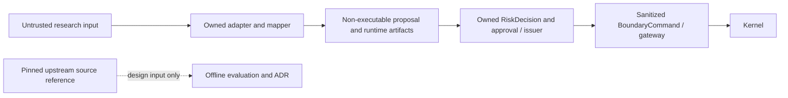

# TP12 scoped threat model — Agent / owned runtime / kernel

2026-10-16; S2 reference evaluation only. Replaces historical low-risk assertions, retains eight original scenarios as hypotheses. Scope is F07 Agent boundary, proposal/risk/issuer/gateway interactions relevant to TP12, and evaluation/supply-chain workflow. No repository-wide security audit, independent architecture reviewer or deployed exposure verification. Review was sequential. User context prohibits production credentials, external publishing and local databases. No applicable repository SECURITY.md was found for engines/trading-agents.

## Overview

QuantOS accepts research inputs through owned engine RPC boundaries, maps them into non-executable TradeProposal, records owned artifacts and applies owned risk/approval/issuer controls before a sanitized kernel command. The upstream Agent SDK is source reference only, outside this flow. No upstream or Agent process is granted venue authority by this evaluation.

| Component | Role and inspected source |
|---|---|
| Owned Agent adapter | Research-only request/tools/recursive field validation, `engines/trading-agents/src/trading_agents/adapter.py` |
| Owned mapper/runtime | Non-executable proposal, expiry and runtime-owned artifact records, proposal_mapper.py / signal_proposal.rs |
| Owned issuer | RiskDecision/approval binding, no self-approval, expiry/idempotency, quantos-execution/src/lib.rs |
| Owned kernel gateway | BoundaryCommand fields, limits/expiry and submission dedup, quantos-execution/src/gateway.rs |
| Reference evaluator | Pins/hash/tree/rule/interface/threat mapping and runtime-import exclusion; not a production authorization service |

| Deployment or workflow | Resource or capability | Configuration and precedence | Safe effective value/location | Readers/writers/recipients | Enforcing control | Evidence or unknowns |
|---|---|---|---|---|---|---|
| Local owned research adapter | Tool invocation / identity fields | Request metadata is owned context; payload cannot override authority | query_signal/query_snapshot/query_artifact allowlist; no credential/config files read by TP12 | Research caller → owned adapter | Research mode, actor capability, recursive forbidden/authority fields | Actual adapter source + 10 smuggling cases; OS process egress/credential isolation NOT_RUN |
| Local command boundary | Kernel command and identity material | Issuer output → private BoundaryCommand conversion | Account/venue/order parameters and expiry; no tenant/actor/session/decision/approval/signature | Issuer/gateway → kernel | Typed construction and key isolation test | account_id/venue intentionally exist here; this is not an Agent interface or anonymization proof |
| Evaluation recorder | Child test/build processes | staticEnvironment filters inherited environment; offline local profile | No DATABASE_URL, Supabase tokens, GH token or target opt-ins; evidence under docs/audit/evidence | Local operator → owned recorder/checks | Clean source requirement, fixed check set/hash/SHA validation | Tests may use local UDS/TCP; same-host filesystem/process privilege is not an OS sandbox |
| Public reference acquisition | Read source bytes | Fixed public commit, no credential helper/global Git config | third_party/nautilus-agents/source-evidence; no checkout hooks/build | Public Git → local reference metadata | Commit/tree/blob and SHA256 proof | Remote signature identity NOT_RUN; LGPL files retained as reference, not legal approval |
| Future deployed integration | Venue, database, trace storage | No target startup/deployment authorized or inspected in this task | NOT_RUN | Actual service/engine/venue recipients unknown here | Must be reviewed in CORE:TP07/TP12 X3 and Beta | Do not infer deployment locations, credentials or isolation from local fixtures |

## Threat Model, Trust Boundaries, and Assumptions

Assets: order issuance authority, account exposure, authoritative risk/approval identity, confidential observations/traces, owned evidence integrity, replay correctness and dependency/license integrity. Research callers can provide untrusted prompt-derived payloads/observations, nested JSON and tool requests; they do not thereby possess command issuer authority, approval keys, deployment credentials or a maintainer account. A future privileged maintainer changing dependencies is a separate supply-chain workflow, not a remote prompt-injection capability.

Boundaries: request payload → owned adapter (research authorization and field/tool constraints); Agent output → runtime (non-executable proposal / source validity); proposal → issuer (owned authoritative risk, approval and expiry); issuer → kernel (sanitized command, limits and replay); agent trace → authoritative evidence (no automatic promotion); public source → evaluation evidence (pinned bytes, no execution). Local symbol checks and a matching design principle do not prove actual host confinement, cryptographic authenticity or a live authorization chain.

Assumptions/open questions: no upstream adoption, runtime dependency or venue access is introduced. Generic kernel trait documentation requires separate process/pure simulator, but source traits do not enforce OS isolation. Existing in-memory replay tests do not prove crash-safe durable dedup. Retention classes/field metadata are candidates and are not implemented in QuantOS by this task. TP12 CVE audit, remote signature authenticity, deployed path/credential recipients, current vulnerability reachability, performance/soak, target identity/database and hosted same-SHA CI are NOT_RUN. TP07 known advisory IDs and unknown nonregistry packages remain open. Formal acceptance is PENDING, not a substitute for engineering evidence.

## Attack Surface, Mitigations, and Attacker Stories

All rows are design hypotheses/control mappings, not validated vulnerability findings. Impact priorities guide future review; residual risk is UNASSESSED rather than historical blanket “low”. Machine mapping is boundary-assessment.json with T1–T8, NC-01–NC-07 and exact source anchors.

| Priority | Scenario and capability gain | Prerequisites | Impact | Existing controls | Mitigation / remaining work | Evidence |
|---|---|---|---|---|---|---|
| High | T1 prompt/tool injection obtains venue/order authority | Malicious research input plus a host/consumer that supplies new authority | Unauthorized orders/credential access | NC01/02 research/tool/recursive-field gates, executable=false | Revalidate every new tool; actual network/secret isolation in X3 | Actual owned adapter smuggling tests, mapper and F07 runtime tests |
| High | T2 identity/session data reaches kernel | New serializer/path bypasses sanitization | Secret/identity leakage or confused deputy | NC04 private BoundaryCommand conversion and key allowlist | Review every new field and actual transport | Gateway isolation test; account/venue are intentionally retained |
| High | T3 advisory report becomes authoritative risk | Consumer treats Agent claim as RiskDecision | Unauthorized issuance | NC03 issuer decision binding/approval/self-approval gates | Review real auth chain and deployment receipt | seven_rejection_classes_are_all_enforced |
| High | T4 retries/crash duplicate downstream orders | Durable crash/restart window and actual venue submission | Duplicate financial exposure | NC03/04 in-memory issuance/gateway dedup tests | Persist/restore idempotency atomically and test crash windows | 1000 concurrent issuance/replay tests are local, not durable venue proof |
| High | T5 stale proposal survives evaluation | Expired input/clock boundary | Orders from stale context | NC06 expiry at runtime/issuer/gateway | Validate actual process clocks and restart path | TradeProposalEvaluationGate / CommandExpired |
| Medium | T6 upstream dependency enters runtime | Maintainer/build change introduces source/import/lock entry | Supply-chain/licensing impact | NC07 source/lock scans, fixed evidence | Refresh full audit/legal/deployed graph before adoption | Offline exclusion tests; NOT_RUN advisories remain open |
| Medium | T7 Agent trace promoted or restricted data retained | Consumer records sensitive payload or trusts Agent-only record | Confidentiality and audit-integrity loss | NC05 owned artifact record path | Explicit retention/authorization and actual storage review | record_artifact is traceability, not retention implementation |
| Medium | T8 protocol/digest changes silently mapped | Upstream/owned contract drift without reevaluation | Misinterpreted proposals or invalid evidence | NC02/07 pinned tree and six interface differences | New pin requires complete mapping/review/frozen closure | Tamper and incompatible TP07 binding tests |

## Severity Calibration (Critical, High, Medium, Low)

Critical would require a demonstrated reachable path from unprivileged research input to uncontrolled live venue authority or broad cross-account compromise. No live venue deployment or such path is established here. High could apply to a proven approval bypass, duplicate actual orders or cross-principal secret leakage with concrete consumer/privilege evidence; a trait or fixture alone does not establish it. Medium could apply to a concrete retention/digest/supply-chain control gap with bounded exposure and an authorized affected workflow. An unimplemented candidate pattern is an open design question, not automatically a vulnerability. Low could apply to a bounded diagnostic/metadata error without authority gain. A correctly rejected forbidden field, authorized maintainer action alone, or static upstream design agreement is not a security finding at any severity. Confidence in local source/test facts is separate from unknown target likelihood and impact.

Verified source anchors (inspected exact current source; frozen candidate bound by the local receipt):

- `engines/trading-agents/src/trading_agents/adapter.py:19` — `ALLOWED_TOOLS =`.
- `engines/trading-agents/src/trading_agents/adapter.py:252` — `def _reject_forbidden_fields`.
- `engines/trading-agents/src/trading_agents/proposal_mapper.py:57` — `executable=False`.
- `crates/quantos-runtime/src/signal_proposal.rs:227` — `pub struct TradeProposalEvaluationGate`.
- `crates/quantos-runtime/src/signal_proposal.rs:1019` — `.record_artifact(`.
- `crates/quantos-execution/src/lib.rs:276` — `RiskVerdict::ApprovalRequired =>`.
- `crates/quantos-execution/src/lib.rs:531` — `fn seven_rejection_classes_are_all_enforced`.
- `crates/quantos-execution/src/gateway.rs:34` — `pub struct BoundaryCommand`.
- `crates/quantos-execution/src/gateway.rs:720` — `fn boundary_command_carries_no_session_or_identity_material`.
- `crates/quantos-execution/src/gateway.rs:564` — `fn thousand_replays_with_same_key`.
- `scripts/provider-a1-receipts.mjs:88` — `export function staticEnvironment`.
